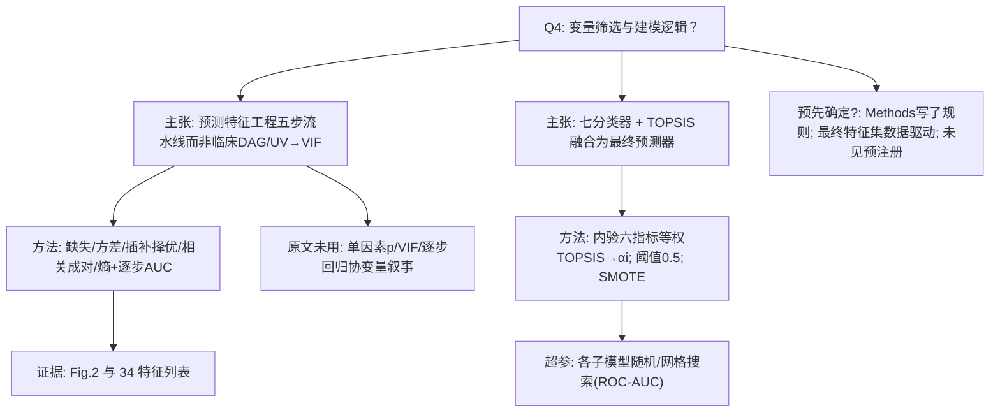

# AI-A Decision Tree Round 1

paper_id: paper_40295871
question_id: Q4
task_type: literature_decision_tree_reasoning
question: 变量/协变量筛选与建模逻辑是什么？该逻辑是否在分析前预先确定？
source_file: adversarial_lit_reading/chunks/paper_40295871_tcf_septic_shock.md (+ supp chunk)

## 1. Evidence Map

| evidence_id | location | evidence_summary | used_by_node |
|---|---|---|---|
| E1 | Methods Data preprocessing (1)–(5) | 五步：缺失>30%删；布尔方差删(>90%一致)；四种插补比较后选优；Pearson≥0.7 成对留 AUC 更大者；熵排序逐步加特征至 AUC 最优→34 | N1,N2 |
| E2 | Results + Fig.2 + Supp T5 | 特征数增加时 AUC 变化；34 为最优点；列出 34 指标名 | N2,N3 |
| E3 | Methods Prediction modeling | 七基模型（DT/RF/XGB/LGBM/NB/SVM/GBDT）；训练后内验六指标；TOPSIS 等权融合；阈值 0.5；训练集 SMOTE 1:1 | N4,N5 |
| E4 | Supp T4 / T6 | 插补方法比较；超参 RandomizedSearch/网格 | N2,N6 |
| E5 | 全文 | 未见预注册分析计划；特征筛选规则写在 Methods，但 34 的最终集合由数据驱动 AUC 选定 | N7 |
| E6 | Methods | 入模前 min-max 归一化；未做传统 UV p 值/VIF/DAG 协变量筛选叙事 | N8 |

## 2. Decision Tree - Mermaid

## 3. Node Table

| node_id | node_type | claim | evidence_location | evidence_summary | confidence | risk_tag |
|---|---|---|---|---|---|---|
| N0 | question | Q4 | — | 根 | high | |
| N1 | claim | 特征筛选=五步预处理 | Methods | 非 UV/VIF | high | |
| N2 | method | 五步细则 | Methods (1)-(5) | 见 E1 | high | |
| N3 | evidence | 34 特征与 Fig.2 | Results | AUC 最优 | high | |
| N4 | claim | 建模=七模型+TCF | Methods | 融合 | high | |
| N5 | method | TOPSIS+SMOTE+0.5 | Methods | 等权六指标 | high | |
| N6 | method | 超参搜索 | Supp T6 | ROC-AUC | high | |
| N7 | uncertainty | 规则预写但子集数据驱动；无预注册 | 全文 | 原文未明确预注册 | medium | 证据不足 |
| N8 | claim | 未走经典协变量 p/VIF | 全文 | 原文未说明 UV/VIF | high | |

## 4. Provisional Answer

变量进入逻辑是 **预测导向的五步特征处理**（缺失→方差→插补方法择优→高相关成对按 AUC 保留→熵排序逐步加至 AUC 最大得 34 特征），**不是**临床 DAG / 单因素 p / VIF 多因素那套路。建模为七个基分类器，在内验集上用六项性能等权 TOPSIS 得融合权重，阈值 0.5；训练集 SMOTE 1:1；子模型超参以 ROC-AUC 搜索。Methods 预先写了筛选**规则**，但最终 34 个特征集合由样本 AUC 路径决定；原文**未明确说明**预注册分析计划，也未报告传统 UV→VIF 协变量筛选。

## 5. Uncertainty List

- U1: 插补在全队列还是仅训练集拟合——公开 notebook 与正文对泄漏防护的表述需对照（迁移时必须 train-only fit）。
- U2: 相关成对「留 AUC 更大」的 AUC 在哪一折/是否泄漏——原文未完全写清。
- U3: Fig.1 70/30 vs Table1 80/20 划分不一致，影响「内验上算 TOPSIS 权重」的可复现性。

## 6. Follow-up Questions

1. 复现时是否强制「插补/归一化/特征逐步仅在 MIMIC train 拟合再应用到内验与 eICU」？
2. 双库特征池是「34 文献名单∩双库可算」还是「在 MIMIC 上重跑五步再锁名单」？
