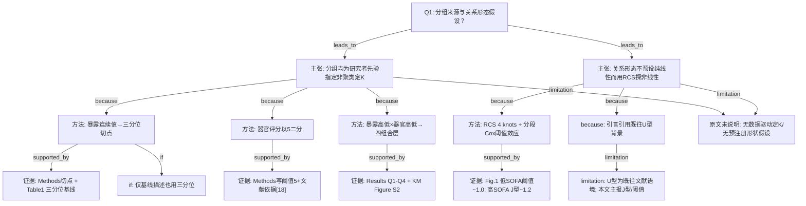

# AI-A Decision Tree Round 1

paper_id: paper_40295872
question_id: Q1
task_type: literature_decision_tree_reasoning
question: 本研究预设了几个分组/亚型/类别？该数量是数据驱动的（如聚类定 K）还是研究者主观指定？是否假设了暴露-结局关系的方向（线性、单调、U 型）？
source_file: adversarial_lit_reading/chunks/paper_40295872_jin2025_shr_sofa_af_mortality_cardiovasc_diabetol.md

## 1. Evidence Map

| evidence_id | location | evidence_summary | used_by_node |
|---|---|---|---|
| E1 | Statistical analysis（Page 4） | 暴露指数按三分位分层：Tertile1 &lt;0.93、Tertile2 0.93–1.22、Tertile3 ≥1.22；属分位切点，非聚类定 K | N1,N2,N3 |
| E2 | Statistical analysis（Page 4） | 器官功能障碍评分以 5 为界二分：&lt;5=Low、≥5=High；文称该阈值经文献验证可标志显著器官功能障碍 | N1,N4,N5 |
| E3 | Statistical analysis + Results「The SHR-SOFA combination…」 | 联合分为四组：Q1 Low暴露+Low器官分、Q2 High暴露+Low器官分、Q3 Low暴露+High器官分、Q4 High暴露+High器官分 | N1,N6,N7 |
| E4 | Results Baseline + Table 1 | 基线按暴露三分位描述；死亡率随三分位升高（P&lt;0.001） | N3,N8 |
| E5 | Statistical analysis + Results RCS / Fig.1 | 用 4 结点 RCS 评估非线性；低器官分层院内/30 天非线性显著、阈值约 1.0；高器官分层呈 J 型、理想点约 1.2；1 年低器官层非线性不显著 | N9,N10,N11 |
| E6 | Introduction | 既往文献有 U 型死亡关联叙述；本文目的是量化暴露对器官功能障碍–死亡关系的修饰，并探非线性 | N12,N13 |
| E7 | 全文 Methods/Results | 未见 LCA/K-means/轮廓系数等数据驱动定类数；未见预注册声明分组个数由信息准则选定 | N14 |

## 2. Decision Tree - Mermaid

## 3. Node Table

| node_id | node_type | claim | evidence_location | evidence_summary | confidence | risk_tag |
|---|---|---|---|---|---|---|
| N0 | question | Q1：分组个数来源与暴露–结局形状假设 | — | 根问题 | high | |
| N1 | claim | 主分组为先验指定：暴露三分位 + 器官分二分 + 四组合 | Statistical analysis | 非聚类/LCA 定 K | high | |
| N2 | method | 暴露按三分位切点分层 | Statistical analysis | &lt;0.93 / 0.93–1.22 / ≥1.22 | high | |
| N3 | evidence | 三分位定义与 Table1 组间比较 | Methods + Table 1 | n≈5117–5122/层 | high | |
| N4 | method | 器官功能障碍评分以 5 二分 | Statistical analysis | Low&lt;5 / High≥5 | high | |
| N5 | evidence | 阈值 5 写明并引文献 | Methods [18] | 「validated to signify significant organ dysfunction」 | medium | |
| N6 | method | 联合四层 Q1–Q4 | Statistical analysis | 高低×高低 | high | |
| N7 | evidence | KM 四层生存差异 log-rank P&lt;0.001 | Results + Figure S2 | Q4 预后最差 | high | |
| N8 | method | 基线亦按三分位展示 | Results Baseline / Table 1 | 描述层=分析层之一 | high | |
| N9 | claim | 剂量反应不假定纯线性；用 RCS 检验非线性 | Methods + Results Fig.1 | 形状由样条估计 | high | |
| N10 | method | RCS 四结点；显著阈值用分段 Cox | Statistical analysis | LRT P&lt;0.05 定量阈值 | high | |
| N11 | evidence | 分层非线性形态与拐点 | Fig.1 + Results RCS 段 | 低层阈≈1.0；高层 J 型≈1.2 | high | |
| N12 | claim | 引言将既往 U 型作为研究背景 | Introduction | 「U-shaped mortality association is established」 | medium | 逻辑跳跃 |
| N13 | limitation | 本文 Results 主述阈值/J 型，不宜把引言 U 型写成本文预设形状 | Results vs Introduction | Discussion 亦写 J-shaped | medium | 方法误读 |
| N14 | uncertainty | 无数据驱动定类数；形状假设是否预注册原文未明确说明 | 全文 | 原文未明确说明 | high | 证据不足 |

## 4. Provisional Answer

本研究**没有**用聚类/LCA 等数据驱动方式确定患者亚型个数。分析用的「分组」均为研究者**先验指定**：（1）暴露连续指标按**三分位**切点分成三层；（2）器官功能障碍评分以 **5** 为界**二分**；（3）二者组合为 **Q1–Q4 四层**（低/高暴露 × 低/高器官分）。结局侧为多时点死亡（见 Q2），不是亚型发现。关于暴露–结局**关系形态**：Methods 明确用 **4 结点 RCS** 评估非线性并检验阈值效应，Results 显示随器官分层与时点不同出现阈值（约 1.0）或 **J 型**（理想点约 1.2），**并非**先假定线性后只报 HR。引言提及既往 **U 型**背景，但本文主文结果用语以非线性/J 型/阈值为主；是否在分析前书面锁定「必为 U 型」——**原文未明确说明**。

## 5. Uncertainty List

- U1: Abstract 写「stratified by SHR quartiles」，Methods/Results 明确为 **tertiles**——分组层数以 Methods/Table1 三分位为准；摘要用词与正文不一致，属证据张力。
- U2: Results KM 段写 SOFA「categorized at the median」，Methods 写 cutoff=5；Table1 总体 SOFA 中位数为 4.0，与「中位数切」是否等同于 5——原文未完全对齐说明。
- U3: 「High/Low SHR」进入四组合时，是否把三分位的 T2 并入某一侧，或仅用两端——Statistical analysis 定义四组时写 High/Low，**未在该段逐字说明**中位三分位如何并入高低二分类。
- U4: 引言 U 型 vs Results J 型：形状标签是否互换使用——不宜在树中合并为同一预设。

## 6. Follow-up Questions

1. 复现四组合时，暴露「High/Low」应以三分位上下层（并掉中间层）还是以连续值中位数/1.0 阈值二分？原文哪一段可裁定？
2. 迁移本套路时，器官评分二分点应固定文献阈值 5，还是按本队列中位数重切并做敏感性？
