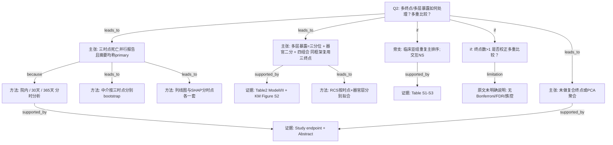

# AI-A Decision Tree Round 1

paper_id: paper_40295872
question_id: Q2
task_type: literature_decision_tree_reasoning
question: 如何处理多亚型/多终点/多层暴露？是否会因多重比较膨胀 I 类错误？是否对相关终点做了主成分/复合终点聚合？
source_file: adversarial_lit_reading/chunks/paper_40295872_jin2025_shr_sofa_af_mortality_cardiovasc_diabetol.md

## 1. Evidence Map

| evidence_id | location | evidence_summary | used_by_node |
|---|---|---|---|
| E1 | Abstract Methods + Study endpoint | 明确三个死亡时点：院内、入院后 30 天、入院后 365 天；Abstract 称均为 primary endpoints | N1,N2,N3 |
| E2 | Study endpoint | 出院后死亡信息来自美国社保 Death Master File | N3 |
| E3 | Results Table 2 + KM | 同一套暴露三分位、器官二分、四组合在三个时点分别报粗/校正 HR；KM 三终点 | N4,N5 |
| E4 | Results RCS Fig.1 | 非线性按「时点 × 器官分层」分别展示 | N6 |
| E5 | Results Subgroup + Table S1–S3 | 亚组（心梗/心衰/肾衰等）验证风险排序一致；交互项不显著 | N7,N8 |
| E6 | Mediation analysis + Fig.4 | 碳酸氢盐中介在三个时点分别估计，介导比例随时间下降（22.7%→21.7%→17.2%） | N9 |
| E7 | Nomogram + SHAP | 三时点各建 logistic 列线图与 SHAP；非单一复合终点 | N10 |
| E8 | Statistical analysis | 显著性双侧 P&lt;0.05；全文未见 Bonferroni/FDR/预先界定假设族校正的明确表述 | N11,N12 |
| E9 | 全文 | 未见将多时点死亡主成分/复合终点聚合；多层暴露用三分位与四组合并列报告 | N13 |

## 2. Decision Tree - Mermaid

## 3. Node Table

| node_id | node_type | claim | evidence_location | evidence_summary | confidence | risk_tag |
|---|---|---|---|---|---|---|
| N0 | question | Q2：多终点/多层与多重比较 | — | 根问题 | high | |
| N1 | claim | 三个死亡时点被并行当作主要终点族报告 | Abstract | 「primary endpoints were in-hospital, 30-day, and 1-year」 | high | |
| N2 | method | 分时点生存/关联分析，非单一复合终点 | Study endpoint + Results | 院内/30d/365d | high | |
| N3 | evidence | 终点定义与随访来源 | Study endpoint | Death Master File | high | |
| N4 | claim | 多层暴露结构在三终点上重复应用 | Statistical analysis + Table 2 | 三分位、SOFA 高低、Q1–Q4 | high | |
| N5 | evidence | 三终点粗/校正 HR 同表呈现 | Table 2 | Q4 风险最高 | high | |
| N6 | method | RCS 按终点×器官层展开 | Fig.1 Results | 形态随时点变化 | high | |
| N7 | method | 亚组分析检验排序一致性；交互不显著 | Results + Table S1–S3 | 探索性分层 | medium | |
| N8 | evidence | 补充表亚组 HR | Table S1–S3 | 交互 NS | medium | |
| N9 | method | 中介效应分三时点估计 | Mediation + Fig.4 | 介导比例递减 | high | |
| N10 | method | 预测工具分三时点（列线图/SHAP） | Fig.2 Fig.3 | 非聚合终点 | high | |
| N11 | uncertainty | 多终点×多层×亚组检验次数多，是否控制 I 类错误 | Statistical analysis | 仅写双侧 P&lt;0.05 | medium | 证据不足 |
| N12 | limitation | 未见多重比较校正策略的明确说明 | 全文 Methods | 原文未明确说明 | high | 证据不足 |
| N13 | claim | 未将多时点合成为复合终点或 PCA | Results 全线 | 分时报告 | high | |

## 4. Provisional Answer

本文用**三个时间窗死亡终点**（院内、30 天、365 天）并行分析；Abstract 将三者均称为 **primary endpoints**，正文未再清晰区分「唯一主终点 vs 次要/探索性」。**多层暴露**处理为：暴露三分位、器官评分二分，以及二者组合的四层，并在三终点上用 KM、Cox、RCS 同一框架重复报告；另有临床亚组（补充表）与碳酸氢盐中介、分时列线图/SHAP，均属**分终点/分层展开**，**未见**主成分或复合终点聚合。关于**多重比较**：全文统计显著性写双侧 P&lt;0.05，**原文未明确说明**是否对多终点、多层对比或亚组交互做 Bonferroni/FDR/预先假设族控制——因此「是否因多重比较膨胀 I 类错误」在证据上只能标为**方法学未披露**，不能断定作者已校正或已证明无膨胀。

## 5. Uncertainty List

- U1: Abstract「primary」三终点并列 vs 临床论文常需单一主终点——作者意图是共主终点还是写作笼统，原文未再裁定。
- U2: Table1 结局行出现「90 days」「360 days」表述，与 Methods 的 30/365 天不一致——属表内标签张力，不影响「多时点」结构判断但影响精确时点迁移。
- U3: 亚组「non-significant interaction」是否经过交互检验校正——原文未说明。
- U4: 补充材料是否含多重比较说明——主 chunk 仅有「Supplementary Material 1」链接提示，**主文未写**具体校正。

## 6. Follow-up Questions

1. 若迁移到本流水线，三终点应如何声明（唯一主终点 + 次要时点），以避免审稿质疑多重检验？
2. 四组合 vs 三分位主效应，哪一层应预指定为「主对比」、其余标探索性？
