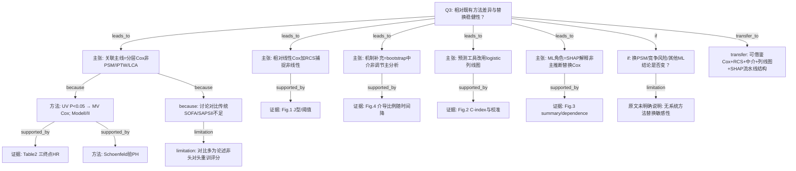

# AI-A Decision Tree Round 1

paper_id: paper_40295872
question_id: Q3
task_type: literature_decision_tree_reasoning
question: 该方法/模型与既有方法的区别在哪？对照逻辑回归/Cox/PSM/IPTW/LCA/传统聚类/其他 ML。本研究为何选此法而非彼法？换一种方法结论会变吗？
source_file: adversarial_lit_reading/chunks/paper_40295872_jin2025_shr_sofa_af_mortality_cardiovasc_diabetol.md

## 1. Evidence Map

| evidence_id | location | evidence_summary | used_by_node |
|---|---|---|---|
| E1 | Statistical analysis | 主推断：Cox 比例风险；单因素 P&lt;0.05 进入多因素；分层调整 Model I（未调整）/ Model II（广泛协变量） | N1,N2,N3 |
| E2 | Statistical analysis | Schoenfeld 残差检验比例风险假设 | N2,N4 |
| E3 | Statistical analysis + Fig.1 | RCS（4 knots）评估非线性；显著阈值用分段 Cox | N5,N6 |
| E4 | Statistical analysis + Fig.4 | 反事实框架下 bootstrap 中介（1000 次）分解直接/间接/介导比例；中介变量为血清碳酸氢盐 | N7,N8 |
| E5 | Results Nomogram + Fig.2 | 预后工具：多变量 **logistic** + 后退逐步（α=0.05）建三时点列线图；bootstrap 校准与 C-index | N9,N10 |
| E6 | Model interpretation + Fig.3 | SHAP 解释特征贡献与依赖图；面向已建预测模型的可解释性 | N11,N12 |
| E7 | Discussion | 相对传统 ICU 评分（SOFA、SAPS II）强调代谢–器官交互；称既有评分未充分纳入该交互 | N13,N14 |
| E8 | Strengths and limitations | 回顾性单库；未做因果推断；无 PSM/IPTW/竞争风险/LCA 等对照复算的完整报告 | N15,N16 |
| E9 | 全文 | R 包列出 survival/rms/glmnet；未见系统「换模型族」敏感性（如 Fine–Gray、随机生存森林主结论复核） | N16,N17 |

## 2. Decision Tree - Mermaid

## 3. Node Table

| node_id | node_type | claim | evidence_location | evidence_summary | confidence | risk_tag |
|---|---|---|---|---|---|---|
| N0 | question | Q3：方法选择与替换稳健性 | — | 根问题 | high | |
| N1 | claim | 主关联方法是多因素 Cox，不是 PSM/IPTW/聚类亚型 | Statistical analysis | 时间–事件框架 | high | |
| N2 | method | 单因素筛入 → 多因素 Cox；Model I/II | Methods + Table 2 脚注 | Model II 含人口学/实验室/治疗等 | high | |
| N3 | evidence | 三终点校正后组合层与组分 HR | Table 2 | Q4 风险最高仍成立 | high | |
| N4 | method | PH 用 Schoenfeld 检验 | Statistical analysis | 写明已验证假设 | medium | |
| N5 | claim | 相对「仅线性 Cox」增加 RCS/分段以描述非线性 | Methods + Results | 4 knots | high | |
| N6 | evidence | 分层非线性曲线与拐点 | Fig.1 | J 型 / 阈值 | high | |
| N7 | claim | 中介分析补充路径，不替代主 Cox | Mediation section | bootstrap 1000 | high | |
| N8 | evidence | 碳酸氢盐介导比例分时点 | Fig.4 + 正文数字 | 22.7%/21.7%/17.2% | high | |
| N9 | claim | 个体预测改用 logistic 列线图（非继续用 Cox 公式作 nomogram 主叙述） | Nomogram Results | 后退法 α=0.05 | high | |
| N10 | evidence | C-index 与 bootstrap 校准 | Fig.2 / Figure S3 | 院内 C=0.807 等 | high | |
| N11 | claim | SHAP 用于解释预测贡献，不是无监督分型主结论 | Model interpretation | summary + dependence | high | |
| N12 | evidence | SHAP 图三时点 | Fig.3 | 暴露与器官分为重要贡献 | high | |
| N13 | claim | 作者论证相对传统 SOFA/SAPS II 的增量在于代谢修饰 | Discussion | 评分未含代谢–器官交互 | medium | 因果过度 |
| N14 | limitation | 讨论对比偏论述；未见与重拟合传统评分的严格头对头表 | Discussion | 证据强度中等 | medium | 逻辑跳跃 |
| N15 | uncertainty | 若换 PSM/IPTW/竞争风险/其他 ML，点估计是否同向显著 | 全文 | 需敏感性 | high | 证据不足 |
| N16 | uncertainty | 方法替换敏感性——原文未明确说明系统做过 | Strengths/limitations + Methods | 原文未明确说明 | high | 证据不足 |
| N17 | transfer | 可迁移的是「Cox 关联 + RCS + 中介 + 分时预测/解释」结构，不是疾病标签本身 | — | 统计套路参考 | medium | 可迁移性不足 |

## 4. Provisional Answer

相对最直接替代法，本文**主推断**选择 **Cox 比例风险模型**（单因素 P&lt;0.05 入选 → 多因素；Model I/II），并用 **Schoenfeld** 处理 PH 假设；相对「只报线性 HR」，增加 **RCS（4 knots）+ 阈值分段 Cox** 描述非线性。相对纯关联，增加 **bootstrap 中介**（碳酸氢盐）分解直接/间接效应。相对继续用生存模型做床旁工具，**列线图**改走 **多变量 logistic + 后退逐步**，并以 bootstrap 校准与 C-index 做内部验证；**SHAP** 用于解释该预测模型特征贡献，**不是**用随机森林/XGBoost 等替换主 Cox 推断，也**不是** LCA/K-means 亚型发现。作者在讨论中对比 **传统 SOFA/SAPS II** 未纳入代谢–器官交互，但多为论述性差异。**换一种方法结论是否改变**：Model I→II 后组合层关联方向大致保持，但**原文未明确说明**是否用 PSM/IPTW、竞争风险、或另一套 ML 主模型做系统替换敏感性——故「换法仍稳健」不能从原文直接证明。

## 5. Uncertainty List

- U1: Methods 列出 `glmnet`，Results 列线图叙述为 backward stepwise logistic——glmnet/LASSO 是否实际用于主文筛选，**原文主结果段未写清**。
- U2: 关联用 Cox、预测用 logistic，同一终点两种似然——口径差异是否讨论，原文着墨有限。
- U3: PH 检验「通过」的具体结果（全局/逐变量）未在 Results 展开——仅 Methods 声称已验证。
- U4: 「directed cyclic graph」用于识别因果路径——表述异常（通常为 DAG）；具体图是否展示、如何约束入模——**原文未明确说明**细节。

## 6. Follow-up Questions

1. 迁移时主推断是否统一坚持 Cox（或按本引擎 Rubin Cox），列线图/SHAP 仅作预测附录？
2. 若审稿要求方法替换，最小充分集应是：PSM/IPTW 其一 + 竞争风险（若有出院竞争）+ 关闭中介后主 HR 是否仍显著？
