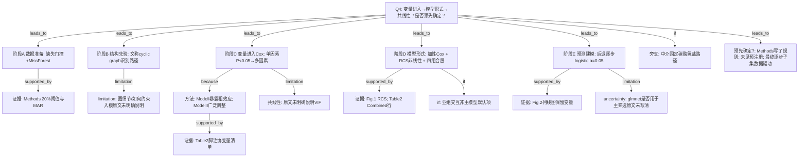

# AI-A Decision Tree Round 1

paper_id: paper_40295872
question_id: Q4
task_type: literature_decision_tree_reasoning
question: 变量/协变量筛选与建模逻辑是什么？（入模依据：临床重要性/单因素 p/文献/DAG/VIF；模型形式：加性/交互/RCS；是否 LASSO/逐步）该逻辑是否在分析前预先确定？
source_file: adversarial_lit_reading/chunks/paper_40295872_jin2025_shr_sofa_af_mortality_cardiovasc_diabetol.md

## 1. Evidence Map

| evidence_id | location | evidence_summary | used_by_node |
|---|---|---|---|
| E1 | Data extraction + Statistical analysis | 缺失&gt;20% 变量删除；&lt;20% 用 MissForest（MAR 假设）多重插补式填补 | N1,N2 |
| E2 | Data extraction | 分析前用「directed cyclic graph」识别因果路径（原文措辞） | N3,N4 |
| E3 | Statistical analysis | Cox：凡单因素关联 P&lt;0.05 的候选预测因子进入多因素；报 HR(95%CI) | N5,N6 |
| E4 | Table 2 脚注 Model II | 校正集列举：Age、Gender、生命体征、SAPSII、SIRS、实验室、合并症、有创通气、Insulin/Aspirin/Statin 等 | N6,N7 |
| E5 | Statistical analysis + Fig.1 | 模型形式含 RCS（4 knots）评估非线性；显著阈值用分段 Cox；KM 按分层 | N8,N9 |
| E6 | Results Nomogram | 列线图：后退逐步回归，保留水准 α=0.05；多变量 logistic；各时点保留暴露、器官分、年龄等 | N10,N11 |
| E7 | Mediation | 中介预设碳酸氢盐；bootstrap 分解效应 | N12 |
| E8 | Results Subgroup | 亚组分层；交互项多数不显著（非主模型强制交互项叙事） | N13 |
| E9 | 全文 | 未见 VIF/多重共线性筛查步骤的明确报告；未见预注册分析计划 | N14,N15 |
| E10 | Packages | 提及 glmnet，但主文筛选叙述以 UV→MV 与 backward stepwise 为主 | N16 |

## 2. Decision Tree - Mermaid

## 3. Node Table

| node_id | node_type | claim | evidence_location | evidence_summary | confidence | risk_tag |
|---|---|---|---|---|---|---|
| N0 | question | Q4：筛选逻辑与模型形式、是否预指定 | — | 根问题 | high | |
| N1 | method | 先按缺失比例删变量，再 MissForest 填补 | Data extraction / Statistical analysis | &gt;20% 删；&lt;20% 填 | high | |
| N2 | evidence | MAR + MissForest 非参数森林填补 | Methods 引 [16,17] | 写明假设 | high | |
| N3 | method | 称用有向图识别因果路径后再统计 | Data extraction | 「directed cyclic graph」 | low | 方法误读 |
| N4 | uncertainty | 图如何决定强制保留/排除变量——原文未明确说明 | 全文 | 无图/无变量清单挂钩 | high | 证据不足 |
| N5 | claim | Cox 入模主规则=单因素 P&lt;0.05 | Statistical analysis | UV→MV | high | |
| N6 | method | 分层模型：Model I 粗；Model II 广泛校正 | Table 2 | 层次调整 | high | |
| N7 | evidence | Model II 协变量具名列表 | Table 2 脚注 | 含评分、实验室、治疗等 | high | |
| N8 | method | 形式：分层/组合暴露 + RCS 非线性；非默认全交互模型 | Methods + Results | 4 knots；组合四层 | high | |
| N9 | evidence | RCS 与 Combined HR | Fig.1 + Table 2 | 非线性与联合效应 | high | |
| N10 | method | 预测阶段改后退逐步 logistic（α=0.05） | Nomogram Results | 逐步剔除 P≥0.05 | high | |
| N11 | evidence | 各时点保留暴露、器官分、年龄等 | Fig.2 正文 | 时点特异纳入 | high | |
| N12 | method | 中介分析指定碳酸氢盐为中介 | Mediation | bootstrap 1000 | high | |
| N13 | method | 亚组交互为验证一致性，主文称交互多不显著 | Results + Table S1–S3 | 非强制入主模型 | medium | |
| N14 | uncertainty | 是否做 VIF/共线性筛查——原文未明确说明 | 全文 Methods | 原文未明确说明 | high | 证据不足 |
| N15 | uncertainty | Methods 预写 UV 阈值与逐步 α；最终变量集数据驱动；预注册未见 | 全文 | 部分预指定规则 | medium | 证据不足 |
| N16 | uncertainty | glmnet 在包列表中，主文未描述 LASSO 路径选模 | Statistical analysis 末句 | 原文未明确说明用途 | medium | 方法误读 |

## 4. Provisional Answer

变量/建模逻辑可拆成三段：**（1）变量进入（Cox 关联）**——缺失处理后，主规则是**单因素 P&lt;0.05** 进入多因素 Cox，并报告 Model I（粗）与 Model II（广泛校正，脚注列出年龄、性别、生命体征、严重度评分、实验室、合并症与治疗等）；文称分析前用图模型识别路径，但**如何落到具体入模名单原文未明确说明**。**（2）模型形式**——加性多因素 Cox 为主；暴露另以三分位/器官二分/**四组合**编码；非线性用 **RCS 4 knots**（必要时分段 Cox）；亚组交互多为补充，主文称交互多不显著。**（3）预测支路**——三时点 **logistic 列线图**用**后退逐步**（保留 α=0.05）再定精简协变量；中介支路**预指定**碳酸氢盐。**共线性**：未见 VIF 报告。**是否分析前预先确定**：Methods 预先写了 UV 阈值、RCS 结点策略、逐步 α 与中介变量，属**规则层面部分预指定**；最终逐步保留集与 UV 入选集由数据决定；**预注册分析计划原文未明确说明**；`glmnet` 是否用于主筛选亦**未写清**。

## 5. Uncertainty List

- U1: Model II 列表与「凡 UV P&lt;0.05 皆入」是否完全等同——若 Model II 为固定临床调整集，则与 UV 闸门可能双轨，原文未逐条对照。
- U2: 「directed cyclic graph」措辞与常规 DAG 不符；有无实际作图——原文未展示。
- U3: 四组合「High/Low SHR」与三分位如何对应（见 Q1 U3）影响「暴露编码」是否预指定清晰。
- U4: MissForest「multiple imputation」表述与常见单次森林填补产物如何进入 Cox（是否 Rubin 合并）——原文未明确说明 m 与池化。

## 6. Follow-up Questions

1. 复现引擎应把 Model II 写成「UV→VIF→MV」还是「文献式固定调整集 + 暴露组合」？以 Table2 脚注还是 UV 句子为准？
2. 列线图后退法与主 Cox 调整集不一致时，Methods 应如何声明两套模型用途以免审稿混淆推断与预测？
