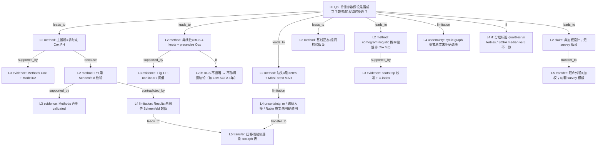

# AI-A Decision Tree Round 1

paper_id: paper_40295872
question_id: Q5
task_type: literature_decision_tree_reasoning
question: 该分析依赖哪些参数假设？是否满足？（Cox 比例风险、RCS/非线性、缺失 MAR、logistic nomogram 等）。若是复杂抽样/加权设计：是否正确使用权重？缺失如何处理？ML/预测工具的划分与验证假设是什么？
source_file: adversarial_lit_reading/chunks/paper_40295872_jin2025_shr_sofa_af_mortality_cardiovasc_diabetol.md

## 1. Evidence Map

| evidence_id | location | evidence_summary | used_by_node |
|---|---|---|---|
| E1 | Methods Statistical analysis | 主推断用 **Cox proportional hazards**；候选变量单因素 P&lt;0.05 进多因素；分层校正 Model1（仅暴露）/ Model2（实验室+治疗+严重度） | N1, N2 |
| E2 | Methods Statistical analysis | **比例风险假设**用 **Schoenfeld residual analysis** 验证（原文措辞：assumptions … were validated） | N3 |
| E3 | Results 全文 | 未报告 Schoenfeld 全局/逐变量 P 值或违例变量清单；仅 Methods 声明已验证 | N3, N4 |
| E4 | Methods Statistical analysis | 非线性用 **RCS，四 knots**；阈值效应用似然比检验 P&lt;0.05 后做 **piecewise Cox** | N5 |
| E5 | Results RCS（Fig.1 叙述） | Low SOFA：院内/30 天 P-nonlinear 显著、1 年 NS；High SOFA：各时点 J 型、ideal SHR≈1.2 | N5, N6 |
| E6 | Data extraction + Statistical analysis | 缺失 &gt;20% 的变量剔除；&lt;20% 用 **MissForest** 多重插补，假设 **MAR** | N7 |
| E7 | Methods | 未写明插补套数 m、是否将结局/暴露纳入预测矩阵、推断层是否 Rubin 合并或取单套 complete | N8 |
| E8 | 全文 Methods/Results | **无** NHANES/复杂抽样；**无** survey 权重、PSU、分层；单库 MIMIC-IV 便利队列 | N9 |
| E9 | Methods Statistical analysis | 正态性用 Shapiro-Wilk；组间 T/KW、χ²/Fisher（基线描述假设） | N10 |
| E10 | Methods Statistical analysis + Results nomogram | 预后工具为 **multivariable logistic + nomogram**（非 Cox 生存概率）；bootstrap 校准（文中先后写 200 / 1,000 resamples）与 C-index | N11, N12 |
| E11 | Methods | 称用 directed **cyclic** graph 识别因果路径（非常规 DAG 表述）；未给出图或边清单 | N13 |
| E12 | Abstract vs Methods | Abstract 写「SHR quartiles」；Methods/Results 主分层为 **SHR tertiles** + SOFA 二分组合成四组 | N14 |
| E13 | Methods KM 句 | KM「SOFA scores categorized at the **median**」与同节「SOFA cutoff=5」并存——切点语义是否等同原文未明确说明 | N14 |

## 2. Decision Tree - Mermaid

**边关系摘要**

| 边 | 关系 |
|---|---|
| N0→N1 | leads_to |
| N1→E1n | supported_by |
| N1→N3 | because |
| N3→E2n | supported_by |
| N3→N4 | contradicted_by（声明有检验、结果无数值） |
| N0→N5 | leads_to |
| N5→E5n | supported_by |
| N5→N6 | if |
| N0→N7 | leads_to |
| N7→N8 | limitation |
| N0→N9 | leads_to |
| N0→N11 | leads_to |
| N11→N12 | supported_by |
| N4/N8→N15 | transfer_to |
| N9→N16 | transfer_to |

## 3. Node Table

| node_id | node_type | claim | evidence_location | evidence_summary | confidence | risk_tag |
|---|---|---|---|---|---|---|
| N0 | question | 参数假设、缺失、加权是否妥当？ | — | Q5 根 | high | |
| N1 | method | 主关联推断为多终点时点 Cox PH | Methods Statistical analysis | Cox + HR/CI | high | |
| N2 | method | 单因素 P&lt;0.05 筛选后进多因素；Model1/2 层级校正 | Methods | 入模门槛明确 | high | |
| N3 | method | PH 假设以 Schoenfeld 残差验证 | Methods | 「were validated」 | medium | 证据不足 |
| N4 | limitation | Results 未给出 Schoenfeld P/违例变量 →「满足」不可独立核验 | Results 全文 | 仅 Methods 声明 | medium | 证据不足 |
| N5 | method | 非线性 RCS（4 knots）+ 阈值 piecewise Cox | Methods; Fig.1 | 方法与结果对齐 | high | |
| N6 | claim | 非线性结论依赖 SOFA 层与时点；Low SOFA 1 年非线性 NS | Results RCS | P-nonlinear=0.168 | high | |
| N7 | method | 缺失：&gt;20% 删变量；&lt;20% MissForest，MAR | Methods Data extraction / Statistical analysis | 双处重复 | high | |
| N8 | uncertainty | 插补 m、结局是否入预测矩阵、推断是否 Rubin 合并：原文未明确说明 | Methods | 仅写 MissForest + MAR | low | 方法误读 |
| N9 | claim | 非复杂抽样；无权重/PSU/分层估计 | 全文 | MIMIC 单中心队列 | high | |
| N10 | method | 连续变量正态性 Shapiro-Wilk；组间参数/非参数检验 | Methods | 基线 Table1 口径 | high | |
| N11 | method | 预测工具假设为 logistic 死亡概率（非 Cox 累积风险） | Methods; Results nomogram | multivariable logistic + points | high | |
| N12 | evidence | 内部 bootstrap 校准 + C-index 报告 | Results | C-index 0.807/0.792/0.722 | high | |
| N13 | uncertainty | 「directed cyclic graph」路径未展示 | Methods | 原文未明确说明边集 | low | 证据不足 |
| N14 | uncertainty | Abstract「quartiles」vs Methods「tertiles」；KM「median」vs cutoff=5 | Abstract; Methods | 口径冲突 | medium | 逻辑跳跃 |
| N15 | transfer | 迁移到预后 batch：须导出 PH 检验表；插补改 m=5+Rubin（引擎铁律） | 用户研究约束 | 非原文做法 | high | |
| N16 | transfer | 加权模板不适用；外验是第二库而非 survey | 用户研究 | eICU 外验 | high | |

## 4. Provisional Answer

本文关键假设栈可概括为五层：

1. **Cox PH**：Methods 写明用 Schoenfeld 残差验证比例风险；属「论文明确声明已做」，但 Results **未报告**检验统计量或违例变量 → 证据强度降为「声明有、数值不可核」。若 PH 不满足，原文 **未给出** 备选分支（如时依协变量、加速失效、分段时间）。
2. **暴露–结局形态**：默认允许非线性；RCS 四 knots + 似然比阈值检验；Results 显示形态依赖 **SOFA 层与随访时点**（Low SOFA 短期非线性显著、1 年不显著；High SOFA 持续 J 型）。
3. **缺失**：显式 MAR + MissForest；&gt;20% 缺失变量删除。**原文未明确说明** m、是否纳入结局、Cox 是否按 Rubin 合并 —— 迁移时不可照抄为「已做规范多重插补推断」。
4. **加权/抽样**：非调查设计，**无** survey 假设问题；勿按 NHANES 模板解读。
5. **预测工具**：nomogram 走 **logistic** 死亡概率 + bootstrap 校准/C-index，与主文 Cox 关联模型 **似然与链接函数不同**；原文未写独立 hold-out 划分比例，内部验证以 bootstrap 为主。

另有标签口径张力：Abstract「quartiles」与 Methods/Results「tertiles」不一致；KM 的 SOFA「median」与 cutoff=5 是否等同 **原文未明确说明**。

## 5. Uncertainty List

- U1: Schoenfeld 实际结果未落盘 → 无法判断 PH 是否对全部时点/暴露编码成立。
- U2: MissForest「multiple imputation」的 m 与推断合并规则不明；可能实为单次填充却写 multiple。
- U3: nomogram 校准「200 resamples」与「1,000 bootstrap」两处数字并存，以何为准原文未统一。
- U4: directed cyclic graph 是否笔误（应为 acyclic）及是否真正约束入模集合：原文未明确说明。
- U5: 中介分析反事实框架下的序贯可忽略性、无中介–结局混淆等假设 Methods 未逐条检验。

## 6. Follow-up Questions

1. 补充材料是否含 Schoenfeld 全局/逐变量表？（主 chunk 未摘到数值）
2. MissForest 实现是 `missForest` 单次迭代填充还是真正 m 套后池化？
3. nomogram 的 bootstrap 次数以 Methods（200）还是 Results（1,000）为准？
