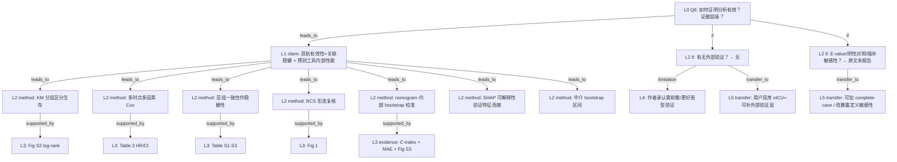

# AI-A Decision Tree Round 1

paper_id: paper_40295872
question_id: Q6
task_type: literature_decision_tree_reasoning
question: 论文如何证明分析有效？（内部验证：C-index/校准/bootstrap；外部验证；敏感性/亚组；阴性对照；E-value）。证据强度如何？
source_file: adversarial_lit_reading/chunks/paper_40295872_jin2025_shr_sofa_af_mortality_cardiovasc_diabetol.md

## 1. Evidence Map

| evidence_id | location | evidence_summary | used_by_node |
|---|---|---|---|
| E1 | Results：SHR-SOFA + KM | 四组合层 KM，log-rank P&lt;0.001；高 SHR+高 SOFA 各时点预后最差（Figure S2） | N1 |
| E2 | Results Table 2 | 多因素 Cox：组合组与单独 SHR tertile / 高 SOFA 在院内、30 天、365 天均报 HR/CI | N2 |
| E3 | Results 亚组 | 亚组验证风险排序在 MI、心衰、肾衰等队列一致；交互项多不显著（Table S1–S3）；年龄&lt;65 等高危层 HR 更大 | N3 |
| E4 | Results RCS Fig.1 | 分层 RCS + P-nonlinear；阈值/理想 SHR 点（1.0 / 1.2） | N4 |
| E5 | Results nomogram | 内部验证：1,000 bootstrap；校准曲线重叠比例与 MAE；**C-index** 院内 0.807、30 天 0.792、1 年 0.722；Figure S3 | N5, N6 |
| E6 | Methods | Bootstrapping-corrected calibration；Brier；200 resamples（与 Results 1,000 并存） | N5 |
| E7 | Results SHAP Fig.3 | SHAP summary/dependence 解释特征贡献与 SHR–SOFA 交互形态 | N7 |
| E8 | Results Mediation Fig.4 | Bootstrap 中介 1,000 次；碳酸氢盐介导比例院内 22.7%→30 天 21.7%→1 年 17.2% | N8 |
| E9 | 全文 | **无**外部验证队列；**无**时间外验；仅 MIMIC-IV | N9 |
| E10 | 全文 | **未报告** E-value、阴性对照结局、完整病例 vs 插补头对头敏感性表 | N10 |
| E11 | Strengths and limitations | 作者自认单中心、回顾性，需前瞻亚组进一步验证 | N9, N11 |
| E12 | Abstract/Results | 关联有效性主要靠多时点一致 HR 方向 + 亚组一致；预测有效性靠 C-index/校准 | N12 |

## 2. Decision Tree - Mermaid

**边关系摘要**

| 边 | 关系 |
|---|---|
| N0→N12 | leads_to |
| N12→N1/N2/N3/N4/N5/N7/N8 | leads_to |
| N1→E1n 等 | supported_by |
| N0→N9 | if |
| N9→N11 | limitation |
| N0→N10 | if |
| N9→N13 | transfer_to |
| N10→N14 | transfer_to |

## 3. Node Table

| node_id | node_type | claim | evidence_location | evidence_summary | confidence | risk_tag |
|---|---|---|---|---|---|---|
| N0 | question | 有效性如何证明？ | — | Q6 | high | |
| N12 | claim | 有效性分「关联」与「预测工具」两轨 | Abstract; Results | 双轨并行 | high | |
| N1 | evidence | KM 显示四层生存可分 | Results; Fig S2 | log-rank P&lt;0.001 | high | |
| N2 | evidence | 校正后 HR 多时点同向 | Table 2 | Q4 最高风险 | high | |
| N3 | method | 亚组分析作稳健性/外推至合并症层 | Table S1–S3 | 交互多不显著 | medium | |
| N4 | evidence | RCS 提供非线性与阈值的图形+检验 | Fig.1 | 层特异形态 | high | |
| N5 | method | 预测工具内部验证=bootstrap 校准 | Methods; Results | 200/1000 次数表述不一 | medium | 方法误读 |
| N6 | evidence | 区分度 C-index + 校准 MAE | Results | 0.807/0.792/0.722 | high | |
| N7 | method | SHAP 解释≠外部验证；属可解释性证据 | Fig.3 | 特征排序 | medium | 逻辑跳跃 |
| N8 | evidence | 中介间接效应有 bootstrap CI | Fig.4; Results | 比例随时间下降 | high | |
| N9 | limitation | 无外部/多中心验证 | Limitations | 单中心 MIMIC | high | 可迁移性不足 |
| N10 | uncertainty | 无 E-value、阴性对照、系统敏感性套件报告 | 全文 | 原文未明确说明 | high | 证据不足 |
| N11 | limitation | 作者呼吁前瞻表型亚组验证 | Strengths and limitations | 自限 | high | |
| N13 | transfer | 用户计划 eICU 外验可补齐原文最大验证缺口 | 用户确认 | 双库 | high | |
| N14 | transfer | 迁移应补暴露改写/complete-case/禁 HbA1c 轴等敏感性 | 用户确认 | 复合指标池 | high | |

## 4. Provisional Answer

有效性证据呈 **双轨、偏内部**：

**关联轨（论文实验显示，强度中–高）**  
多时点（院内/30 天/1 年）Cox 校正后仍同向；KM 分层可分；亚组大体同序；RCS 提供形态学复核。这支持「SHR×器官功能障碍组合与死亡相关」在 **同一 MIMIC 队列内** 稳健，但不是因果证明。

**预测轨（论文明确报告内部性能，强度中）**  
logistic nomogram：bootstrap 校准 + C-index（院内最好、1 年下降至约 0.72）。**无外部验证**。SHAP 增强可解释性，**不能**替代外验或校准外推。

**缺失的有效性层级（原文未说明/未做）**  
E-value、阴性对照、独立时间外验、插补策略敏感性头对头等。作者在 Limitations 承认单中心与需进一步验证——与「无外验」一致。

综合：对「文内关联与工具表观性能」证据充分；对「可推广到其他 ICU/病种」证据不足——用户双库外验正好对准该缺口。

## 5. Uncertainty List

- U1: 亚组「validated consistent ranking」是否预先注册主亚组，还是探索性：原文未明确说明多重比较校正。
- U2: C-index 是否 optimism-corrected 与校准同套 bootstrap：原文叙述偏校准，C-index CI 来源细节不足。
- U3: 关联模型（Cox）与预测模型（logistic）有效性指标不可直接互换解读。
- U4: Figure S 材料是否含更多敏感性：主 chunk 未展开全部附录表。

## 6. Follow-up Questions

1. Table S1–S3 是否报告交互 P 的完整矩阵，还是仅叙述「多不显著」？
2. 是否有未在主文点名的敏感性分析（如排除糖尿病、排除胰岛素使用）藏在 Supplement？
3. C-index 的 95% CI 计算方法（bootstrap vs 解析近似）？
