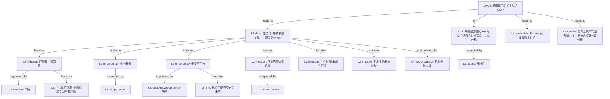

# AI-A Decision Tree Round 1

paper_id: paper_40295872
question_id: Q7
task_type: literature_decision_tree_reasoning
question: 局限有哪些？是否被合理讨论？是否动摇主要结论方向？（残余混杂、选择偏倚、因果倒置、外推、中介时序、AF 表型缺失、单中心等）
source_file: adversarial_lit_reading/chunks/paper_40295872_jin2025_shr_sofa_af_mortality_cardiovasc_diabetol.md

## 1. Evidence Map

| evidence_id | location | evidence_summary | used_by_node |
|---|---|---|---|
| E1 | Strengths and limitations | 回顾性 → **不能因果推断**；长时期实践变迁影响当代外推 | N1, N2 |
| E2 | Strengths and limitations | **单中心** MIMIC 数据 → 人群/协议/资源不同时外推受限 | N3 |
| E3 | Strengths and limitations | 缺炎症标志、超声、线粒体/凝血直接指标 → 机制解释受限 | N4 |
| E4 | Strengths and limitations | **无法细分 AF**：病因（主因 vs 并发症）、类型（阵发/持续）、慢性度（新发/既往）；率控 vs 节律策略不可分析 | N5 |
| E5 | Strengths and limitations | 作者称模型变量易得、对异质危重 AF「仍 broadly applicable」；呼吁前瞻表型亚组验证 | N6 |
| E6 | Introduction | ICU AF 可为入院主因或继发并发症；预后研究少区分——本文 Limitations 承认仍未区分 | N5, N7 |
| E7 | Methods 人群 | 排除缺 HbA1c/入院 24h 空腹血糖或随访不可得者：22,419→15,358 → **选择偏倚**风险（代谢数据完整者） | N8 |
| E8 | Methods 中介 | 反事实 + bootstrap 中介；碳酸氢盐；未详述暴露–中介–结局时序窗是否严格先验 | N9 |
| E9 | Discussion 机制段 | 大量病理生理叙述（线粒体、酸碱等）超出本数据直接测量 → 解释性强于证据 | N10 |
| E10 | Results 多时点一致 | 院内/30 天/1 年 HR 同向 → 主要关联方向在内部多终点上稳定 | N11 |
| E11 | 全文 | 未系统讨论残余混杂定量（E-value）、失访机制、竞争风险 | N12 |

## 2. Decision Tree - Mermaid

**边关系摘要**

| 边 | 关系 |
|---|---|
| N0→N13 | leads_to |
| N13→N1 | because |
| N1→E1n | supported_by |
| N13→N3/N5/N8/N9/N4 | limitation |
| N5→N7 | because |
| N13→N10 | contradicted_by（叙述强度 vs 数据） |
| N0→N11 | if |
| N11→E10n | supported_by |
| N0→N12 | leads_to |
| N0→N14 | transfer_to |
| N1→N15 | leads_to |

## 3. Node Table

| node_id | node_type | claim | evidence_location | evidence_summary | confidence | risk_tag |
|---|---|---|---|---|---|---|
| N0 | question | 局限是否动摇主结论？ | — | Q7 | high | |
| N13 | claim | 主结论应读作关联+分层预测，非因果 | Limitations; Conclusion | 作者亦写 precludes causal inference | high | |
| N1 | limitation | 回顾性设计限制因果 | Strengths and limitations | 明文 | high | 因果过度 |
| N2 | limitation | 长纳入窗实践变迁 → 当代外推不确定 | Limitations | temporal changes | medium | |
| N3 | limitation | 单中心 → 外推他院弱 | Limitations | single center | high | 可迁移性不足 |
| N4 | limitation | 缺关键生物标志 → 机制解释受限 | Limitations | inflammatory/echo/ATP 等 | high | |
| N5 | limitation | AF 病因/类型/慢性度不可分 | Limitations | critically | high | |
| N6 | claim | 作者认为变量易得仍 broadly applicable | Limitations | 自我辩护 | medium | 逻辑跳跃 |
| N7 | evidence | Intro 已承认 ICU AF 异质且少区分；本文仍未区分 | Introduction; Limitations | 空白延续 | high | |
| N8 | limitation | 剔除缺 HbA1c/FBG 者 → 选择偏倚可能高估/低估不明 | Methods 人群 | 22419→15358 | medium | 证据不足 |
| N9 | limitation | 中介：时序可忽略性与未测混淆原文论证不足 | Methods Mediation | bootstrap 有、假设检验少 | medium | 因果过度 |
| N10 | limitation | Discussion 机制叙事超出直接测量 | Discussion | 病理生理长段 | medium | 因果过度 |
| N11 | claim | 就「死亡风险升高方向」：内部多时点一致，局限更伤外推/因果强度而非翻转点估计方向的文内证据 | Table 2 | 同向 HR | medium | |
| N12 | uncertainty | 残余混杂定量、竞争风险未作为局限深挖 | 全文 | 原文未明确说明 | medium | 证据不足 |
| N14 | transfer | 用户：eICU 外验缓解单库；脓毒症≠AF → AF 特异机制段不可照搬 | 用户确认 | 病种切换 | high | |
| N15 | claim | 可信度分层：关联方向中高；因果/机制低；工具外推低 | 综合 | 见 Provisional | high | |

## 4. Provisional Answer

作者在 **Strengths and limitations** 对核心局限讨论基本到位：回顾性非因果、单中心外推、机制标志缺失、**AF 表型无法细分**（与 Introduction 提出的研究空白形成呼应——提出了问题但数据仍解决不了）。

**对主结论的影响（需拆开读）**

| 结论类型 | 局限冲击 | 判断 |
|---|---|---|
| 「高 SHR+高 SOFA 死亡风险更高」（关联） | 残余混杂/选择偏倚可改效应量；文内多时点同向 | **方向在文内较稳**；因果不可延申 |
| 「碳酸氢盐介导 X%」 | 时序与未测混淆、回顾性 | **比例宜作探索**；不宜当机制定论 |
| 「nomogram/SHAP 可临床分层」 | 无外验、单中心、AF 异质 | **外推弱**；作者已部分承认 |
| Discussion 代谢–器官「治疗分层」建议 | 超出观察关联 | **易因果过度**；属解释非证明 |

综合：**局限动摇的是因果声称、机制精确比例与跨中心工具性能，不自动推翻文内「组合暴露与死亡正相关」的描述性结论。** 迁移到脓毒症时，AF 特异病理讨论段 **不适用**；单中心局限可用双库部分缓解，但病种切换引入新的外推不确定性。

## 5. Uncertainty List

- U1: 代谢数据缺失导致的选择偏倚方向（高估 vs 低估）原文未做 bound。
- U2: 出院后死亡依赖 Death Master File，失访/匹配误差未量化。
- U3: 竞争风险（如非死亡出院后删失定义）对 1 年终点的影响原文未明确说明。
- U4: 「broadly applicable」与「需更好表型验证」并列表述，外推边界仍模糊。

## 6. Follow-up Questions

1. Figure S1 纳排每步 n 是否完整可复现选择偏倚评估？
2. 中介模型协变量集是否与 Table 2 Model II 一致？
3. 作者是否在他处声明 SHR 测量时点相对 SOFA/碳酸氢盐的先后？
