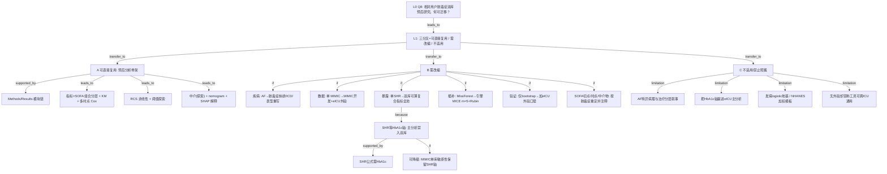

# AI-A Decision Tree Round 1

paper_id: paper_40295872
question_id: Q8
task_type: literature_decision_tree_reasoning
question: 该文方法与套路哪些可迁移到「我的研究」？哪些需改编？哪些不适用？
source_file: adversarial_lit_reading/chunks/paper_40295872_jin2025_shr_sofa_af_mortality_cardiovasc_diabetol.md

### 用户已确认的「我的研究」（必须写入树）

| 维度 | 用户定稿 |
|---|---|
| 疾病 | **脓毒症**（非原文 AF） |
| 数据库 | **MIMIC-IV 开发 + eICU 外验**（原文仅 MIMIC） |
| 暴露 | **不只 SHR**；并行跑双库可算的**全部复合指标**；eICU 无 HbA1c ⇒ 主分析**禁止 HbA1c 轴**（SHR / HGI / HbA1c_HDL_C / eGDR）；上述可作 **MIMIC 单库敏感性** |
| 方法迁移 | Jin 2025 **预后预测套路**（指标×SOFA 分层、多时点 Cox、RCS、KM、中介、nomogram、SHAP）迁到脓毒症双库 batch |
| 地基 | **预后 survival**，非发病 |

## 1. Evidence Map

| evidence_id | location | evidence_summary | used_by_node |
|---|---|---|---|
| E1 | Methods Statistical analysis | 套路骨架：暴露分层×SOFA 二分→四组合；KM；多时点 Cox；RCS；中介；logistic nomogram；SHAP | N1 |
| E2 | Methods 人群/Data source | 单库 MIMIC-IV 3.1；成人 ICU；AF 诊断；需 HbA1c+FBG 算 SHR | N2, N3 |
| E3 | Methods SHR 公式 | SHR=FBG/(28.7×HbA1c−46.7) → **依赖 HbA1c** | N3, N4 |
| E4 | Results 全链 | 发表顺序：Table1 → SHR-SOFA KM/Cox → 亚组 → RCS → nomogram → SHAP → mediation | N1, N5 |
| E5 | Limitations | 无外验、单中心、AF 表型缺失 | N6 |
| E6 | Methods 缺失 | MissForest MAR；&gt;20% 删变量 | N7 |
| E7 | Methods 预测 | nomogram=logistic+bootstrap；非独立外验集 | N8 |
| E8 | 用户确认 | 脓毒症；双库；全复合指标池；禁双库主分析 HbA1c 轴；survival 地基 | N0, N9–N12 |

## 2. Decision Tree - Mermaid

**边关系摘要**

| 边 | 关系 |
|---|---|
| N0→N13 | leads_to |
| N13→N1 | transfer_to（可直接复用） |
| N1→N1a/b/c | leads_to |
| N1→E1n | supported_by |
| N13→N9 | transfer_to（需改编） |
| N9→N2/N10/N11/N7/N8/N12 | if |
| N11→N3 | because |
| N3→E3n | supported_by |
| N3→N4 | if |
| N13→N14 | transfer_to（不适用） |
| N14→N14a–d | limitation |

## 3. Node Table

| node_id | node_type | claim | evidence_location | evidence_summary | confidence | risk_tag |
|---|---|---|---|---|---|---|
| N0 | question | 迁移三分法判定 | 用户确认 + 原文 Methods | Q8 | high | |
| N13 | claim | 必须分「复用/改编/不适用」三叶 | question_templates Q8 | 强制分叉 | high | |
| N1 | transfer | **可直接复用**：预后模块顺序与统计套路（非变量名） | Methods; Results | 组合分层→KM→Cox→RCS→中介→nomogram→SHAP | high | |
| N1a | transfer | 暴露×SOFA（或等价器官评分）交叉分层 + 多时点死亡 Cox/KM | Statistical analysis; Table2; FigS2 | 四组合设计 | high | |
| N1b | transfer | RCS 探非线性 + 层内形态比较 | Fig.1 | 4 knots | high | |
| N1c | transfer | 中介（探索）+ 列线图 + SHAP 解释链 | Fig.2–4 | 预测可解释组件 | medium | |
| N2 | transfer | **改编**：脓毒症纳排、诊断字段、排除规则；禁止沿用 AF ICD 逻辑 | 用户确认; Methods 人群 | 病种切换 | high | |
| N3 | transfer | **改编/门控**：依赖 HbA1c 的指标不得进双库主分析 | Methods SHR 公式; 用户确认 | eICU 无 HbA1c | high | |
| N4 | transfer | SHR/HGI/HbA1c_HDL_C/eGDR → 仅 MIMIC 单库敏感性可选 | 用户确认 | 敏感性降级 | high | |
| N7 | transfer | 缺失处理按引擎 MI+Rubin，不照抄 MissForest 单叙事 | Methods; 项目铁律 | 推断层 | high | |
| N8 | transfer | 验证层用 eICU 外验补原文缺口；nomogram/ML 须预声明主模型规则 | Limitations; 用户确认 | 双库 | high | |
| N9 | transfer | 「需改编」总括节点 | — | — | high | |
| N10 | transfer | 流水线改为 survival dual-batch（dev_internal_ext） | 用户确认 | 地基=预后 | high | |
| N11 | transfer | 暴露改为 combo/全可算复合指标循环，非单 SHR 论文复刻 | 用户确认 | index pool | high | |
| N12 | transfer | SOFA 切点、死亡时点、中介变量按脓毒症与数据重选并写进 config 注释 | Methods cutoff=5; Fig.4 碳酸氢盐 | 不可默认 AF 的 5 分/碳酸氢盐 | medium | 可迁移性不足 |
| N14 | transfer | **不适用**总括 | — | — | high | |
| N14a | limitation | AF 代谢–心房重塑机制段、Protected/Alert/Critical 治疗话术不可当脓毒症结论 | Discussion | 病种特异 | high | 因果过度 |
| N14b | limitation | 双库主分析强行纳入 SHR 等 HbA1c 轴 | 用户门控 + E3 | 外验不可算 | high | |
| N14c | limitation | 发病横断面/加权 logistic 地基 | 用户确认 survival | 设计不符 | high | |
| N14d | limitation | 仅内部 bootstrap 就宣称跨中心通用工具 | Limitations | 原文亦弱 | high | |

## 4. Provisional Answer

### A. 可直接复用（方法骨架，改标签不改结构）

Jin 2025 的 **预后预测分析链**可整体平移到脓毒症 survival dual-batch 的「单指标/组合指标」发表故事线：

1. 暴露分层 × 器官功能障碍（SOFA 或课题选定评分）交叉 → 组合风险层  
2. KM + log-rank  
3. 多随访时点 Cox（院内 / 短期 / 长期——时点按脓毒症惯例重定）  
4. 分层 RCS  
5. 亚组稳健性  
6. （可选）中介探索  
7. 列线图/校准/区分度 + SHAP 解释  

这些是 **统计套路**，不绑定 AF 病名或 SHR 列名。

### B. 必须改编

| 项 | 原文 | 我的研究 |
|---|---|---|
| 病种与纳排 | 危重 AF | 脓毒症定义与排除重写 |
| 数据 | 仅 MIMIC | MIMIC 开发 + **eICU 外验** |
| 暴露 | 主打 SHR | **双库可算复合指标全池并行**；主分析 **剔除 HbA1c 轴** |
| HbA1c 轴（SHR 等） | 主分析核心 | **仅 MIMIC 敏感性** |
| 插补/推断 | MissForest 叙述 | 引擎 **m=5 + Rubin**（操作层 complete#1 仅作图/Table1） |
| 验证 | 内部 bootstrap | 增加 **外验队列性能/校准**；预声明 primary_model_rule |
| SOFA 切点/中介物 | cutoff=5；碳酸氢盐 | 按脓毒症文献与两库分布重选并注释 |
| 地基 | 单库回顾队列脚本 | **预后 survival** dual-batch，非发病 |

### C. 不适用

- 将 Discussion 中 **AF 特异**病理与「Protected/Alert/Critical」干预范式直接写成脓毒症结论  
- 因复刻论文而把 **SHR/HGI/HbA1c_HDL_C/eGDR** 塞进 **含 eICU 的主分析**  
- 改走发病 logistic / NHANES 加权模板  
- 在无外验、未改病种口径时宣称「工具已可临床通用」

**一句话**：迁的是 **Jin 的预后模块菜谱**；不迁 **AF×SHR 实体菜品**；HbA1c 依赖指标降级为 MIMIC 敏感性，双库主菜换成可算复合指标池。

## 5. Uncertainty List

- U1: 脓毒症下器官评分是否仍用 SOFA cutoff=5，抑或改用文献常用切点/三分位——需课题检索后用户确认（原文切点不可默认真理）。  
- U2: 中介变量是否仍用碳酸氢盐，或改乳酸/肌酐等脓毒症更常见路径——原文证据不能外推。  
- U3: nomogram 在双库设定下是「仅开发库建模+外验校准」还是「禁止跨库硬套同一张图」——引擎/发表规范需另定。  
- U4: 多时点终点（院内死亡 vs 28 天 landmark 等）与原文 30/365 天是否对齐，属改编而非复用。

## 6. Follow-up Questions

1. 双库主分析器官分层固定 SOFA，还是允许 APSIII/SAPSII 作敏感性对照评分？  
2. 中介是「每个指标固定同一中介」还是「LM 筛共享实验室」跟引擎门控？  
3. MIMIC 单库 HbA1c 轴敏感性是否要求完整套图（RCS/SHAP）还是只出关联表？
