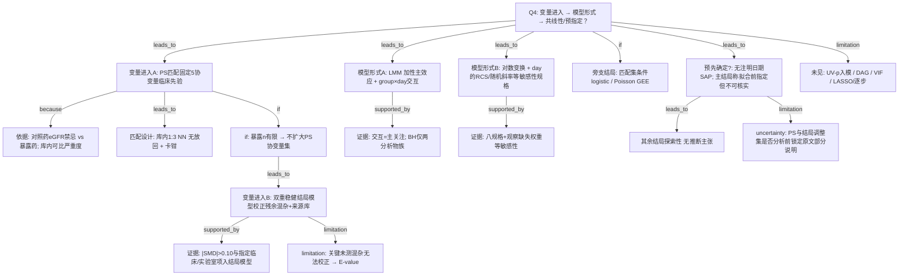

# AI-A Decision Tree Round 1

paper_id: paper_42898695
question_id: Q4
task_type: literature_decision_tree_reasoning
question: 变量/协变量筛选与建模逻辑是什么？（入模依据：临床重要性/单因素 p/文献/DAG/VIF；模型形式：加性/交互/含非线性项 RCS；是否 LASSO/逐步）该逻辑是否在分析前预先确定？
source_file: adversarial_lit_reading/chunks/paper_42898695_t2dm_mimic_eicu.md

## 1. Evidence Map

| evidence_id | location | evidence_summary | used_by_node |
|---|---|---|---|
| E1 | Section 2.4 Propensity-score matching | 暴露组 1:3 最近邻匹配（无放回），PS 的 logit，卡钳 0.25 SD；匹配变量固定为年龄、BMI、男性、24-h SOFA、day-1 eGFR；eGFR 入模理由=对照药禁忌与暴露药不同 | N1,N2,N3 |
| E2 | Section 2.4 | 暴露例数有限（约 116）→ PS 模型可支持协变量数受限；残余混杂用双重稳健估计，而非扩大 PS 协变量集 | N4,N5 |
| E3 | Section 2.4 + Results 3.1 | 结局模型额外校正：来源库、慢性肝病、心衰、磺脲/胰岛素并用、day-1 白蛋白/钠及结局分析物自身；\|SMD\|>0.10 的变量亦带入双重稳健结局模型 | N5,N6 |
| E4 | Section 2.4 | 未记录病程时长、糖化血红蛋白、他汀/RAS 抑制剂、脓毒症前血糖控制等，无法校正；用 E-value 量化未测混杂 | N7 |
| E5 | Section 2.5 Statistical analysis | 轨迹：线性混合效应 `analyte ~ group × day`，患者随机截距；关注 group×day 交互（斜率差异）；胆红素+ALP 两分析物族做 BH-FDR | N8,N9 |
| E6 | Section 2.5 | 右偏分析物再拟合 log(x+1)；另八种规格含随机斜率、日为分类因子、**对 day 的 RCS**、双重稳健调整、校正 day-1 分析物值、加来源库等 | N10,N11 |
| E7 | Section 2.5 | 死亡：Fisher 精确检验；按匹配集分层的条件 logistic；按匹配集聚类的 Poisson GEE；试图校正全部 20 个残余不平衡协变量因完全分离未解释 | N12 |
| E8 | Section 2.3 Outcomes + 2.5 | 无注明日期的统计分析计划；主结局与两分析物族称拟合前已指定但无法独立核实；其余轨迹/复合指数/死亡为探索性 | N13,N14 |
| E9 | 全文 Methods | 未见单因素 p 阈值筛选入 PS/结局模型；未见 DAG；未见 VIF/LASSO/逐步回归叙述 | N15,N16 |
| E10 | Results 3.1–3.2 / Table 1 / Fig.2 / Love plot Fig.S1 | 匹配后 5 个 PS 变量平衡优秀；残余不平衡变量入结局模型；主文报告轨迹斜率差与多规格敏感性 | N6,N9,N11 |

## 2. Decision Tree - Mermaid

## 3. Node Table

| node_id | node_type | claim | evidence_location | evidence_summary | confidence | risk_tag |
|---|---|---|---|---|---|---|
| N0 | question | Q4：协变量进入、模型形式、是否预指定 | — | 根问题 | high | |
| N1 | method | PS 匹配协变量为固定临床名单（非 UV-p 筛选） | Section 2.4 | age/BMI/sex/SOFA/eGFR | high | |
| N2 | claim | eGFR 入模因对照药肾功能禁忌差异；SOFA 作严重度 | Section 2.4 | 临床理由写明 | high | |
| N3 | method | 库内 1:3 最近邻、无放回、logit-PS、卡钳 0.25 SD | Section 2.4 | 匹配规格 | high | |
| N4 | method | 暴露例数限制 → 用双重稳健而非扩 PS | Section 2.4 | 「limited…doubly robust」 | high | |
| N5 | method | 结局模型额外校正来源库、共病、并用降糖药、day-1 实验室等 | Section 2.4 | DR 调整集 | high | |
| N6 | evidence | 匹配后 \|SMD\|>0.10 变量带入结局模型；Love plot/Table1 | Results 3.1 + Fig.S1 | 残余不平衡处理 | high | |
| N7 | limitation | 病程/HbA1c/他汀等未测 → E-value 量化 | Section 2.4–2.5 | 无法校正清单 | high | |
| N8 | method | LMM：group×day 交互为轨迹主关注项 | Section 2.5 | 随机截距 | high | |
| N9 | evidence | BH-FDR 仅限胆红素+ALP 族；其余探索 | Section 2.3/2.5 + Results | 多重比较范围 | high | |
| N10 | method | 敏感性规格含对 **day** 的 RCS、随机斜率、log 变换、DR 调整等 | Section 2.5 | 八规格列表 | high | |
| N11 | evidence | 多规格与 IPOW/完整测量子集等敏感性报告 | Results 3.2 + Suppl | 规格依赖讨论 | high | |
| N12 | method | 死亡用匹配设计下的条件 logistic / GEE Poisson | Section 2.5 + 3.3 | 非轨迹主模型 | high | |
| N13 | uncertainty | 无注明日期的 SAP；主结局「拟合前指定」不可独立核实 | Section 2.3, 2.5 | 预指定证据弱 | medium | 证据不足 |
| N14 | claim | 非主族轨迹、复合指数、死亡标为探索性 | Section 2.3 | 无推断主张 | high | |
| N15 | uncertainty | 原文未明确说明 UV-p、DAG、VIF、LASSO/逐步 | 全文 Methods | 原文未明确说明 | high | 证据不足 |
| N16 | uncertainty | 最终 DR 调整项是否全部预锁定 vs 按 SMD 数据驱动——原文写了规则但部分依赖匹配后 SMD | Section 2.4 + 3.1 | 半规则半数据驱动 | medium | 逻辑跳跃 |

## 4. Provisional Answer

本文**不是**「单因素 p→多因素回归」或 LASSO/逐步选模叙事，而是**药物流行病学：倾向评分匹配 + 双重稳健结局模型**。

**（1）变量进入**  
- **PS 阶段**：预列 **5 个固定协变量**（年龄、BMI、男性、24-h SOFA、day-1 eGFR），依据为**临床/药理**（对照药 eGFR 禁忌）与**跨库严重度可比性**；匹配在库内进行。原文**未**写单因素 p 阈值、DAG 或自动选择。  
- **因暴露人数有限**，作者明确选择**不扩大 PS 协变量**，改用**双重稳健结局调整**：来源数据库、慢性肝病、心衰、磺脲/胰岛素并用、day-1 白蛋白/钠及结局分析物自身；Results 进一步写明 **\|SMD\|>0.10** 的残余不平衡变量亦进入结局模型。  
- 关键未记录混杂（病程、HbA1c 等）**无法入模**，用 **E-value** 量化。  
- **VIF / LASSO / 逐步：原文未明确说明**。

**（2）模型形式**  
- 主轨迹：**线性混合模型**，含 **group×day 交互**（关注斜率差），非默认「全协变量交互」。  
- 非线性：**对时间 day 的 RCS**（及随机斜率、分类 day、log 变换等）出现在**敏感性规格**列表，不是把暴露做成 RCS 主模型。  
- 死亡：Fisher、**匹配集条件 logistic**、匹配集聚类 Poisson GEE；试图纳入全部残余不平衡协变量时出现完全分离而未解释。

**（3）是否分析前预先确定**  
- **无注明日期的统计分析计划**；正式样本量计算无法事后构造。  
- 主结局与两分析物 FDR 族称**拟合前已指定**，但作者写明**无法独立核实**。  
- 其余轨迹/复合指数/死亡为**探索性**。  
- PS 五变量与 DR 核心项属 Methods 预写规则；**按匹配后 SMD 带入**的项带数据驱动成分。

## 5. Uncertainty List

- U1: 「每个 \|SMD\|>0.10 的变量」与 Section 2.4 预先列出的 DR 调整集是否完全重合——原文两处叙述需对照，是否另有扩充原文未列表穷尽。
- U2: day-1 eGFR 与 24-h SOFA 部分为暴露后测量，作者承认过调整/对撞风险；入模是「可比性」选择还是因果最优——属设计张力，非单纯筛选问题。
- U3: 对 day 的 RCS 是否用于主文推断还是仅敏感性——Methods 列为八规格之一，主规格仍是线性 day。
- U4: 完全分离导致「20 个残余不平衡协变量全调」模型未解释——是否意味着死亡模型实际只用了较少调整集，原文对最终死亡模型协变量清单写得不如轨迹清晰。

## 6. Follow-up Questions

1. 若复现「临床先验固定 PS 集 + 匹配后 SMD 闸门进结局模型」，Medical Blocks 应落在哪一层 config（勿误写成 UV→VIF→Model2）？
2. 对时间轴 RCS 与对暴露 RCS 在发表叙事上如何区分，以免被误读为暴露–结局非线性主分析？
3. 无 SAP 时，Q4「预先确定」结论应标到何种置信度才适合喂给决策树下游？
