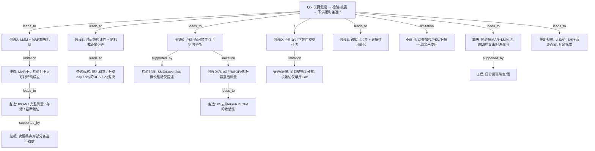

# AI-A Decision Tree Round 1

paper_id: paper_42898695
question_id: Q5
task_type: literature_decision_tree_reasoning
question: 该分析依赖哪些参数假设？是否满足？（Cox PH、logit 线性、正态/方差齐性、聚类 K、LCA 局部独立、ML 划分与超参；复杂抽样加权；缺失处理）若假设不满足有何备选？
source_file: adversarial_lit_reading/chunks/paper_42898695_t2dm_mimic_eicu.md

## 1. Evidence Map

| evidence_id | location | evidence_summary | used_by_node |
|---|---|---|---|
| E1 | Section 2.5 | 轨迹用线性混合模型（随机截距）；推断在 MAR 下有效，条件于模型协变量与患者既往观测；作者写明假设不可检验且不大可能精确成立 | N1,N2,N3 |
| E2 | Section 2.5 + 3.2 | MAR 不成立风险的备选：IPOW、≥3 次测量、存活出院、截断至 day4；ALP 在 IPOW/存活限制下不稳 | N3,N4 |
| E3 | Section 2.5 | 右偏分析物用 log(x+1)；另试随机斜率、分类 day、对 day 的 RCS，检验线性 day / 协方差结构假设 | N5,N6 |
| E4 | Section 2.4 | 匹配假设：库内可换性、卡钳内可比；用 SMD 评估平衡（\|SMD\|<0.10）；假设检验仅描述性 | N7,N8 |
| E5 | Section 2.4 + 4.1 | day-1 eGFR、24-h SOFA 可能非纯基线 → 过调整/对撞；敏感性从 PS 去掉它们 | N9,N10 |
| E6 | Section 2.5 + 3.3 | 死亡：匹配集条件 logistic / 匹配集聚类 Poisson GEE；全调 20 协变量完全分离；探索性；单库才有 30/90 天与 Cox | N11,N12 |
| E7 | Section 2.5 | 跨库异质性：DerSimonian–Laird 随机效应、I²、Cochran Q、leave-one-database-out | N13 |
| E8 | Section 2.5 | 无调查加权/复杂抽样设计叙述；三库为方便样本危重症库池化，非 NHANES 式权重 | N14 |
| E9 | Section 2.5 + 实验室缺失叙述 | 未报告对基线协变量做多重插补；轨迹用 LMM 吃「可得观测」+ MAR；日分母骤降有表/图 | N15,N16 |
| E10 | Section 2.3, 2.5 | 无注明日期 SAP；最小可检效应事后计算；双侧 p/q<0.05；BH 限两分析物族 | N17 |
| E11 | Results 3.2–3.3 / Fig.2–3 | 主结局胆红素交互多规格稳健接近无效；ALP 信号规格依赖；死亡点估计升高但 CI 含 1 | N4,N12 |

## 2. Decision Tree - Mermaid

## 3. Node Table

| node_id | node_type | claim | evidence_location | evidence_summary | confidence | risk_tag |
|---|---|---|---|---|---|---|
| N0 | question | Q5：参数/设计假设与备选 | — | 根问题 | high | |
| N1 | method | 轨迹推断依赖 LMM 与条件 MAR | Section 2.5 | 随机截距混合模型 | high | |
| N2 | limitation | 作者明确 MAR 不可检验且不大可能精确成立 | Section 2.5 | 自我披露 | high | |
| N3 | method | 四类观测缺失敏感性作为 MAR 备选 | Section 2.5 | IPOW 等 | high | |
| N4 | evidence | 次要终点在部分敏感性下失去显著性 | Results 3.2 | 规格脆弱 | high | |
| N5 | method | 主规格假设线性 day 与随机截距-only | Section 2.5 | 主形式 | high | |
| N6 | method | 用随机斜率/分类 day/RCS/log 检验结构假设 | Section 2.5 | 进一步规格 | high | |
| N7 | method | PS 匹配隐含治疗可换性与卡钳可比 | Section 2.4 | 匹配假设 | high | |
| N8 | evidence | 用 SMD 与 Love plot 报告平衡 | Results 3.1 + Fig.S1 | \|SMD\| 阈值 | high | |
| N9 | limitation | eGFR/SOFA 可能介导/对撞，威胁「基线调整」解释 | Section 2.4, 4.1 | 作者承认 | high | 因果过度 |
| N10 | method | 从 PS 省略 eGFR±SOFA 的敏感性 | Section 2.4 + Suppl S4 | 备选匹配 | high | |
| N11 | method | 死亡用匹配集条件 logistic / GEE | Section 2.5 | 设计一致 | high | |
| N12 | limitation | 全调整完全分离；较长随访死亡仅单库且样本小 | Section 3.3 | Cox 仅单库 | high | 证据不足 |
| N13 | method | 库特异估计 + 随机效应合并 + leave-one-out | Section 2.5, 3.2 | 异质性 | high | |
| N14 | claim | 原文未使用调查加权复杂抽样；本问 NHANES 专项不适用 | 全文 Methods | 原文未明确说明权重 | high | |
| N15 | uncertainty | 未见基线协变量多重插补步骤；轨迹靠 LMM+MAR | Section 2.5 | 原文未明确说明 MI | medium | 证据不足 |
| N16 | evidence | 各日可测人数大幅下降有表证 | Suppl Table S6 / Fig.S6 | 缺失严重 | high | |
| N17 | method | 无 SAP；主族 BH；其余探索性 α 规则 | Section 2.3, 2.5 | 推断边界 | high | |

## 4. Provisional Answer

关键假设可分五块：

1. **轨迹混合模型与缺失**：主分析假设条件 **MAR** + 随机截距 LMM；作者写明 MAR **不可检验且不大可能精确成立**，并以 IPOW、完整测量、存活出院、截断随访为备选；次要终点对部分备选不稳健。  
2. **时间/协方差形式**：主规格线性 day + 截距-only；用 log、随机斜率、分类 day、**对 day 的 RCS** 等规格探测假设依赖。  
3. **PS 匹配**：库内可换性与卡钳平衡，用 **SMD/Love plot** 报告；eGFR/SOFA 的暴露后测量构成过调整/对撞张力，敏感性从 PS 剔除。  
4. **死亡与可估性**：匹配设计下条件 logistic/GEE；全协变量调整因**完全分离**失败；30/90 天与 Cox **仅单库**，外推受限。非主文 PH 检验叙事（Cox 非主分析）。  
5. **加权/插补/预注册**：**无**调查权重；基线 **MI 原文未明确说明**；无注明日期 SAP；BH 限两终点族。

**假设不满足时的备选**已在 Methods/Results 展开（缺失加权与子集、规格变换、去 eGFR 匹配、leave-one-out），但次要阳性信号对这些备选敏感。

## 5. Uncertainty List

- U1: 条件 logistic / GEE 的小样本与稀疏事件下渐近假设是否充分——原文以完全分离说明全调整不可行，但对主报告模型的有限样本性质讨论有限。
- U2: IPOW 模型中「前值+严重度」是否足以近似 MNAR 的备选——原文未声称解决 MNAR。
- U3: 随机效应合并的库数很少（三库），I²/Q 的解释力有限。
- U4: 是否对匹配权重做了方差校正以外的设计——主要靠分层/聚类，而非 IPTW 主分析。

## 6. Follow-up Questions

1. 若用户课题改为发病 ML，本文 MAR+LMM 假设链哪些完全不可迁移？
2. 复现时是否应把「去 eGFR 的 PS」升为与主匹配并列的预指定敏感性，而非补充材料附带？
