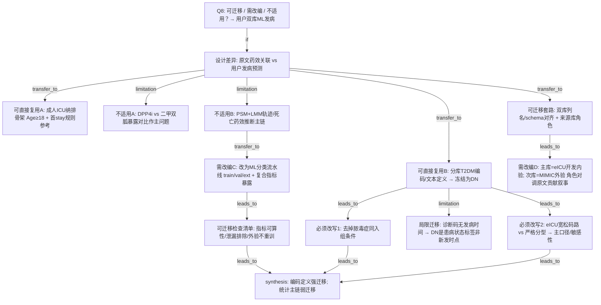

# AI-A Decision Tree Round 1

paper_id: paper_42898695
question_id: Q8
task_type: literature_decision_tree_reasoning
question: 该文的方法与套路中，哪些可迁移到「我的研究」？（我的研究：万学思；II型糖尿病；MIMIC-ICU+eICU；双库机器学习发病/分类预测；全可算复合指标 single_loop；结局=该文 T2DM 编码定义冻结为 DN；人群=全 ICU 成人不绑脓毒症；主库 eICU 开发+内验、MIMIC 外验）。哪些步骤可原样套用，哪些必须按我的数据改写？
source_file: adversarial_lit_reading/chunks/paper_42898695_t2dm_mimic_eicu.md

## 1. Evidence Map

| evidence_id | location | evidence_summary | used_by_node |
|---|---|---|---|
| E1 | Section 2.1 | 三库成人≥18；T2DM 与脓毒症均由诊断码/结构化诊断识别；MIMIC/NWICU 与 eICU 定义字符串/ICD 不同；分析单位为首合格住院/首 unit stay≥24h | N1,N2,N3 |
| E2 | 补充/正文定义 | MIMIC/NWICU：ICD-9 250.x0/250.x2 或 ICD-10 E11；eICU：糖尿病文本且非 1 型/胰岛素依赖，或码 250.x/E11；本文 Limitations 承认 eICU 码路未必分型 | N2,N4 |
| E3 | Section 2.1–2.2 | 暴露= DPP4i 医嘱/入院药；对照=二甲双胍且无 DPP4i；GLP-1RA 排除；非 ML 分类结局 | N5,N6 |
| E4 | Section 2.4–2.5 | 主分析=库内 PSM + LMM 轨迹 + 双重稳健；死亡条件 logistic；**不是**训练/验证划分的监督学习流水线 | N6,N7 |
| E5 | Section 2.1 | 各库查询输出同一 canonical schema 后下游一次分析；来源库作协变量；异质性/leave-one-out | N8,N9 |
| E6 | Introduction/Aims | 目标人群= T2DM **且脓毒症**；用户研究明确**不绑脓毒症** | N3,N10 |
| E7 | Results/Limitations | 暴露误分类、残余混杂、小暴露 n、三库案混差异；对「药物效应推断」强相关，对「T2DM 标签定义」弱相关 | N11 |
| E8 | 用户确认（本轮输入） | 万学思；双库 ML 发病/分类；single_loop 全可算复合指标；DN=冻结本文 T2DM 定义；eICU 开发+内验 / MIMIC 外验 | N0,N12,N13 |

## 2. Decision Tree - Mermaid

## 3. Node Table

| node_id | node_type | claim | evidence_location | evidence_summary | confidence | risk_tag |
|---|---|---|---|---|---|---|
| N0 | question | Q8：迁移到用户双库 ML 发病研究 | 用户确认 | 研究方向已确认 | high | |
| N1 | transfer | 成人≥18、首合格住院/unit stay 规则可作纳排参考 | Section 2.1 | 人群骨架 | high | |
| N2 | transfer | 分库 T2DM 操作定义可冻结为结局 DN | Section 2.1 + 冻结定义 | 编码强迁移 | high | |
| N3 | transfer | 必须删除「与脓毒症同次入组」约束 | Section 2.1 vs 用户确认 | 人群改写 | high | |
| N4 | transfer | eICU 文本+码并集 vs 严格分型应设主/敏口径 | Limitations + 定义 | 分型噪声 | high | |
| N5 | limitation | DPP4i/二甲双胍对比不迁移为 ML 任务定义 | Section 2.2 | 暴露不适用 | high | 可迁移性不足 |
| N6 | limitation | PSM+LMM 药效轨迹主链不作为 ML 主流水线 | Section 2.4–2.5 | 方法不适用 | high | 可迁移性不足 |
| N7 | transfer | 改为监督学习分类：划分、特征、外验；暴露=复合指标 single_loop | 用户确认 | 需引擎改编 | high | |
| N8 | transfer | 双库 harmonize / canonical schema / 库角色协变量思路可借鉴 | Section 2.1 | 工程套路 | medium | |
| N9 | transfer | 开发/外验库角色按用户指定（eICU→MIMIC），勿照搬原文样本量叙事 | Results 3.1 | 角色对调 | high | |
| N10 | claim | 设计类型不同：观察药效关联 vs 发病分类预测 | Aims vs 用户 | 根差异 | high | |
| N11 | limitation | 诊断码无 onset → DN 是状态/患病标签，不是精确「新发日期」 | Section 2.1 | 横断面标签 | high | 因果过度 |
| N12 | transfer | ML 检查：特征可算、疾病泄漏排除、外验不重训、分母衔接 | 用户确认+工程规范 | 落地清单 | medium | |
| N13 | claim | 综合：编码与纳排强迁移；推断主链弱迁移；ML 须另建 | 全树 | 分桶结论 | high | |

## 4. Provisional Answer

**可原样/近原样套用**  
- **T2DM 操作定义**（分库 ICD/文本规则）→ 冻结为用户结局 **DN**（与课题冻结定义件一致）。  
- **成人 ICU** 年龄门控与「每患者一个分析单位」的精神（MIMIC 首合格住院；eICU 首 unit stay 且 LOS 门槛可参考，但是否照搬 24h 须按用户提取口径裁定）。  
- **双库 schema 对齐后再统一下游**的工程思路。

**必须改写**  
- **人群**：去掉脓毒症同入组；分析对象=全 ICU 成人 ± T2DM 标签（按 DN）。  
- **eICU 糖尿病分型宽松问题**：主口径可照原文并集，另设严格敏感性（用户冻结件已规划）。  
- **库角色**：用户主库 **eICU 开发+内验**、**MIMIC 外验**——与原文「三库匹配合并、eICU 贡献匹配队列过半」叙事不同，不可照抄贡献比例当验证设计。  
- **分析主链**：由 PSM+LMM 药效轨迹 → **双库 ML 分类/发病预测 + 复合指标 single_loop**。

**不适用**  
- DPP4i vs 二甲双胍暴露对比、肝指标轨迹主结局、匹配药效推断、E-value 针对药物效应的主叙事。  
- 本文 **不是** ML 论文：无现成 train/val/test、SHAP、外验 AUC 可抄流水线。

**标签语义警告**：原文诊断为住院/入科记录、无发病时间 → 用户将 DN 作「发病/分类」结局时，实质多为**患病状态分类**，Methods 须写实，避免写成有明确发病日的前瞻新发。

## 5. Uncertainty List

- U1: eICU unit LOS≥24h 是否纳入用户主口径——冻结件 ICU 池与原文略有项目化裁量，需与提取一致。
- U2: NWICU 不在用户双库内——本文三库异质性经验仅部分可迁移。
- U3: 「发病」一词与横断面诊断标签的张力如何在中文 Methods 表述——属写作裁决。
- U4: 复合指标公式库与 MIMIC/eICU 可算交集须另做可算性审计（本文未提供 ML 特征清单）。

## 6. Follow-up Questions

1. DN=1 的预测任务是「入院即判糖尿病状态」还是「住院期间出现编码」？时间零点如何定义以免泄漏？
2. single_loop 指标池是否预先剔除依赖 HbA1c 等外验库不可算轴？
