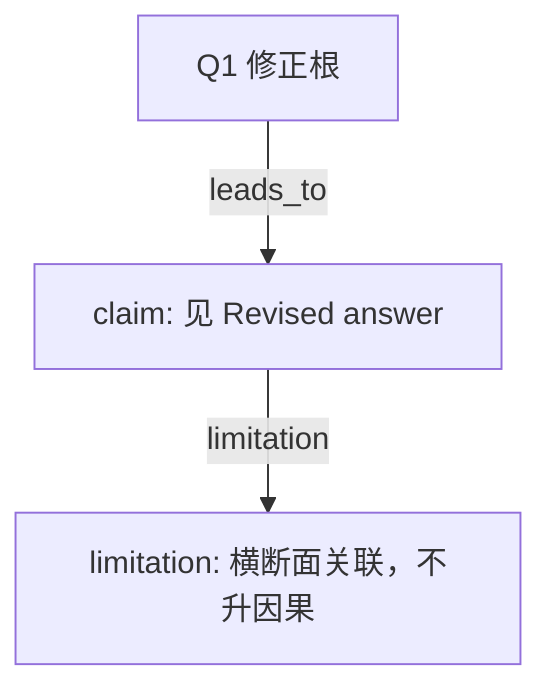

# AI-A Decision Tree Round 2

paper_id: paper_004
question_id: Q1
task_type: literature_decision_tree_reasoning
source_file: adversarial_lit_reading/chunks/paper_004_ewas_new.md

## Revision Log

高严重度意见已改入下面的答案。攻击文件：`rounds/B_attack_tree_paper_004_Q1.md`（首行含 glm_call provenance）。

## Revised answer

采纳高严重度：结局二分类来自 CDC/AAP 合并，不是聚类定 K；轻中重只出现在定义、正文未做有序模型。年龄<60与性别是分层，切点 60 在 Results 3.4 给出、Methods 未论证。ERS 组数为先验两组，切点是样本中位数。每 IQR 的 OR 是报告尺度，原文未声明线性假设；RCS（P-nonlinear=0.348）是事后诊断。反向因果在 Discussion 单独作为方向限制，不并进剂量-反应形状。

## Mermaid

