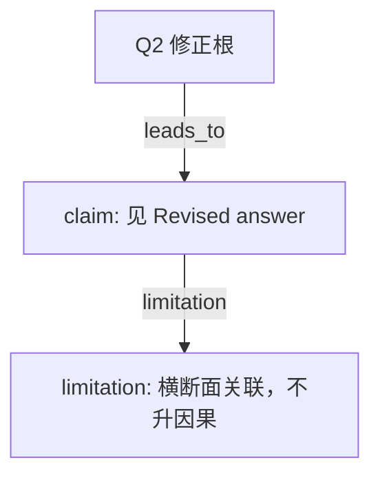

# AI-A Decision Tree Round 2

paper_id: paper_004
question_id: Q2
task_type: literature_decision_tree_reasoning
source_file: adversarial_lit_reading/chunks/paper_004_ewas_new.md

## Revision Log

高严重度意见已改入下面的答案。攻击文件：`rounds/B_attack_tree_paper_004_Q2.md`（首行含 glm_call provenance）。

## Revised answer

主终点只有一个二分类。73 个暴露先逐一 ExWAS 再 BH-FDR，然后弹性网收成 ERS，二者是先后步骤不是并列降维。ERS 是暴露侧评分，不是复合终点。Fig.4F 展示牙数、探诊深度、附着丧失与 ERS 的线性回归，原文未称 secondary phenotype。类别内 FDR 是敏感性。中介六指标未写族错误率校正。Discussion 指出尼古丁代谢物与其他暴露同时入模可能碰撞偏倚。

## Mermaid

