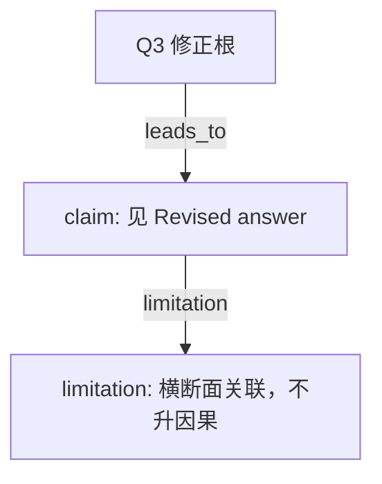

# AI-A Decision Tree Round 2

paper_id: paper_004
question_id: Q3
task_type: literature_decision_tree_reasoning
source_file: adversarial_lit_reading/chunks/paper_004_ewas_new.md

## Revision Log

高严重度意见已改入下面的答案。攻击文件：`rounds/B_attack_tree_paper_004_Q3.md`（首行含 glm_call provenance）。

## Revised answer

ExWAS 是逐暴露独立回归，这一步不处理暴露间共线；共线交给自适应弹性网（先有 adaptive 表述，再 alpha 网格与 5 折，bootstrap 看纳入频率）。WQS 是互补混合物，不是替换 ExWAS 的实验。未插补、类别内 FDR、影响点、从不吸烟者分层是稳健性，不是换方法。正文未报告 BKMR/qgcomp；未逐表核对补充材料前不能写成「确认未使用」。

## Mermaid

