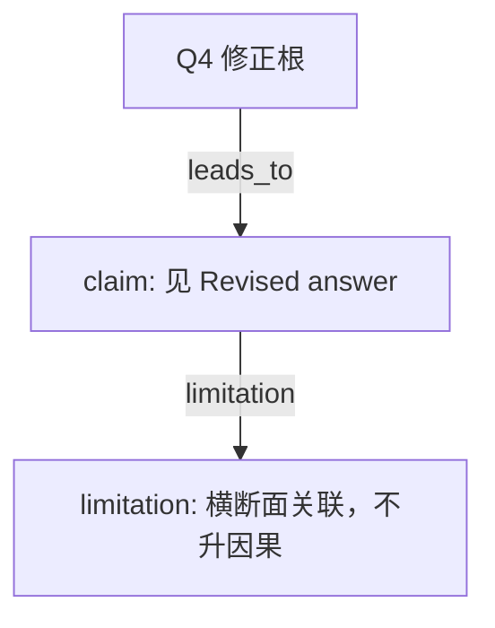

# AI-A Decision Tree Round 2

paper_id: paper_004
question_id: Q4
task_type: literature_decision_tree_reasoning
source_file: adversarial_lit_reading/chunks/paper_004_ewas_new.md

## Revision Log

高严重度意见已改入下面的答案。攻击文件：`rounds/B_attack_tree_paper_004_Q4.md`（首行含 glm_call provenance）。

## Revised answer

协变量来自 DAG 与既往关联，毒物不经单因素 p 预筛。变量选择只在 ERS。ExWAS 不加权；ERS 与结局的 logistic 原文写 weighted。Model1 不调整，Model2 调整协变量名单。RCS 做在 ERS 上。共线性除弹性网外，Discussion 还警告烟相关毒物同时入模的碰撞偏倚。正文未给 VIF 切点。

## Mermaid

