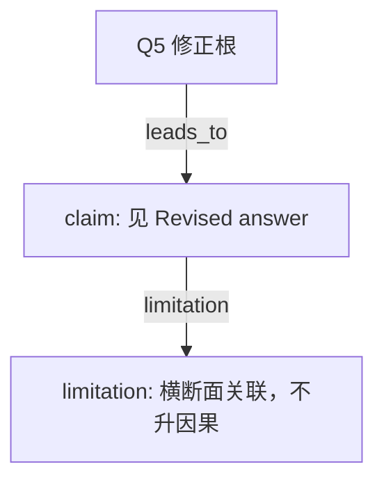

# AI-A Decision Tree Round 2

paper_id: paper_004
question_id: Q5
task_type: literature_decision_tree_reasoning
source_file: adversarial_lit_reading/chunks/paper_004_ewas_new.md

## Revision Log

高严重度意见已改入下面的答案。攻击文件：`rounds/B_attack_tree_paper_004_Q5.md`（首行含 glm_call provenance）。

## Revised answer

默认复杂抽样，ExWAS 是写明的不加权例外（一致性 + 避免过调整）。描述、RCS、亚组、中介加权。ERS–结局为加权 logistic。WQS 是否加权原文未写明。LOD：>90% 低于检出或缺失>40% 剔除；>30% 二分类；其余 ln。mice m=5、迭代 5、PMM/logreg，种子 123456 / bootstrap 2024。未报告逐毒物 logit 线性检验，只对 ERS 做了 RCS。中介假设顺序可忽略。

## Mermaid

