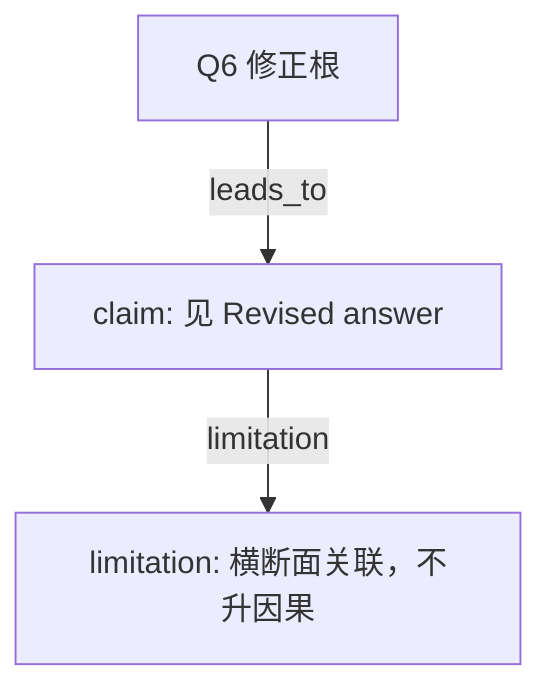

# AI-A Decision Tree Round 2

paper_id: paper_004
question_id: Q6
task_type: literature_decision_tree_reasoning
source_file: adversarial_lit_reading/chunks/paper_004_ewas_new.md

## Revision Log

高严重度意见已改入下面的答案。攻击文件：`rounds/B_attack_tree_paper_004_Q6.md`（首行含 glm_call provenance）。

## Revised answer

这里的有效性指关联估计对分析选择是否稳，不是预测 AUC。5 折只调 alpha/lambda，原文未报告 AUC 或校准。bootstrap 1000 次是变量纳入频率。另有类别内 FDR、未插补 ExWAS、影响点、E-value、medsens。无外部队列。影响点句子指向 Supplementary Table 1 与该表实际内容可能不符，证据降级。

## Mermaid

