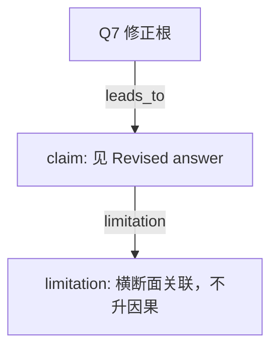

# AI-A Decision Tree Round 2

paper_id: paper_004
question_id: Q7
task_type: literature_decision_tree_reasoning
source_file: adversarial_lit_reading/chunks/paper_004_ewas_new.md

## Revision Log

高严重度意见已改入下面的答案。攻击文件：`rounds/B_attack_tree_paper_004_Q7.md`（首行含 glm_call provenance）。

## Revised answer

横断面不能排除反向因果。单周期、单次尿、暴露组不全、地域外推、残余混杂都在。E-value 只说明未测量混杂要多强，不消除混杂。吸烟进一步调整后多数关联减弱；从不吸烟者中铅、2HPMA、2-萘酚仍正向。中介比例约 5%–11% 且依赖 medsens。这些限制动摇因果措辞；原文没有显示 FDR 显著关联的符号被整体反转。

## Mermaid

