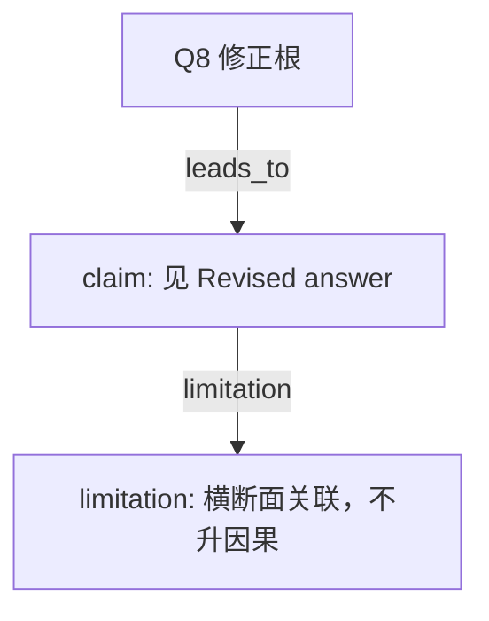

# AI-A Decision Tree Round 2

paper_id: paper_004
question_id: Q8
task_type: literature_decision_tree_reasoning
source_file: adversarial_lit_reading/chunks/paper_004_ewas_new.md

## Revision Log

高严重度意见已改入下面的答案。攻击文件：`rounds/B_attack_tree_paper_004_Q8.md`（首行含 glm_call provenance）。

## Revised answer

可迁移的是步骤骨架，不是牙周结局、口腔行为协变量和单周期 wtsa2yr。用户数据是 2003–2016 七周期、自报胃癌 31 例。必须先核对周期交集、单位和尿肌酐校正，再谈 73 种毒物。多周期要合并权重并带上 PSU/分层；设计列目前不在结局 csv。ExWAS 按原文与用户要求保持不加权。弹性网原文未写权重，加权的是 ERS 的 logistic 以及 RCS/亚组/中介；权重列缺失时不得假装加权。事件数远小于原文 533，FDR、弹性网、WQS、中介都不稳定。自报癌症是诊断后测暴露，反向因果更重。

## Mermaid

