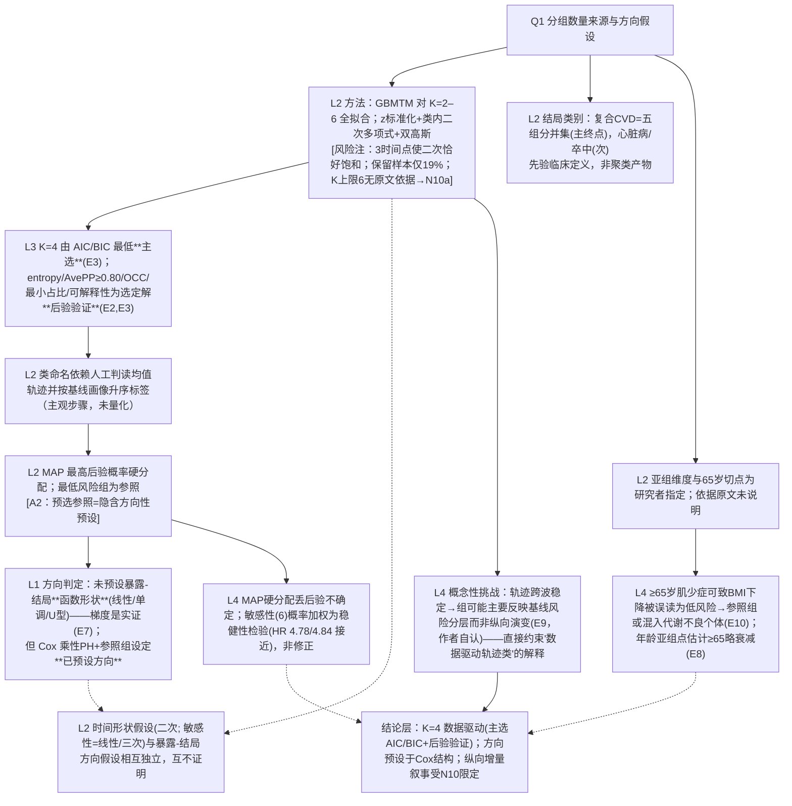

# AI-A Decision Tree Round 2 (Revised)

paper_id: paper_013
question_id: Q1
task_type: literature_decision_tree_reasoning
question: Q1 本研究预设了几个分组/亚型/类别？数量是数据驱动还是主观指定？是否假设了暴露-结局关系的方向？
source_file: adversarial_lit_reading/chunks/paper_013_joint_traj_tyg_cvd_elsa.md
critic: rounds/B_attack_tree_paper_013_Q1.md（glm provenance 已核验）

## 0. Revision Log（对攻击的逐条处置）

| attack_id | severity | 处置 | 修订内容 |
|---|---|---|---|
| A1 | 高 | **采纳** | N3 改为"K 由 AIC/BIC 最低主选；entropy/AvePP(≥0.80)/OCC/最小类占比/临床可解释性为选定解的**后验质量验证**，非共同决定 K" |
| A2 | 高 | **采纳** | N4 增注"最低风险组为参照＝隐含方向性预设（低→高梯度）" |
| A3 | 中 | **采纳** | N6 措辞改"敏感性(6)为稳健性检验（结果接近）"而非"修正" |
| A4 | 高 | **采纳** | N7 拆分：未预设暴露-结局**函数形状**（线性/单调/U 型），但 Cox 乘性 PH + 预选参照**已预设方向** |
| A5 | 中 | **采纳** | N8 明确"类内时间形状假设"与"暴露-结局方向假设"为两独立层次 |
| A6 | 低 | **采纳** | N9 删"常用切点"，改"原文未说明 65 岁切点依据" |
| E1 | 高 | **采纳** | 删"两层分类体系"表述：结局终点是事件类型变量（主/次），不与轨迹分类并列为分类体系 |
| E2 | 中 | **采纳** | N3→N4 间插入"类命名依赖人工判读均值轨迹（主观步骤）"节点 |
| E3/E4/E5/E7 | 中低 | **采纳** | 删除 N6→N7、N5→N6、N4→N5、N8→N9 等无因果力边，节点独立化 |
| E6 | 高 | **采纳** | N7→N8 边改为"两独立假设层次，互不证明" |
| M1 | 高 | **采纳** | 新节点 N10a：K 的拟合范围 2–6 本身是研究者主观上限设定（原文无依据） |
| M2 | 高 | **采纳** | 新节点 N10：轨迹跨波稳定→组可能反映基线风险分层而非纵向演变（作者自认，挑战'数据驱动分组'概念意义） |
| M3 | 中 | **采纳** | 并入 N2 风险注：仅 3 时间点、二次多项式恰好饱和（3 点定二次），类稳定性先天受限 |
| M4 | 中 | **采纳** | 新 uncertainty：MICE 20 套是否逐套重选 K 未报告 |
| M5 | 高 | **采纳** | 同 M2 → N10 |
| M6 | 中 | **采纳** | 并入 N2 风险注：1808/9432≈19% 保留率，选 K 建立在 19% 子样本上 |
| M7 | 高 | **采纳** | 新节点 N11：≥65 岁肌少症可致 BMI 下降而被误读为低风险→参照组可能混入代谢不良个体（原文 Discussion 支持） |
| M8 | 中 | **采纳** | U1 升格：选 K 证据链不可独立验证（逐 K AvePP/OCC 全表未在文本层给出） |
| P1/P2 | 高 | **采纳** | E1/E2 只作方法流程证据；"K=4 最优"证据唯一来源=Results L443–455 + Supp Table 4 |
| P3 | 中 | **采纳** | E4 只支撑命名/占比；MAP 与参照的证据标注为 Methods L308–310 |
| P4/P5 | 高 | **采纳** | E7 仅证"未预设函数形状"；删"类间关系不预设形状"无据后半句 |
| P6 | 中 | **采纳** | entropy/AvePP 归位为后验验证而非选择判据 |

## 1. Evidence Map（修订后，方法与证据严格分离）

| evidence_id | location | evidence_summary | role |
|---|---|---|---|
| E1 | Methods L283–300 | GBMTM(flexmix) 对 K=2–6 全拟合，z 标准化、类内二次、双高斯 | 方法流程（不证 K 最优） |
| E2 | Methods L300–304 | 最优 K 由 AIC/BIC/entropy/AvePP/OCC/最小占比/可解释性"比较"决定；AvePP 阈值 0.80 | 选择规则文本（未明主选/后验之分） |
| E3 | Results L443–455; Supp Table 4 | K=4 两法 AIC/BIC 最低；选定解 AvePP 0.82/0.81、entropy 0.75/0.74 | **K=4 唯一直证** |
| E4 | Results L455–468 | 组名与占比（18.8/34.6/30.7/15.9；11.7/30.0/38.4/20.0） | 命名/占比证据 |
| E5 | Methods L308–310 | MAP 分配；最低风险组为参照 | 分配与参照证据 |
| E6 | Methods Outcome L211–227 | 复合 CVD=五组分并集（先验定义），心脏病/卒中为次终点 | 结局定义证据 |
| E7 | Results L755–810 | HR 梯度 2.31→2.72→5.06 / 2.22→2.75→5.12 | 实证梯度（仅证形状未预设） |
| E8 | Methods L343–350 | 亚组：年龄<65/≥65、性别、教育、DM、HTN、吸烟；切点依据未述 | 亚组设定证据 |
| E9 | Discussion L2060–2073 | "trajectories remained relatively stable…may primarily reflect baseline risk strata" | 概念性局限证据 |
| E10 | Discussion L1945–1965 | BMI 老年因肌少症下降而 WHtR 升（中央脂肪重分布） | 肌少症误分类证据 |
| E11 | Methods L251–257 | MICE m=20（教育/饮酒/FVC/抑郁） | 插补与 K 一致性缺口来源 |

## 2. Decision Tree - Mermaid（终版）

## 3. Node Table（终版）

| node_id | node_type | claim | evidence_location | evidence_summary | confidence | risk_tag |
|---|---|---|---|---|---|---|
| N0 | question | 分组来源与方向预设？ | — | — | high | |
| N2 | method | K=2–6 全拟合；二次多项式；双高斯；z 标准化 | Methods L283–300 | 3 点饱和/19% 保留/K 范围主观 → 见注 | high | 证据不足（K 范围依据） |
| N3 | evidence | K=4 主选依据=AIC/BIC 最低；其余指标为后验验证 | Results L443–455; Supp Table 4 | 数值：24235.7/24466.7；25612.5/25843.4 | high | |
| N3b | method | 类命名=人工判读均值轨迹+升序标签 | Results L455–468 | 主观步骤 | medium | 逻辑跳跃 |
| N4 | method | MAP 硬分配；最低组参照（隐含方向预设） | Methods L308–310 | 方向性在参照选择处出现 | high | |
| N6s | claim | 结局先验定义（并集主终点+两次终点） | Methods L211–227 | 非聚类 | high | |
| N7 | claim | 未预设函数形状；方向由 Cox 结构预设 | Results L755–810; Methods L330–345 | 两层次分开陈述 | high | |
| N8 | method | 时间形状假设与方向假设独立 | Methods L291–296; Sens(8) | 互不证明 | high | |
| N9 | uncertainty | 亚组切点无依据声明 | Methods L343–350 | 原文未说明 | low | 证据不足 |
| N6 | limitation | 硬分配不确定性由 Sens(6) 稳健性检验（非修正） | Methods L308; Sens(6) | HR 接近 | medium | |
| N10 | limitation | 轨迹稳定→或为基线分层（作者自认） | Discussion L2060–2073 | 概念性挑战 | high | |
| N11 | limitation | 肌少症致 BMI 误分类可污染参照组解释 | Discussion L1945–1965 | 年龄亚组衰减一致 | medium | 证据不足 |
| NA | claim | 综合判定 | 上列 | K 数据驱动/方向预设/增量受限 | high | |

## 4. Provisional Answer（终版）

类别数量层面：轨迹组 **K=4 是数据驱动**的——K=2–6 全部拟合并以 **AIC/BIC 最低为主选判据**，entropy(0.75/0.74)、AvePP(0.82/0.81≥0.80)、OCC、最小类占比与临床可解释性作为**选定解的后验质量验证**（原文并未声明六项共同决定 K）。但三处主观性必须记账：K 的搜索范围 2–6 无依据、组名靠人工判读轨迹画像、结局复合分组完全是先验临床定义。**方向假设层面**：作者未预设暴露-结局的函数形状（线性/单调/U 型），HR 梯度是实证结果；然而 Cox 乘性比例风险结构+预先把最低风险组设为参照，**本身即预设了低→高的比较方向**——"未预设方向"的说法不成立，应修正为"未预设形状、预设方向"。**概念层面**：作者自己承认三条轨迹跨波高度稳定，组别可能主要复现基线风险分层而非纵向演变（并有 ≥65 岁肌少症使 BMI 误指"低风险"的讨论），这实质限定了"数据驱动纵向轨迹"叙事的解释边界。方法学上还有两点未被原文处理：仅 3 个时点使类内二次多项式恰好饱和、以及保留样本仅 19% 且 MICE 20 套是否逐套重选 K 未报告。

## 5. Uncertainty List

- U1: 逐 K 的 AvePP/OCC 全表在文本层不可核验（Supp Table 4 若其他 K 亦达标，则"优越性"减弱）。
- U2: 组命名主观性无量化（如类间轨迹距离判据）。
- U3: 65 岁亚组切点与复合结局并集构成均无先验文献引用。
- U4: MICE 与 K 选择的一致性未报告。

## 6. Follow-up Questions

1. 复现时是否应把"AIC/BIC 主选 + 指标后验验证"的判据顺序写死进 GBMTM 块 config（选 K 规则=可配置字符串，默认 align-paper）？
2. N10"基线分层"挑战可否用本地数据直接量化（如类内斜率 vs 类间截距方差分解）——作为套路的一个附加诊断面板？
