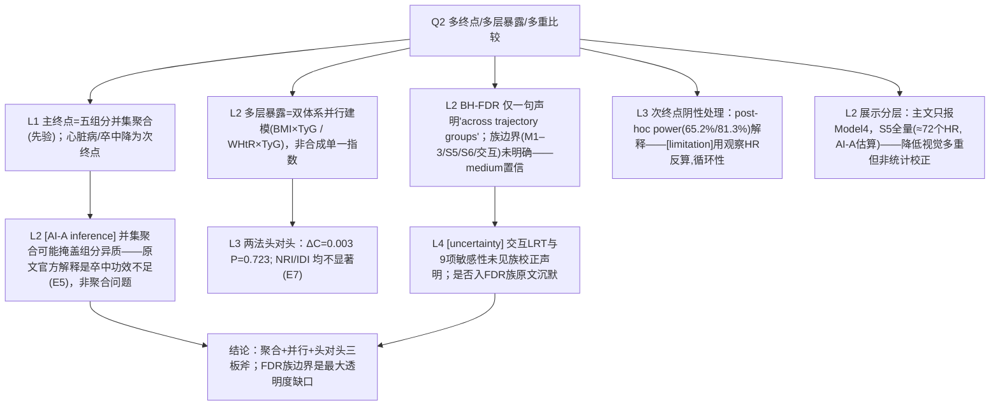

# AI-A Decision Tree Round 2 (Revised)

paper_id: paper_013
question_id: Q2
task_type: literature_decision_tree_reasoning
question: Q2 如何处理多亚型/多终点/多层暴露？多重比较是否膨胀 I 类错误？是否复合终点聚合？
source_file: adversarial_lit_reading/chunks/paper_013_joint_traj_tyg_cvd_elsa.md
critic: rounds/B_attack_tree_paper_013_Q2.md（glm provenance 已核验）

## 0. Revision Log

| attack | severity | 处置 | 修订 |
|---|---|---|---|
| N5/U1 表述 | 高 | **采纳** | BH-FDR 只按原文一句"applied … across trajectory groups"+Fig5 注为限；族是否含 M1–3/S5/S6/交互未明确说明→N5 confidence 降为 medium，U1 升为核心不确定 |
| N2 推理类型 | 高 | **采纳** | "并集聚合掩盖组分异质"标注为 **AI-A inference**；原文对卒中阴性的官方解释=limited statistical power（65.2%/81.3%） |
| N7 循环性 | 高 | **采纳** | 明示 post-hoc power 用观察 HR 反算=作者策略而非统计补偿；加 risk_tag |
| M1 事件数 | 高 | **采纳** | 补卒中事件绝对数（复现口径下约 66–83 例级别，主文 Table2/3 组分计数）与自报结局属性入解读节点 |
| 72 HR 标注 | 高 | **采纳** | "≈72 个 HR"明确标 **AI-A 估算**（2法×3结局×3暴露组×4模型） |
| E4 校正 | 高 | **采纳** | 删除对 BH 细节的过度解读，仅保留两句原文事实 |
| 树结构 | 中 | **采纳** | N2→N3 边删除；N3 改为 N0 直接分支；两法头对头(N4)独立成支 |

## 1. Evidence Map

| evidence_id | location | evidence_summary | role |
|---|---|---|---|
| E1 | Methods L211–227 | 复合 CVD=五组分并集（主）；心脏病/卒中（次） | 聚合定义 |
| E2 | Methods L286–290 | 两法并行=多层暴露双体系 | 并行设计 |
| E3 | Results L473–482; Fig 4 | 2 法 × 3 结局 KM，log-rank 全 P<0.001 | 结果广度 |
| E4 | Statistical L368–370（逐字仅一句） | "Benjamini–Hochberg FDR … across trajectory groups"；Fig5 注称全部存活 | 校正声明（边界未说明） |
| E5 | Results L786–793 | 卒中仅最高组显著；post-hoc power 65.2%/81.3% | 次终点处理 |
| E6 | Methods L343–350 | 交互=预设亚组乘法项 LRT；无校正声明 | 交互族 |
| E7 | Supp Table 8 | ΔC/NRI/IDI 头对头（全 P>0.8） | 体系比较 |
| E8 | Methods L328–345 | Model 1–4 嵌套 → 暴露组×4 模型全报 S5 | 展示分层（AI-A 计数 72 HR 系估算） |

## 2. Decision Tree - Mermaid（终版）

## 3. Node Table

| node_id | node_type | claim | evidence_location | evidence_summary | confidence | risk_tag |
|---|---|---|---|---|---|---|
| N1 | method | 复合聚合=先验主终点 | L211–227 | 明示 | high | |
| N2 | claim | 聚合掩盖组分异质 | L786–793 | **AI-A inference**（原文归因功效） | medium | 逻辑跳跃 |
| N3 | method | 双体系并行 | L286–290 | 明示 | high | |
| N4 | evidence | 头对头无差 | Supp Table 8 | ΔC P=0.723 | high | |
| N5 | method | BH-FDR 一句声明，族不明 | L368–370; Fig5 | 原文只一句 | medium | 证据不足 |
| N6 | uncertainty | 交互/敏感性无校正声明 | L343–366 | 原文沉默 | high | 证据不足 |
| N7 | limitation | post-hoc power 循环 | L786–793 | 观察 HR 反算 | medium | 因果过度 |
| N8 | claim | 展示分层≠统计校正 | S5; Fig5 | 72 计数为估算 | medium | |
| NA | claim | 综合 | — | — | high | |

## 4. Provisional Answer（终版）

三个乘法维度的处理：**多终点**——五组分先验并集为复合主终点，心脏病/卒中降为次终点；卒中仅最高轨迹组显著，原文归因**统计功效不足**（post-hoc 65.2%/81.3%），"并集聚合掩盖组分异质"只是本树的推断而非原文主张。**多层暴露**——不做单一复合指数，而是 BMI×TyG 与 WHtR×TyG 两套轨迹**并行建模 + 正式头对头**（ΔC/NRI/IDI 全不显著，即两体系判别等价）。**多重比较**——原文仅一句"Benjamini–Hochberg FDR applied across trajectory groups"且 Fig 5 声明校正后全部存活；**FDR 族的精确边界（是否含 Model 1–3、S5、S6 交互、9 项敏感性）原文沉默**，这是最大透明度缺口；交互检验与敏感性本身未见任何校正声明。约 72 个 HR（2×3×3×4，AI-A 估算）靠"主文只展示 Model 4、全量入 S5"分层展示，属视觉降噪而非统计校正。post-hoc power 用观察效应量反算，存在循环性。

## 5. Uncertainty List

- U1: FDR 族边界不可考（核心缺口）。
- U2: 复合结局五组分未分别建模，聚合掩盖效应差异无法排除（AI-A 推断）。
- U3: NRI/IDI 参照 base model 未定义。

## 6. Follow-up Questions

1. 复现时建议把 FDR 族显式定义（哪些估计量入族）写进 config 并在脚注披露——比原文更透明，是否采用？
2. 五组分各自单独 Cox 作为附加补充表，检验聚合掩盖，是否纳入套路标准件？
