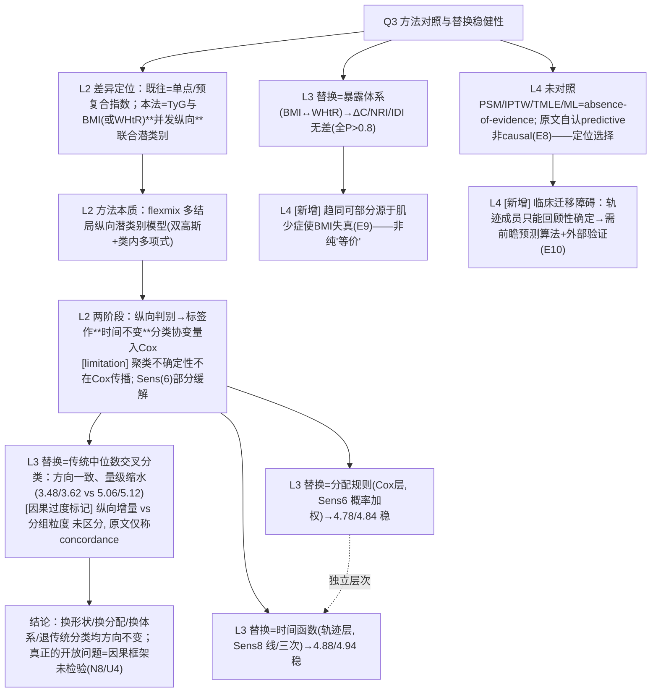

# AI-A Decision Tree Round 2 (Revised)

paper_id: paper_013
question_id: Q3
task_type: literature_decision_tree_reasoning
question: Q3 GBMTM 与既有方法区别？对照 logistic/Cox/PSM/LCA/聚类/ML。换方法结论会变吗？
source_file: adversarial_lit_reading/chunks/paper_013_joint_traj_tyg_cvd_elsa.md
critic: rounds/B_attack_tree_paper_013_Q3.md（glm provenance 已核验）

## 0. Revision Log

| attack | severity | 处置 | 修订 |
|---|---|---|---|
| Fix1 | 高 | **采纳** | N3 改为"组标签作为**时间不变分类协变量**入 Cox——标签本身来自 3 次纵向测量的联合判别，非基线单值"；补"两阶段法未在 Cox 中传播聚类不确定性，Sens(6) 仅部分缓解" |
| Fix2 | 高 | **采纳** | N4 删"轨迹信息有增量"因果主张，改"方向一致但效应量不同（原文用语 concordance）——纵向增量 vs 分组粒度两种解释未区分"；risk_tag=因果过度 |
| Fix3 | 高 | **采纳** | 新增 N10：BMI→WHtR 无差异可能部分源于肌少症偏倚（Discussion L1945–1965） |
| Fix4 | 高 | **采纳** | 新增 N11：轨迹成员只能回顾性确定→临床需前瞻预测算法（L2087–2100） |
| Fix5 | 中 | **采纳** | 树重构：方法区别(对照)/替换敏感性/因果定位 三支并列 |
| Fix6 | 中 | **采纳** | N7 改引原文"predictive rather than causal"自认 + absence-of-evidence 标注（未用 PSM/ML 是定位选择非疏漏） |
| Fix7 | 中 | **采纳** | Sens(6)（分配规则, Cox 层）与 Sens(8)（时间函数, 轨迹层）拆为两个独立节点 |
| Fix8 | 中 | **采纳** | U4：换因果框架（TMLE/IPTW）原文无证据回答；被引 [10] 的 TMLE 轨迹分析是可参考替代 |
| Fix9 | 低 | **采纳** | N1 精确化为"预复合单点指数 vs 双指标并发纵向轨迹"；N2 术语改"多结局纵向潜类别模型"；NRI/IDI 补"全 P>0.8" |

## 1. Evidence Map

| evidence_id | location | evidence_summary | role |
|---|---|---|---|
| E1 | Intro L137–153 | 既往=基线单点/单指标纵向/预复合指数 | 差异定位 |
| E2 | Methods L283–300 | GBMTM=flexmix 多结局纵向潜类别（双高斯、类内多项式） | 方法本质 |
| E3 | Methods L308–345 | 组标签=时间不变分类协变量入 Cox | 两阶段结构 |
| E4 | Sens(9); Results L1265–1273 | 中位数交叉分类：高-高 HR 3.48/3.62，原文称 concordance | 传统分类替换 |
| E5 | Sens(6) | 概率加权 Cox（Cox 层）HR 4.78/4.84≈主分析 | 分配不确定性 |
| E6 | Sens(8) | 线性/三次时间函数（轨迹层）HR 4.88/4.94 | 函数形式替换 |
| E7 | Supp Table 8 | 两体系 ΔC/NRI/IDI 无差（全 P>0.8） | 暴露体系替换 |
| E8 | 全文 absence-of-evidence | 无 PSM/IPTW/TMLE/ML 对照（与预测性定位一致） | 未采用框架 |
| E9 | Discussion L1945–1965 | 肌少症使 BMI 老年失真、WHtR 稳健 | 解释体系趋同 |
| E10 | Discussion L2087–2100 | 回顾性定组→前瞻预测算法待建 | 迁移边界 |

## 2. Decision Tree - Mermaid（终版）

## 3. Node Table

| node_id | node_type | claim | evidence_location | evidence_summary | confidence | risk_tag |
|---|---|---|---|---|---|---|
| N1 | method | 并发纵向 vs 单点/预复合 | Intro L137–153 | 精确化后 | high | |
| N2 | method | 多结局纵向潜类别（flexmix） | L283–300 | 术语修正 | high | |
| N3 | method | 标签时间不变入 Cox；两阶段不传播不确定性 | L308–345 | Sens6 部分缓解 | high | 方法误读→已修 |
| N4 | evidence | 退传统分类方向一致量级缩水 | Sens(9) | 解释未区分 | medium | 因果过度 |
| N5 | evidence | 分配规则替换稳（Cox 层） | Sens(6) | HR 4.78/4.84 | high | |
| N6 | evidence | 时间函数替换稳（轨迹层） | Sens(8) | HR 4.88/4.94 | high | |
| N7 | evidence | 体系替换无判别差 | Supp Table 8 | 全 P>0.8 | high | |
| N10 | limitation | 趋同或源于肌少症偏倚 | L1945–1965 | 新增 | medium | |
| N11 | limitation | 回顾性定组限临床迁移 | L2087–2100 | 新增 | high | |
| N8 | claim | 无因果框架对照=定位选择 | 全文 E8 | 自认 predictive | high | 可迁移性不足 |
| NA | claim | 综合 | — | — | high | |

## 4. Provisional Answer（终版）

与既有方法的差异被精确化为：既往研究用**基线单点或预复合指数**（TyG-BMI 等乘积），本文用 **flexmix 多结局纵向潜类别**把 TyG 与 BMI（或 WHtR）两条曲线**并发联合**分型；下游把组标签作为**时间不变分类协变量**送进 Cox——两阶段结构意味着聚类不确定性不在回归中传播，作者用 Sens(6) 概率加权 Cox 部分缓解。换方法结论会变吗？四个替换方向：换分配规则（加权 Cox）、换轨迹函数（线/三次）、换暴露体系（BMI↔WHtR）都保持结论；**退回传统中位数交叉分类则效应量从 ~5.1 缩到 ~3.5**——原文只称"concordance"，纵向信息增量与分组粒度差异两种解释并未区分（本树标因果过度）。作者未对照 PSM/IPTW/TMLE/ML，属 absence-of-evidence，但这与原文"predictive not causal"的自我定位一致，是选择不是疏漏；换因果框架结论如何仍无证据（引文 [10] 的 TMLE 轨迹分析是替代路径）。两个新增限定：两法趋同可能部分是肌少症使 BMI 失真的假象；轨迹成员只能回顾性确定，临床应用需前瞻预测算法——这是方法迁移的真实边界。

## 5. Uncertainty List

- U1: 组标签时间不变假设——组身份不随时间重估，若真实风险随轨迹演化则被低估。
- U2: 敏感性只测中位数一种传统分类。
- U3: 未做等价性检验（TOST），"无差异"≠"等价"。
- U4: 因果框架（TMLE/IPTW）替换后结论未知——原文无法回答。

## 6. Follow-up Questions

1. 复现是否给"轨迹 vs 基线单点"加正式对比面板（同 Cox 框架下 C-index/NRI）以直接量化纵向增量？
2. flexmix 与 Rmtraj 组标签一致性要不要在块里加交叉验证开关（默认关，迁移别的库时开）？
