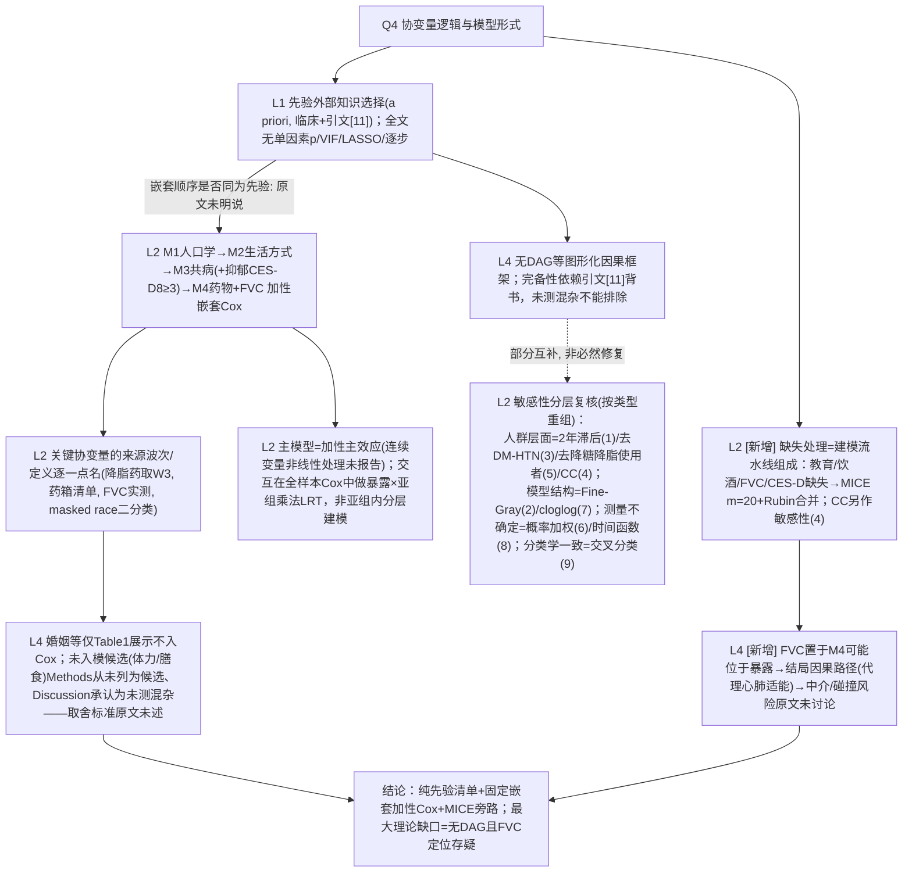

# AI-A Decision Tree Round 2 (Revised)

paper_id: paper_013
question_id: Q4
task_type: literature_decision_tree_reasoning
question: Q4 变量/协变量筛选与建模逻辑？入模依据？模型形式？是否预先确定？
source_file: adversarial_lit_reading/chunks/paper_013_joint_traj_tyg_cvd_elsa.md
critic: rounds/B_attack_tree_paper_013_Q4.md（glm provenance 已核验）

## 0. Revision Log

| attack | severity | 处置 | 修订 |
|---|---|---|---|
| Fix1 N5 | — | **采纳** | 删"无 RCS/非线性"绝对句→"原文未报告主模型对连续变量的非线性处理（RCS/样条/多项式）；模型按加性主效应 Cox 理解"；交互改"全样本 Cox 中检验暴露×亚组变量乘法交互 LRT，非仅亚组内分层建模" |
| Fix2 N4 | — | **采纳** | 未入模项按原文改写：Discussion 承认未测量混杂（体力活动/膳食/FVC 外心肺适能/降压药类别），Methods 从未将其列为候选；婚姻在 Table1 展示不入 Cox，取舍标准原文未说明 |
| Fix3 N7 | — | **采纳** | 9 项敏感性按类型重组分组标注，不再概括为"减协变量方向复核" |
| Fix4 | — | **采纳** | 新增 N8：MICE 20 套+Rubin（教育/饮酒/FVC/CES-D 抑郁）作为建模流水线组成部分 |
| Fix5 | — | **采纳** | 新增 N9：FVC 入 M4 的因果定位风险（可能位于暴露-结局路径→中介/碰撞），原文未讨论 |
| Fix6 N3 | — | **采纳** | "逐一点名"限定为关键协变量（药物来源波次、FVC、CES-D8≥3、masked race） |
| Fix7 E1 | — | **采纳** | a priori 译"基于外部知识先验选择"；"分析前确定"保留但标注依据=Methods 措辞（selected a priori），非独立可证 |
| Fix8 N6 | — | **采纳** | 降级为"未用 DAG 等图形化框架；变量集完备性依赖引文[11]；不能排除未测量混杂" |
| Fix9/10 边 | — | **采纳** | N1→N2 标注"嵌套顺序是否先验固定原文未明说"；N6→N7 降为"部分互补" |
| Fix11 E7 | — | **采纳** | 结局组分定义移出本树（与协变量筛选无关） |
| Fix12 E6 行号 | — | **rejected（附证据）** | 攻击称"L251–257 实为 GBMTM 部分"与 chunk 事实不符：MICE 段落确在 L251–258，GBMTM 自 L283 起；已对照原文复核后保留原行号 |

## 1. Evidence Map

| evidence_id | location | evidence_summary | role |
|---|---|---|---|
| E1 | Methods L229–231 | "selected a priori based on clinical relevance and existing literature [11]" | 先验声明 |
| E2 | Statistical L333–342 | M1 人口学→M2 生活方式→M3 共病(+CES-D8≥3 抑郁)→M4 药物+FVC | 嵌套结构 |
| E3 | Covariates L234–250 | 关键变量细则：降脂药 W2 无→取 W3；药物=护士访药箱清单；FVC=护士实测(L)；种族=harmonized masked White/non-White；CES-D8≥3 定抑郁 | 数据源规则 |
| E4 | Table 1 vs L333 | 婚姻等展示不入模，标准未述 | 取舍缺口 |
| E5 | L330–345 | 主模型加性主效应；亚组交互=全样本 LRT | 模型形式 |
| E6 | L251–258 | MICE m=20 + Rubin；CC 为敏感性(4) | 缺失处理 |
| E7 | Discussion L2073–2082 | 承认未测量混杂（体力/膳食/药类） | 局限侧证 |

## 2. Decision Tree - Mermaid（终版）

## 3. Node Table

| node_id | node_type | claim | evidence_location | evidence_summary | confidence | risk_tag |
|---|---|---|---|---|---|---|
| N1 | method | a priori 外部知识选择，无数据驱动筛选 | L229–231 | 明示（"预先确定"依据原文措辞） | high | |
| N2 | method | 四层嵌套加性 Cox | L333–342 | 顺序固定呈现 | high | |
| N3 | method | 关键协变量数据源逐一点名 | L234–250 | 限定"关键" | high | |
| N4 | uncertainty | 婚姻不入模无标准；未测候选未列理由 | Table1; L2073–2082 | 原文沉默 | low | 证据不足 |
| N5 | method | 加性主效应；非线性未报告；交互=全样本 LRT | L330–350 | 措辞修正后 | high | |
| N6 | limitation | 无 DAG；完备性靠引文 | L229 | 降级表述 | medium | 逻辑跳跃 |
| N7 | evidence | 敏感性按 5 类分层复核 | L350–368 | 重组后 | high | |
| N8 | method | MICE m=20+Rubin（4 变量）；CC 并行 | L251–258 | 新增 | high | |
| N9 | limitation | FVC 中介/碰撞风险未讨论 | L244–246; M4 | 新增 | medium | 因果过度 |
| NA | claim | 综合 | — | — | high | |

## 4. Provisional Answer（终版）

协变量逻辑=**纯先验外部知识**：原文声明 a priori 按临床相关性与文献[11]选定，全链无单因素 p、无 VIF、无 LASSO/逐步。建模形式为**四层嵌套加性 Cox**（M1 人口学→M2 生活方式→M3 共病含 CES-D8≥3 抑郁→M4 三类药物+FVC）；主模型未报告任何连续变量的非线性处理，交互检验是**全样本 Cox 中的暴露×亚组变量乘法交互 LRT**（不是各亚组内独立建模后再比）。关键协变量的**数据源规则被逐一点名**：降脂药因 W2 不可得取 W3（`hechmd`）、药物来自护士药箱清单、FVC 护士实测、种族用 harmonized masked 二分类——这些是 ELSA 可得性驱动的写法，跨库复现时必须重映射。缺失处理是建模流水线的正式组成：教育/饮酒/FVC/抑郁四变量 MICE m=20+Rubin，完整病例另作敏感性(4)。理论缺口两条：无 DAG（完备性只靠引文背书）；婚姻等变量只展示不入模且无取舍标准；FVC 入 M4 有落在暴露-结局因果路径上（中介/碰撞）的风险，原文未讨论。9 项敏感性对变量集的复核应按类型理解（人群排除/模型结构/测量不确定/分类学一致），不能简化成"减协变量方向"。

## 5. Uncertainty List

- U1: 引文[11]与清单逐条对应关系不明。
- U2: MICE 模型是否含结局/轨迹类信息未说明（Q5 交叉）。
- U3: CES-D 与教育/婚姻相关，未报共线性（无 VIF 程序）。

## 6. Follow-up Questions

1. 复现时嵌套四层写成 config 的显式协变量矩阵，并把"婚姻等展示不入模"固化为套路默认？
2. FVC 是否值得在复现中同时给"含/不含"两版 M4（检验碰撞风险方向）？
