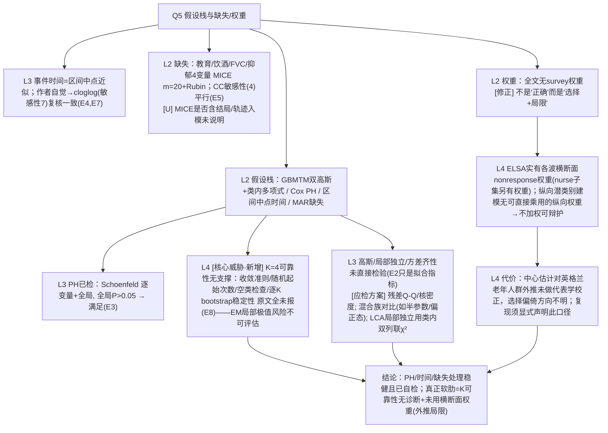

# AI-A Decision Tree Round 2 (Revised)

paper_id: paper_013
question_id: Q5
task_type: literature_decision_tree_reasoning
question: Q5 依赖哪些参数假设？是否满足？复杂抽样权重？缺失处理？
source_file: adversarial_lit_reading/chunks/paper_013_joint_traj_tyg_cvd_elsa.md
critic: rounds/B_attack_tree_paper_013_Q5.md（glm provenance 已核验）

## 0. Revision Log

| attack | severity | 处置 | 修订 |
|---|---|---|---|
| Fix3 权重 | 高 | **采纳** | 撤回"未用权重=正确"的绝对判断。事实：ELSA 提供**横断面 nonresponse weights**（各波，含 nurse 子权重）。本文做**纵向轨迹+发病 Cox**未用权重——对多波潜类别建模，横断面权重本不适用（无可直接乘的纵向权重），故不加权可辩护；但这**不是"正确"而是"方法学选择+局限"**：中心估计对 ELSA→英格兰老年人群的外推未做权重校正，方向不明。改 N6 为 uncertainty + 新增 Limitation |
| Fix1 检验方案 | 高 | **采纳** | 高斯/局部独立/方差齐性三假设的**应检方案**补齐（Q-Q/残差图、类内×结局相关、BIC 对比非高斯混合；LCA 局部独立用双列联 χ²）；标注原文均未执行 |
| Fix2 K 可靠性 | 高 | **采纳** | K 作"假设"处理：收敛判据、随机起始次数、空类、逐 K 稳定性（bootstrap）原文均未报——列为对 K=4 的核心威胁，新增 N10 |
| 其它 | 中 | **采纳** | MICE 是否含结局入模、z 标准化基准、区间中点+cloglog 复核等保留并强化 |

## 1. Evidence Map

| evidence_id | location | evidence_summary | role |
|---|---|---|---|
| E1 | L293–295 | 双结局高斯 + 类内多项式 + z 标准化 | GBMTM 假设 |
| E2 | L300–304 | 拟合充分性用 AIC/BIC/entropy/AvePP/OCC/占比 | 间接（非正态检验） |
| E3 | L342–345; Results L767–770 | Schoenfeld 逐变量+全局；全局 P>0.05 | PH 检验（已做） |
| E4 | L226–228 | 事件按波报告、区间中点 | 时间近似 |
| E5 | L251–258 | MICE m=20+Rubin；CC 敏感性(4) | 缺失 |
| E6 | 全文+ELSA 文档 | 无 survey weight 使用；ELSA 实有横断面权重可用而未用 | 权重选择 |
| E7 | Sens(7) | cloglog 复核区间删失 → HR 5.14/5.20 | 时间假设补救 |
| E8 | 全文缺失 | 收敛准则/随机起始/空类/逐 K bootstrap 未报 | K 可靠性缺口 |

## 2. Decision Tree - Mermaid（终版）

## 3. Node Table

| node_id | node_type | claim | evidence_location | evidence_summary | confidence | risk_tag |
|---|---|---|---|---|---|---|
| N1 | method | 四层假设栈 | L293–345 | 归纳 | high | |
| N2 | evidence | PH 满足 | E3 | 全局 P>0.05 | high | |
| N3 | limitation | 分布/局部独立未直接检 | L300–304 | 应检方案补齐 | high | 方法误读 |
| N10 | limitation | K 可靠性无诊断（新增核心） | E8 | 收敛/起始/空类/bootstrap 全缺 | high | 证据不足 |
| N4 | evidence | 区间中点+cloglog 复核 | E4,E7 | HR 稳 | high | |
| N5 | method | MICE m=20+Rubin；CC 敏感性 | E5 | 双轨 | high | |
| N6 | claim | 无权重=选择非"正确" | E6 | 撤回绝对判断 | high | 方法误读→已修 |
| N7 | claim | 横断面权重对纵向潜类别不适用 | ELSA 文档 | 可辩护 | medium | 可迁移性不足 |
| N8 | limitation | 外推未校正代表性 | — | 方向不明 | medium | |
| NA | claim | 综合 | — | — | high | |

## 4. Provisional Answer（终版）

假设栈四层逐一核查：**(1) Cox PH**——Schoenfeld 逐变量+全局，全部 P>0.05，满足（唯一被正式检验的假设）。**(2) GBMTM 分布/局部独立/方差齐性**——原文只用 AIC/BIC/entropy/AvePP 作拟合充分性代理，**没有对高斯性、类内局部独立、方差齐性做直接检验**；应补的方案是残差 Q-Q/核密度、半参数/偏正态混合对比、类内双列联 χ² 验局部独立。**(3) 事件时间**——波次区间中点近似，作者以 cloglog（敏感性 7）复核且结论不变，处理得当。**(4) 缺失**——仅 4 个协变量有缺失（FVC 18.53% 最高），MICE m=20+Rubin，完整病例作敏感性(4)；残留问题是 MICE 是否纳入结局/轨迹类信息未说明。

两处被攻击纠正的关键判断：**(a) 权重**——原树说"ELSA 非调查设计、不用权重=正确"是**误判**。事实是 ELSA 提供各波横断面 nonresponse 权重（护士访子集另有专用权重）。本文做纵向轨迹+发病 Cox 未用任何权重——对多波潜类别建模，横断面权重确实**没有可直接相乘的纵向版本**，不加权是可辩护的**方法学选择**；但这不等于"正确"，代价是中心估计对英格兰老年人群的总体外推**未经代表学校正**，选择偏倚方向不明，复现时必须显式声明这一口径。**(b) K 的可靠性**——K=4 不只是"选出来"，它还**隐含收敛假设**，而原文未报任何诊断：EM 收敛准则、随机起始次数、空类检查、逐 K 的 bootstrap 稳定性全部缺失，局部极值风险不可评估（复现时须由 GBMTM 块补齐这些诊断输出）。

## 5. Uncertainty List

- U1: MICE 模型是否含结局/FVC 分层信息未知。
- U2: z 标准化基于全池还是分波。
- U3: 混合模型收敛设置全缺（同 N10）。
- U4: 横断面权重缺失对患病率/HR 绝对水平的偏倚方向无法判定。

## 6. Follow-up Questions

1. 复现的 GBMTM 块是否默认输出 AIC/BIC/Entropy/AvePP/OCC/最小类占比 **+ 收敛迭代数 + 随机起始 best-of-n + 空类计数**（补齐 N10 缺口）？
2. 是否值得在敏感性里加一版"用 W2 横断面权重加权 Cox"以量化外推差异？
