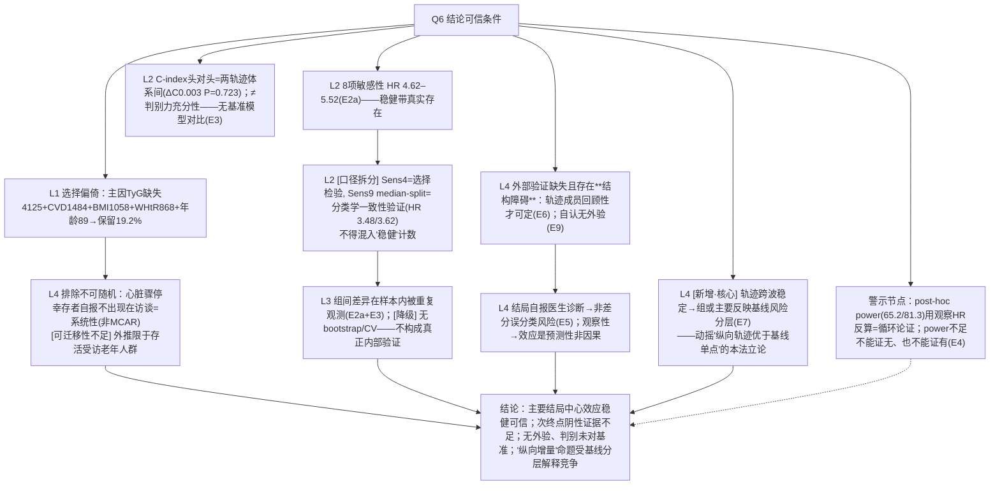

# AI-A Decision Tree Round 2 (Revised)

paper_id: paper_013
question_id: Q6
task_type: literature_decision_tree_reasoning
question: Q6 结论是否受样本构成/选择偏倚/外部验证影响？稳健性证据？
source_file: adversarial_lit_reading/chunks/paper_013_joint_traj_tyg_cvd_elsa.md
critic: rounds/B_attack_tree_paper_013_Q6.md（glm provenance 已核验）

## 0. Revision Log

| attack | severity | 处置 | 修订 |
|---|---|---|---|
| Fix1 (N2) | 高 | **采纳** | 改"9 项敏感性"为"**8 项敏感性 + 1 项分类学一致性验证**"（Sens9 median-split HR 3.48/3.62 本就不在 4.62–5.52 稳健带内，口径拆开）；E2 拆分 |
| Fix2 (N3) | 高 | **采纳** | 区分两件事：C-index 头对头比较（两轨迹体系间，E3）≠ 判别力充分性（**无基准模型**对比——原文从未把轨迹模型 vs 常规 Cox 作 C-index 差检验）。"头对头无差"不等于"判别力不足被证明" |
| Fix3 (N5) | 高 | **采纳** | N5 核心改为**结构性障碍**：轨迹成员只能回顾性确定→外部验证无法前瞻兑现（作者自认需预测算法）；补"结局自报→误分类""观察性→预测性非因果性" |
| Fix4 (M1) | 高 | **采纳** | 新增 N12：轨迹跨波稳定→组可能只反映基线分层（作者自认 L2060–2073）——直接动摇"纵向优于基线"命题 |
| Fix5 (A4) | 中 | **采纳** | post-hoc power 循环论证标注：power<80% 不能排除有意义效应 |
| Fix6 (A2) | 中 | **采纳** | N6 从"内部验证"降级为"**组间差异的重复观测**"——bootstrap/CV 从未做过，无真正的内部验证 |
| Fix7 结构 | 中 | **采纳** | N1（选择偏倚）与 N2（敏感性）并行支路；post-hoc power 拆为独立"伪验证警示"节点 |
| Fix8/9 | 低 | **采纳** | N2→N3 边删除（并列维度）；E1 补 SMD 不只结局率 |

## 1. Evidence Map

| evidence_id | location | evidence_summary | role |
|---|---|---|---|
| E1 | Methods L261–268 | 序贯排除链：9432 −89(年龄<50) −4125(TyG缺) −1058(BMI缺) −868(WHtR缺) −1484(基线CVD) = 1808；最大项为 TyG 缺失(43.7%)，非基线 CVD | 选择 |
| E2a | Sens(1)(2)(3)(5)(7)(8) | 8 项敏感性 HR 4.62–5.52 稳健带 | 稳健性 |
| E2b | Sens(4); Sens(9) | CC=选择检验；median-split=**分类学一致性验证**（HR 3.48/3.62 非敏感性） | 口径拆分 |
| E3 | Supp Table 8; L380–386 | ΔC 0.003(P=0.723)、NRI P=0.679、IDI P=0.453 ——**两轨迹体系间头对头**，无基准模型 | 判别（边界明确） |
| E4 | L786–793 | 卒中 power 65.2%/81.3%（post-hoc） | 伪验证警示 |
| E5 | Methods L219–228 | 事件自报医生诊断；波次区间 | 误分类来源 |
| E6 | Discussion L2087–2100 | 回顾性定组→需前瞻预测算法 | 外验结构障碍 |
| E7 | Discussion L2060–2073 | 轨迹稳定→或为基线分层（作者自认） | 核心命题威胁 |
| E8 | L500–520; Table1 | 高 vs 低组基线特征 SMD 有差异 | 混杂残留 |
| E9 | Discussion L1849 | 自认无外验人群 | 外部验证 |

## 2. Decision Tree - Mermaid（终版）

## 3. Node Table

| node_id | node_type | claim | evidence_location | evidence_summary | confidence | risk_tag |
|---|---|---|---|---|---|---|
| N1 | evidence | 19% 保留，排除链 | Fig1 | 明示 | high | |
| N1b | limitation | 排除非随机 | — | 推断合理 | medium | 可迁移性不足 |
| N2a | evidence | 8 项敏感性稳健带 | E2a | 4.62–5.52 | high | |
| N2b | claim | Sens9 是分类学验证非敏感性 | L2013–2027 | 口径修正 | high | 因果过度→已修 |
| N3 | limitation | 头对头≠判别充分（无基准） | E3 | 修正后表述 | high | 因果过度→已修 |
| N5 | limitation | 外验结构障碍（回顾性定组） | E6 | 核心改写 | high | 可迁移性不足 |
| N11 | limitation | 自报结局+预测性定位 | E5 | 补充 | high | |
| N12 | limitation | 轨迹≈基线分层（作者自认） | E7 | 新增 | high | 证据不足→已改claim |
| N6 | claim | 组间差异重复观测（非内部验证） | E2a,E3 | 降级表述 | medium | |
| N7 | limitation | post-hoc power 循环 | E4 | 独立警示 | medium | 因果过度 |
| NA | claim | 综合 | — | — | high | |

## 4. Provisional Answer（终版）

样本构成：**1808/9432≈19.2%**，序贯排除链的最大项是 **TyG 缺失（n=4125，43.7%）**，其后基线 CVD 1484、BMI 缺失 1058、WHtR 缺失 868、年龄<50 仅 89（Methods L261–268；Fig1 为同一链图形版）——被排者多为缺代谢测量者，不可随机补测，外推只能限定在"有空腹近似代谢数据且无 CVD 的受访老人"。稳健性证据的**正确口径是 8 项敏感性（HR 4.62–5.52）+ 1 项分类学一致性验证**——median-split 交叉分类（HR 3.48/3.62）是"轨迹法与传统分类是否自洽"的检验，混进"9 项全稳健"会虚增证据强度。判别证据同样要收窄：ΔC=0.003/NRI/IDI 是**两轨迹体系之间**的头对头（回答"用 BMI 还是 WHtR"），从未与不含轨迹的基准模型比较，所以"判别力充分"原文既未证也未否。外部验证缺失，且存在作者自认的**结构性障碍**——轨迹成员只有随访完成后回顾才可确定，没有前瞻预测算法就无法在临床上验证；效应是预测性而非因果性。最核心的新限定：作者自己承认轨迹跨波高度稳定，组别可能主要反映**基线风险分层**而非动态演变——这与"纵向信息带来增量"的立论构成直接竞争（中位数交叉分类给出的同向缩水 HR 恰好是这种竞争的部分体现）。post-hoc power 属循环论证，作为独立警示而非稳健性证据。

## 5. Uncertainty List

- U1: 无正式外部或 bootstrap/CV 内部验证。
- U2: 轨迹≈基线分层未被量化分解（截距 vs 斜率贡献）。
- U3: 卒中/心外次要终点仅单变量支持，外推有限。
- U4: 与 UKHLS/CHARLS 的方向一致性只是"支持"（引文对照），非验证。

## 6. Follow-up Questions

1. 复现能否加一个"类间截距方差 / 总方差"分解，量化作者自认的基线分层解释占比？
2. 套路交付要不要默认留 external-holdout 接口（如 ELSA 内 W2→W4 提前定组再评 W5+），缓解回顾性定组的结构障碍？
