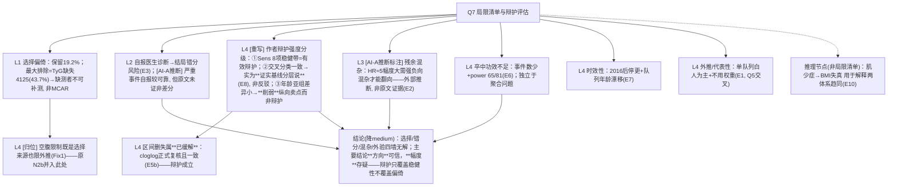

# AI-A Decision Tree Round 2 (Revised)

paper_id: paper_013
question_id: Q7
task_type: literature_decision_tree_reasoning
question: Q7 主要局限？证据是否充分证明这些不是主要限制？
source_file: adversarial_lit_reading/chunks/paper_013_joint_traj_tyg_cvd_elsa.md
critic: rounds/B_attack_tree_paper_013_Q7.md（glm provenance 已核验）

## 0. Revision Log

| attack | severity | 处置 | 修订 |
|---|---|---|---|
| Fix1 N2 | 高 | **采纳** | 节点拆分：N2a 自报诊断错分（独立）、N2b TyG 空腹构造性缺失（归入 N1 选择偏倚，非测量误差）；"非差分错分假设未证"删除，无原文依据——不冒充原文主张 |
| Fix2 N4 | 中 | **采纳** | "HR≈5 需强混杂解释掉"明确标 **AI-A 外部推断**，不作原文证据 |
| Fix3 N3 | 高 | **采纳** | 重写辩护评估：交叉分类一致其实**证实**"轨迹≈基线分层"而非反驳作者；年龄亚组差异本小是**削弱纵向卖点**的辩护，两者不得当"已排除"级辩护 |
| Fix4 补分支 | 中 | **采纳** | 新增：卒中功效不足（独立 M 节点）、区间删失**已缓解**（cloglog 复核）、外推/人群代表性节点 |
| Fix5 E9 | 中 | **采纳** | E9（无外验）角色改 context/interpretation；E5 拆两条；E1 补"仅保留 19%"量级语境 |
| Fix6 NA | 中 | **采纳** | NA 置信度 high→**medium**；答案显式写"方向可能稳健、幅度存疑" |
| Fix7 N7 | 中 | **采纳** | N7（肌少症→BMI）从"被承认局限"重定位为"解释趋同现象的推理"（作者用它解释两法等价），不计入局限清单 |

## 1. Evidence Map

| evidence_id | location | evidence_summary | role |
|---|---|---|---|
| E1 | Methods L261–268; L382–387; L2038–2044 | 9432→1808(19.2%)：−89年龄<50、−4125 TyG缺失(最大项)、−1058 BMI、−868 WHtR、−1484 基线CVD（链为序贯，逐项非可换序） | 选择量级 |
| E2 | L816–828 | 未测混杂：膳食、体力活动、FVC 外心肺适能、药类/剂量 | 混杂局限 |
| E3 | L219–228 | 事件=自报医生诊断，波次报告 | 错分来源 |
| E4 | Methods L186–196; L2073–2083; Table1 | TyG 依赖空腹 TG/葡萄糖；ELSA 非空腹采集→静脉采样近似；作者自认 | 空腹局限 |
| E5a | L312–320; L548–577 | 中位随访 6.0 年，波次区间 | 区间删失来源 |
| E5b | Sens(7) cloglog HR 5.14/5.20 | 区间删失**已有正式复核** | 已缓解证据（拆分自 E5） |
| E6 | L786–793 | 卒中 power 65.2/81.3 | 次终点功效 |
| E7 | L1884–1893 | 2016 后无后续轨迹 | 时效性 |
| E8 | L2060–2073 | 自认基线分层为主 | 概念局限 |
| E9 | L2087–2100 | 无外验+回顾性定组 | **context/interpretation**（角色修正） |
| E10 | L1945–1965 | 肌少症使 BMI 失真 | 解释趋同（非局限清单, Fix7） |
| E11 | Sens 1–9 带 4.62–5.52 | 稳健带（8 项口径, 交叉引用 Q6） | 辩护证据 |

## 2. Decision Tree - Mermaid（终版）

## 3. Node Table

| node_id | node_type | claim | evidence_location | evidence_summary | confidence | risk_tag |
|---|---|---|---|---|---|---|
| N1 | limitation | 19.2% 保留；TyG 缺失 4125 为最大项（序贯链） | E1 | 数字以正文 L261–268 为准 | high | |
| N1c | limitation | ELSA 非空腹→TyG 用静脉血近似（选择+测量双重） | E4 | 归位修正 | high | |
| N2a | limitation | 自报错分 | E3 | 拆分保留 | medium | |
| N3 | claim | 辩护三级：稳健带有效/交叉分类反证基线分层/年龄辩护削弱立论 | E8; L2013–2027 | **重写核心** | high | 因果过度→已修 |
| N3b | evidence | 区间删失已缓解 | E5b | cloglog 一致 | high | |
| N4 | claim | 混杂需很强才翻 | E2 | **AI-A 外部推断**标注 | medium | 因果过度 |
| N6 | limitation | 卒中功效独立不足 | E6 | 新增 | high | |
| N7 | limitation | 2016 停更 | E7 | 保留 | medium | |
| N10 | limitation | 外推/代表性/无权重 | E1 | 新增 | medium | 可迁移性不足 |
| N9 | method | 肌少症=趋同解释非局限 | E10 | 重定位 | medium | |
| NA | claim | 综合（high→**medium**） | — | 方向稳/幅度疑 | medium | |

## 4. Provisional Answer（终版）

主要局限按可信度分层：**无解的墙**——①选择偏倚（1808/9432≈19.2%，最大排除项为 TyG 缺失 n=4125——ELSA 非空腹采血所致，再叠 BMI 1058/WHtR 868/基线 CVD 1484/年龄 89；缺测者无法随机补测，非 MCAR，外推限于有代谢测量且无 CVD 的受访老人）；②结局自报医生诊断的错分（原文未证非差分，此点原树措辞已删）；③残余未测混杂（膳食/体力活动/药类剂量，作者自认）；④外部验证缺失且受回顾性定组的结构限制。**辩护的真相要重估**：9 项里 8 项敏感性给出 4.62–5.52 稳健带，是**有效辩护**；但"中位数交叉分类一致"其实**证实**了作者自认的"轨迹≈基线分层"，不构成反驳；"年龄亚组间差异小"同样**削弱**"纵向信息有增量"的卖点。区间删失是唯一被**正式缓解**的局限（cloglog 复核一致）。"HR≈5 需极强混杂才能解释掉"是 AI-A 的外部推断，原文未提供敏感性 E-value 类证据。**独立小局限**：卒中功效不足（65.2/81.3%）、2016 年数据停更、队列白人为主且未用权重。综合判定从原 high 降为 **medium**：主要结局的**方向**可信，效应**幅度**与"纵向优于基线"的解释存在实质不确定性。

## 5. Uncertainty List

- U1: 无定量偏倚分析（E-value/负控）评估混杂强度。
- U2: 自报结局 vs 链接病历的效度差异原文未评。
- U3: "轨迹≈基线分层"与"纵向增量"两解释未分解。
- U4: 2016 后减重代谢药普及对 BMI 类轨迹的外推影响未知。

## 6. Follow-up Questions

1. 复现是否补 E-value 或负控结局作定量偏倚评估，把"需很强混杂"从修辞变成数字？
2. 套路报告模板要不要默认输出"辩护分级"（有效/反证/削弱立论/已缓解）而非平铺局限清单？
