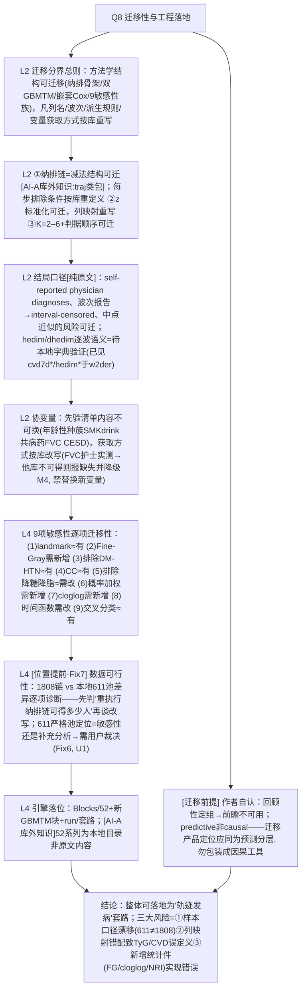

# AI-A Decision Tree Round 2 (Revised)

paper_id: paper_013
question_id: Q8
task_type: literature_decision_tree_reasoning
question: Q8 本研究哪些部分最可能迁移/改写为另一套常规分析流程？迁移后主要风险？
source_file: adversarial_lit_reading/chunks/paper_013_joint_traj_tyg_cvd_elsa.md
critic: rounds/B_attack_tree_paper_013_Q8.md（glm provenance 已核验）

## 0. Revision Log

| attack | severity | 处置 | 修订 |
|---|---|---|---|
| Fix1 拆 E1 | 高 | **采纳** | 全流程拆为 7 步，每步带精确行号：纳排 L261–268+Fig1；伦理/公开 L180–182；暴露 L186–196；GBMTM L283–310；协变量 L229–257；主 Cox+交互 L312–350；判别/敏感性 L350–380（Fine-Gray L350–354、加权 L308–310+Sens6、cloglog Sens7、NRI/IDI L380–386） |
| Fix2 N3 行号 | 高 | **采纳** | 重写为纯原文证据：interval-censored（波次报告）、区间中点、self-reported physician diagnoses；"hedim/dhedim 逐波标签语义"降级为**待本地 dta 字典验证**（已在 exploration/*.txt 完成部分验证：cvd7d*/hedim* 存在于 w2der） |
| Fix3 N7 定义 | 高 | **采纳** | 改"重执行纳排链"：文献链 9432−89−4125−1058−868−1484=1808（序贯，顺序不可换）；本地 611 池链差异逐项诊断；不预设"提取缺失=重提取" |
| Fix4 N4 原则 | 高 | **采纳** | 区分"先验清单内容"（Age/Sex/种族/吸烟/饮酒/身体活动?/共病/用药/FVC/CES-D——**清单本身不可随意换**）与"获取方式"（列名/波次/派生规则按库改写）；FVC 在 CHARLS 类库不可得→**报告缺失并降级 M4**，不得替换为新变量 |
| Fix5 N5 逐项 | 高 | **采纳** | 9 项敏感性逐个标注可迁移性 + 引擎现状：Fine-Gray/cloglog/NRI-IDI 需新增；landmark/排除/Fine-Gray 权重有近似块 |
| Fix6 U-系列 | 高 | **采纳** | **611 严格池定位问题显式化为独立决策节点**：敏感性 vs 主分析定位需用户裁决（两种报告方式不同） |
| Fix7 节点序 | 中 | **采纳** | N7（数据可行性）移到 N6（引擎落位）之前 |
| Fix8 N0 前提 | 中 | **采纳** | N0 下加"原文自认局限=迁移前提条件"子节点 |
| Fix9 概念/代码二分 | 中 | **采纳** | N2 每行标"方法学结构可迁移 vs 代码/列映射按库重写" |
| Fix10 库外知识标注 | 低 | **采纳** | traj/Rmtraj/nagatraj、hedim/dhedim、52 系列 统一标 **AI-A 库外知识** |

## 1. Evidence Map（拆分后）

| evidence_id | location | evidence_summary | role |
|---|---|---|---|
| E1a | L261–268 + Fig1 | 序贯纳排链 9432→1808 | 可迁移骨架 |
| E1b | L180–182 | 公开数据+伦理声明 | 不可迁移(数据权属) |
| E1c | L186–196 | TyG=ln(TG×glucose/2)；非空腹近似 | 公式可迁/来源按库 |
| E1d | L283–310 | flexmix GBMTM 双结局 z 标准化 K=2–6、MAP 参照 | 方法块 |
| E1e | L229–257 | 协变量先验清单+MICE m=20 | 清单固定/获取改写 |
| E1f | L312–350 | 嵌套 Cox+Schoenfeld+交互 LRT | 引擎已有 |
| E1g | L350–386 | Fine-Gray/cloglog/概率加权/NRI-IDI | 部分需新增 |
| E2 | Methods Outcome L219–228 | 自报医生诊断+波次报告=区间删失 | 本地映射触发点 |
| E3 | 本地字典 exploration/ | cvd7dihb 等"Ever reported…diagnosed"+w2–w9 存在 | Fix2 验证材料 |

## 2. Decision Tree - Mermaid（终版）

## 3. Node Table

| node_id | node_type | claim | evidence_location | evidence_summary | confidence | risk_tag |
|---|---|---|---|---|---|---|
| N0p | claim | 迁移产品定位=预测分层非因果 | Discussion L2087–2100 | 作者自认 | high | 可迁移性不足 |
| N1 | method | 结构可迁/列映射重写 | 全 Methods | 二分原则 | high | |
| N2 | method | 纳排链/GBMTM/K 判据可迁 | L261–268; L283–310 | traj 包=库外知识已标 | high | |
| N3 | method | 结局口径映射 | L219–228 | 原文+本地验证中 | high | |
| N4 | limitation | 清单内容 vs 获取方式 | L229–257 | FVC 缺失须报不须换 | high | |
| N5 | claim | 敏感性 9 项分级迁移性 | L350–386 | FG/cloglog/加权需新增 | high | 证据不足→已补 |
| N7 | uncertainty | 1808 vs 611 定位 | L382–387 | 差异诊断先行+用户裁决 | medium | 逻辑跳跃→已拆 |
| N6 | method | 引擎块落位 | 本地结构 | 52 系列标库外 | high | |
| NA | claim | 三大风险 | — | 口径/映射/新增件 | high | |

## 4. Provisional Answer（终版）

最可迁移的是七步**方法骨架**：①序贯纳排减法结构（数字链按库重跑，9432→…→1808 的每步条件按库定义）；②双暴露体系 GBMTM（flexmix，K=2–6、AIC/BIC 主选+指标后验）；③组标签→嵌套 Cox M1–M4 + Schoenfeld + 交互 LRT（引擎 Blocks/52 已具备）；④中位数交叉分类与概率加权两版对照；⑤9 项敏感性族——但**逐分级**：landmark/排除人群/CC/交叉分类≈现有块可用，Fine-Gray、cloglog 区间删失、概率加权 Cox、线性/三次时间函数四项需新实现；⑥判别 ΔC/NRI/IDI。改写原则二分：**先验协变量清单内容不可换**（年龄/性别/种族/吸烟/饮酒/共病/药物/FVC/CES-D8），**获取方式必须按库重写**（如 FVC 在 CHARLS 类库不存在→如实报缺失并降级 M4，禁止找个新变量顶替）；结局"自报医生诊断+波次报告→区间删失+中点"可整体迁移，但本地 `hedim*` 类逐波诊断标签语义需在 dta 字典验证（已初步确认 w2der 存在 cvd7d*/hedim* 系）。落地三大风险：样本口径漂移（本地 611 严格池 ≠ 文献 1808——先做差异诊断，且 611 池定位为敏感性还是补充分析**需要用户裁决**，此为流程外新增设计）；列映射错配（TyG 成分/诊断码误挂）；新增统计件实现错误。产品定位遵循作者自认：预测分层工具，不包装因果结论。

## 5. Uncertainty List

- U1: 611 严格池 vs 1808 复刻池——**用户裁决点**（定位不同则报告口径不同）。
- U2: 引擎对 Fine-Gray/cloglog/NRI-IDI 的支持现状待代码盘点确认（Blocks grep）。
- U3: 本地列映射需逐波标签语义验证（exploration 已导出，待脚本消费）。
- U4: 随访中点时间与 ELSA wave 年份差在本地 data 字典的对应规则。

## 6. Follow-up Questions

1. 先跑"611 vs 1808 差异诊断表"再让用户裁决池定位，还是直接按 1808 链重执行？
2. Fine-Gray/cloglog 是写进 Blocks/52 新块，还是先以课题脚本验证再引擎化？
