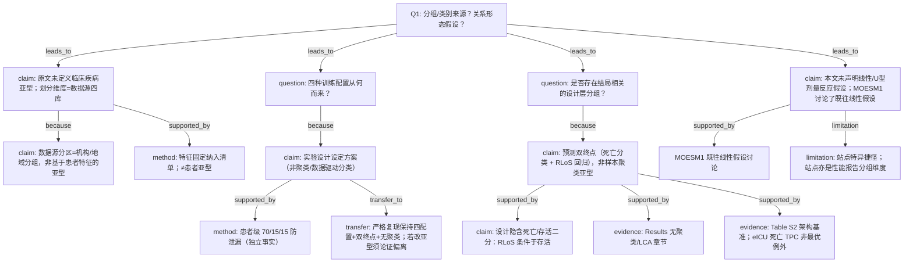

# AI-A Decision Tree Round 2 (Revised)

paper_id: paper_025
question_id: Q1
task_type: literature_decision_tree_reasoning
question: 本研究预设了几个分组/亚型/类别？该数量是数据驱动还是研究者主观指定？是否假设了暴露-结局关系的方向（线性、单调、U型）？
source_file: adversarial_lit_reading/chunks/paper_025_allyn_2026_blended_los_pooling.md (+ MOESM1/MOESM2)
revision_of: rounds/A_tree_round1_paper_025_Q1.md
attack_source: rounds/B_attack_tree_paper_025_Q1.md

## Revision Log

| attack_id | severity | action | change |
|---|---|---|---|
| N-07 | 高 | 采纳 | 补充「死亡 vs 存活」设计层二分（RLoS 条件于存活） |
| N-11 | 高 | 采纳 | 写入 MOESM1 对既往线性假设的讨论语境；澄清本任务为非线性可捕捉的多任务 DL |
| E-08 / VP-06 | 高 | 采纳 | 「非亚型」证据改为 Results 无聚类/LCA 章节，而非仅叙事顺序 |
| VP-02 / N-05 | 高 | 采纳 | 删除用 70/15/15 证明「非聚类」的逻辑；划分仅作防泄漏事实 |
| N-04 / VP-01 | 中 | 采纳 | 「先验指定」→「实验设计设定方案，非数据驱动分类」 |
| N-13 | 中 | 采纳 | 迁移建议改为「严格复现须保持…；若改做亚型须论证偏离」 |
| N-01 / E-01 | 中 | 采纳 | 明确数据源分区=机构/地域分组维度，≠临床亚型 |
| N-10 | 中 | 部分采纳 | 特征为固定纳入清单；注明变量集合≠患者亚型 |
| N-08 | 低 | 采纳 | Table S2 注明 eICU 死亡 AUROC 上 TPC 非最优例外 |

## 1. Evidence Map

| evidence_id | location | evidence_summary | used_by_node |
|---|---|---|---|
| E1 | Abstract / Methods | 四库 BlendedICU；TPC 联合预测 ICU 死亡 + RLoS | N1, N7 |
| E2 | Fig.1 / Table3 | 四种训练配置：单源×2、迁移、池化（实验设计设定） | N4 |
| E3 | Methods / Fig.1 | 患者级 70/15/15 划分防泄漏（不证明有无聚类） | N5 |
| E4 | MOESM1 two-stage | RLoS 假定存活出院；死亡者不计入 RLoS 评估；损失 α=20 | N7, N7b |
| E5 | MOESM2 Table S2 | LSTM/Transformer/TPC 基准；eICU 死亡 AUROC 上 TPC 非最优 | N8 |
| E6 | Results 全文结构 | 无聚类/LCA/亚型发现章节；为预测性能评估主线 | N9 |
| E7 | MOESM1 Feature Selection | 固定纳入人口学+时序+17药，非聚类形成特征亚组 | N10 |
| E8 | MOESM1 Experimental designs | 讨论既往研究「assumed a linear relation…LOS」；本文改用时序 DL | N11 |
| E9 | Discussion | site-specific / drug exposure 捷径学习 | N12 |

## 2. Decision Tree - Mermaid

## 3. Node Table

| node_id | node_type | claim | evidence_location | evidence_summary | confidence | risk_tag |
|---|---|---|---|---|---|---|
| N0 | question | 分组来源与关系形态？ | Q1 | 根问题 | high | — |
| N1 | claim | 原文未定义疾病亚型；划分维度为四库数据源 | Abstract; Methods | 四库对照 | high | — |
| N1b | claim | 数据源分区是机构/地域分组，不是临床特征亚型 | Fig.1; Table1 | 按库报告 | high | — |
| N3 | question | 四种训练配置如何选定？ | Fig.1 | 设计问题 | high | — |
| N4 | claim | 四种配置为实验设计设定，非数据驱动分类结果 | Fig.1; Table3 | ①–④ | high | — |
| N5 | method | 患者级 70/15/15 防泄漏（不用于证明有无聚类） | Methods | 划分比例 | high | — |
| N6 | question | 是否存在结局相关设计层分组？ | MOESM1 | 设计问题 | high | — |
| N7 | claim | 双终点多任务预测；非样本聚类亚型 | Methods | 死亡+RLoS | high | — |
| N7b | claim | RLoS 条件于存活 → 设计层死亡/存活二分 | MOESM1 | 评估时死亡者不计 RLoS | high | — |
| N8 | evidence | 架构基准；eICU 死亡 TPC 非最优 | MOESM2 Table S2 | 例外已记 | high | — |
| N9 | evidence | Results 无聚类/LCA/亚型发现章节 | Results | 负向证据 | high | — |
| N10 | method | 特征固定纳入；不是患者亚型定义 | MOESM1 | 变量清单 | high | — |
| N11 | claim | 本文未声明线性/U型假设；MOESM1 讨论既往线性 LOS 模型 | MOESM1 Experimental designs | 语境有、假设无 | high | — |
| N12 | limitation | 捷径学习；站点是评价分组维度 | Discussion | shortcut | medium | 可迁移性不足 |
| N13 | transfer | 严格复现保持原文设计；偏离须论证 | Q8 | 复现边界 | medium | — |

## 4. Provisional Answer（终版）

1. **临床亚型/聚类**：原文**没有**数据驱动定 K（无 LCA/聚类）。  
2. **设计层「分组」**有三类应区分：  
   - **数据源四库**（机构/地域分组，先验实验分区）；  
   - **四种训练策略**（单源×2 / 迁移 / 池化，实验设计设定，非聚类）；  
   - **死亡 vs 存活**（RLoS 条件于存活的设计二分，非聚类亚型）。  
3. **关系形态**：本文未声明暴露-结局线性/单调/U 型剂量反应；任务是时序深度多任务预测（可捕捉非线性）。MOESM1 讨论了既往线性 LOS 假设，那是文献背景而非本文假设。  
4. **70/15/15** 仅是防泄漏划分，**不能**用来证明「有无聚类」。

## 5. Uncertainty List

- 为何选定 Amsterdam+MIMIC 做池化/迁移、eICU/HiRID 作未见外验：原文有设计陈述，备选配对准则细节有限。  
- α=20、RLoS cap=10 的敏感性：主文未系统报告。  
- 本地提取包 PI-3：原文精确 N 构造未完全公开，复现用同规则重抽。

## 6. Follow-up Questions

- Q2：双终点 + Mcomposite 是否构成多重比较问题？  
- Q3：TPC vs LSTM/Transformer 的选择与稳健性（含 eICU 例外）。  
- Q5：MNAR、前向填充+mask、clip/归一化。  
- Q8：公开 BlendedLoS + 本地四库提取如何接到引擎 batch。
