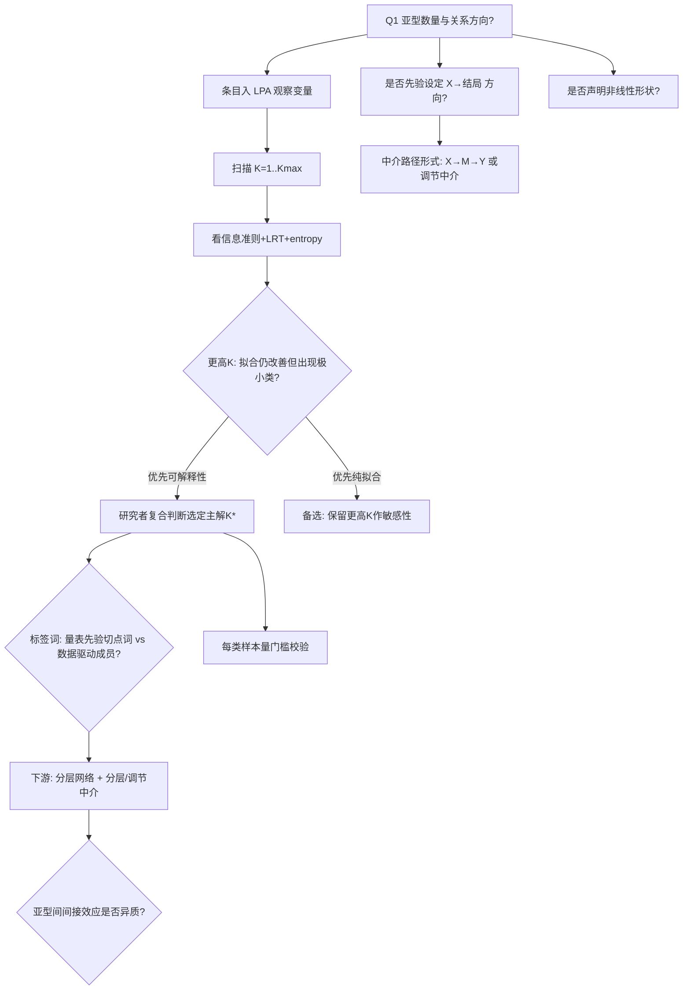

# AI-A Revised Decision Tree

paper_id: paper_060  
question_id: Q1  
revision_source:
  - original_tree: rounds/A_tree_round1_paper_060_Q1.md
  - attack_file: rounds/B_attack_tree_paper_060_Q1.md
  - paper: chunks/paper_060_2026_ma_soc_lpa_network_mediation_42214160.md

## 1. Revised Evidence Map

| evidence_id | location | evidence_summary | used_by_node |
|---|---|---|---|
| E1 | Methods 2.3(2); Table 2 | 拟合 K=1…5；报告 AIC/BIC/aBIC、entropy、LMR、BLRT | N2,N3 |
| E2 | Results 3.2; Table 2 | LMR/BLRT 支持至更高 K；更高 K 含极小类；作者综合拟合+可解释性选 3 类 | N4,N5 |
| E3 | Methods 2.2.2 | 量表说明书已有高/中/低总分切点词汇 | N5b |
| E4 | Results 3.2 | 剖面标签按条目模式命名，与量表切点词汇同源但成员划分来自 LPA | N5,N5b |
| E5 | Methods 2.3(4); Intro H3 | 中介为 moderated mediation；IV 可为连续总分或剖面；路径方向理论先验 | N7,N7a |
| E6 | Methods 2.3; Results | 未见 RCS/非线性形状声明 | N8b |
| E7 | Results 3.4.2; Table 6 | 各剖面间接效应异质（有显著/不显著/边际） | N6b |
| E8 | Methods 2.4 | 规划每类人数门槛与总样本门槛 | N9 |

## 2. Revised Decision Tree - Mermaid

> 脱敏：无具体病名/量表专名/确切 n/确切 P。

## 3. Node Table

| node_id | node_type | claim | evidence_location | evidence_summary | confidence | risk_tag |
|---|---|---|---|---|---|---|
| N1 | method | 用条目而非硬切总分做潜剖面 | Methods 2.3(2) | 条目入模 | high | |
| N2 | method | K 扫描数据驱动 | Methods 2.3(2) | 1–5 类 | high | |
| N3 | method | 多指标联合参考 | Table 2 | 准则+LRT | high | |
| N4 | claim | 更高 K 统计未自动否决；极小类+可解释性驱动弃用 | Results 3.2 | LRT 仍可显著但类退化 | high | |
| N5 | claim | 主解 K* 为研究者复合最优而非纯自动选模 | Results 3.2 | fit+clinical relevance | high | |
| N5b | uncertainty | 标签词借用量表高低中词汇；成员由 LPA 划分 | Methods 2.2.2; Results 3.2 | 先验词表≠先验成员 | medium | 证据不足若声称完全事后语义 |
| N6 | method | 剖面用于分层网络与调节/分层中介；全样本亦可连续 X | Methods 2.3(3)(4) | overall + subgroups | high | |
| N6b | evidence | 亚型间中介异质支持剖面功能差异 | Results 3.4.2; Table 6 | 间接效应不等 | medium | |
| N7a | claim | 方向先验：保护性暴露→更低痛苦（经中介） | Intro H3; Table 5 | 相关与假设 | high | |
| N7 | method | 路径为中介/调节中介；X→M→Y 为提炼式而非原文符号 | Methods 2.3(4) | moderated mediation | high | 因果过度若忽略横断面 |
| N8b | limitation | 未声明线性/单调/U 型形状 | Methods | 无 RCS | high | |
| N9 | method | 类样本量门槛作为稳定性条件 | Methods 2.4 | 每类人数门槛 | medium | |
| Alt4 | transfer | 更高 K 可作敏感性，非本文主解 | Results 3.2 | 备选路径 | medium | |

## 4. Final Answer（脱敏）

1) **类别来源**：数据驱动扫描 K，但**最终 K* 是拟合指标 + 极小类 + 临床可解释性的复合选择**，不是纯自动选模；更高 K 在似然比意义下仍可能「显著」，因退化类被弃。  
2) **标签**：高低中词汇与量表说明书切点词同源，**类成员划分**来自 LPA。  
3) **方向**：先验设定保护性暴露→（经认知中介）→痛苦；**形状**（线性/U 型）原文未声明。  
4) **角色**：亚型既是人中心分组，也作调节/分层轴；同时保留连续 X 的全样本中介。

## 5. Uncertainty List

- U1: 四类 vs 三类的可解释性权重未量化。  
- U2: 软分类不确定性未传入中介。  
- U3: 横断面下 X→M→Y 时序不可证实。

## 6. Follow-up Questions

1. 迁移课题是否预注册 K 选择规则（纯 BIC vs 可解释性优先）？  
2. 是否将更高 K 固定为敏感性表？

## 7. Revision Log

| 批评 | 严重度 | 处理 |
|---|---|---|
| ATK-N2/N4：LRT 未否决更高 K | 高 | 采纳：N4 改为「拟合仍改善但极小类」；增加 Alt4 |
| ATK-N3：K* 非纯数据自动 | 高 | 采纳：N5 写明复合判断 |
| ATK-N4/N8：缩小「方向」问题 | 高 | 采纳：拆 N7a（方向）与 N8b（形状） |
| E4 忽略量表先验切点词 | 高 | 采纳：新增 N5b |
| N5→N7 依赖关系不当 | 中 | 采纳：N7a/N7/N8b 从 Q1 并列分出 |
| 遗漏亚组中介异质 | 中 | 采纳：N6b |
| IV 连续/分类双设定 | 中 | 采纳：写入 N6 |
| 样本量门槛入树 | 低 | 采纳：N9 |
