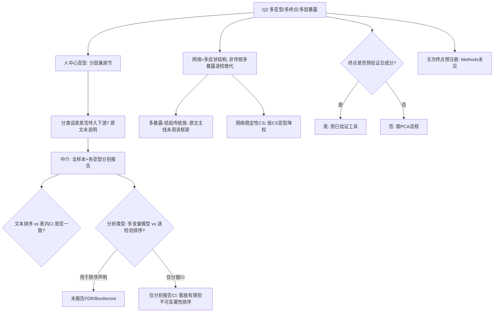

# AI-A Revised Decision Tree — paper_060 / Q2

revision_source: A_tree_round1 + B_attack_tree_paper_060_Q2.md

## 1. Revised Evidence Map

| evidence_id | location | evidence_summary | used_by_node |
|---|---|---|---|
| E1 | Methods 2.3(2); Results 3.2 | 人中心 LPA 亚型供下游分层/调节 | N1 |
| E2 | Methods 2.3(3) | 多症状条目入网络；回答结构关联而非传统多暴露回归族 | N2 |
| E3 | Methods 2.3(4); Table 6 | All+各亚型分别估中介；文本与表对「哪类最强」存在不一致风险 | N3,N3b |
| E4 | Methods; Table 1 note | 未见 Bonferroni/FDR；有多变量模型与 Fisher 选择意识 | N4 |
| E5 | Methods 2.2.4 | 情绪结局为预先验证合成分工具，非数据 PCA | N5 |
| E6 | Methods 2.3(3) | 报告 CS 稳定性；Profile1 CS 偏低需标局限 | N7 |
| E7 | Methods | 未见主次终点预注册声明（未报告≠证实未做） | N6 |

## 2. Mermaid（脱敏）

## 3. Final Answer

1) **多亚型**：LPA 亚型作分层/调节轴，网络与中介在全样本+各亚型分别报告。  
2) **多层/多症状**：网络处理症状关联结构，**不能**等同于解决传统多暴露-结局多重检验；中介仍以单一中介总分。  
3) **多重比较**：原文未报告 FDR/Bonferroni；对多变量模型与「仅分报 CI」场景，不宜从沉默直接判「有罪膨胀」；若用亚型间显著性排序则有族水平风险。  
4) **复合终点**：用预先验证合成分工具，不是数据驱动 PCA。  
5) **额外**：需警惕 Results 叙述与 Table 中介 CI 对「哪类最强」可能不一致；低 CS 亚型网络解释需降权。

## 4. Revision Log

| 批评 | 严重度 | 处理 |
|---|---|---|
| 网络≠多暴露解决方案 | 高 | 采纳 N2/N2b |
| Table6 vs 文本矛盾 | 高 | 采纳 N3b |
| 沉默→膨胀跳跃 | 高 | 采纳 N4/N4a/N4b |
| U1 高估膨胀 | 高 | 采纳限定 |
| PHQ 预验证限定 | 中 | 采纳 N5a |
| CS 低 | — | 采纳 N7 |
