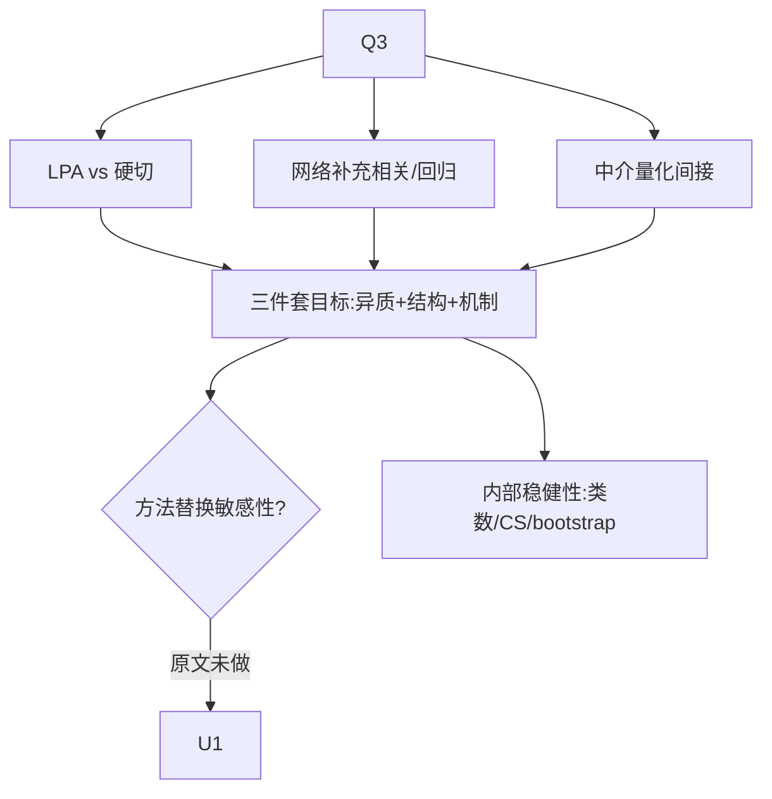

# AI-A Revised — paper_060 / Q3

## Final Answer
相对总分硬切+单回归，本文组合 **LPA（人中心）+ graphical LASSO 网络（结构）+ 调节/分层中介（机制）**。网络与相关分析**并列补充**，非替代。机制结论部分成立（部分亚型中介不显著）。
**方法替换敏感性**（LCA/K-means/SEM 换 LPA）原文未做；但有**内部稳健性**：LPA 1–5 类比较、网络 CS bootstrap、中介 bootstrap。

## Mermaid

## Revision Log
- 高: 网络非替代相关 → 改为补充并列
- 高: 区分内部稳健性 vs 方法替换敏感性
- 中: 机制部分成立限定
