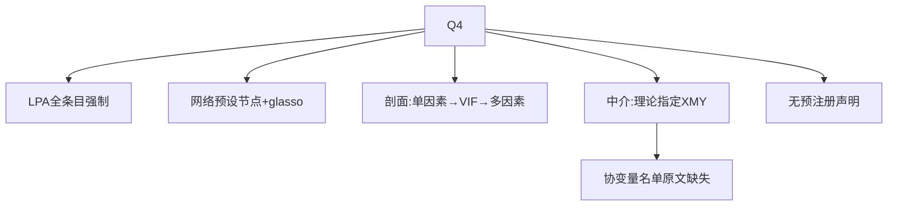

# AI-A Revised — paper_060 / Q4

## Final Answer
三类模型入模逻辑不同：
1) **LPA**：量表条目强制入模（结构先验）
2) **网络**：预设节点集；边用 **graphical LASSO** 稀疏化（非预测筛选 LASSO）
3) **剖面预测 Logistic**：单因素显著 → VIF&lt;5 → 多因素（**数据驱动，非预注册变量集**）
4) **中介**：X/M/Y 由理论 H3 先验；**协变量名单原文未列出（可重复性缺口）**；为 moderated mediation（剖面调节）
原文**无**变量筛选预注册/分析计划声明；入模逻辑从 Methods 事后反推。未见 DAG/逐步；勿把「未见 LASSO」说成绝对——网络估计用了 glasso。

## Mermaid

## Revision Log
- 高: N6 区分 glasso vs 筛选LASSO；承认调节中介
- 高: N5 升级为协变量名单关键缺失
- 高: N7 改为无预注册/事后反推
- 高: 顶层分叉三类入模逻辑
