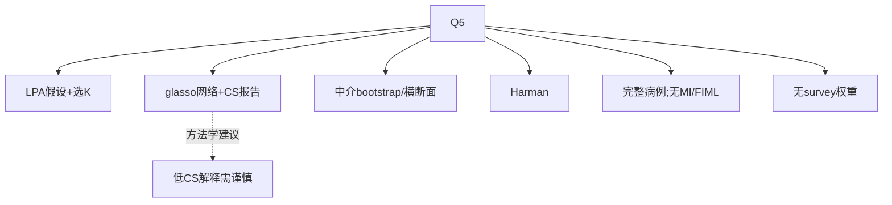

# AI-A Revised — paper_060 / Q5

## Final Answer
假设：LPA 混合模型；网络为 **graphical LASSO** 稀疏网（原文未写 EBICglasso）+ case-dropping CS；中介 bootstrap；横断面时序不可证实。做了 Harman。设计**非调查加权**。缺失：约 20% 无效问卷剔除后 **完整病例**；未见剩余缺失的 MI/FIML。低 CS 为稳定性报告；**原文未据此自动降权解释**（降权属方法学建议）。

## Mermaid

## Revision Log
- 高: 删除 EBICglasso 误标
- 高: 完整病例 vs 未见MI 区分
- 高: N2→N7 改为建议边非原文因果
