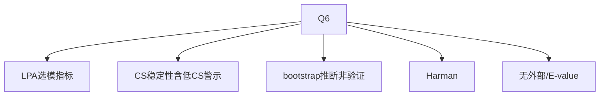

# Revised Q6
## Answer
- LPA 多K指标=**选模**，不是交叉验证。
- 网络 CS 须报数值；低 CS 剖面标「稳定性不足」。
- 中介 bootstrap=**推断方法**；须呈现亚型间显著/不显著异质，不能统一说「已验证」。
- Harman=数据质量检查。
- 无外部验证/E-value/阴性对照；无方法替换敏感性。
## Mermaid

## Revision Log
- 高：选模≠验证；补 CS 阈值风险；bootstrap 归推断；亚型异质必报。
