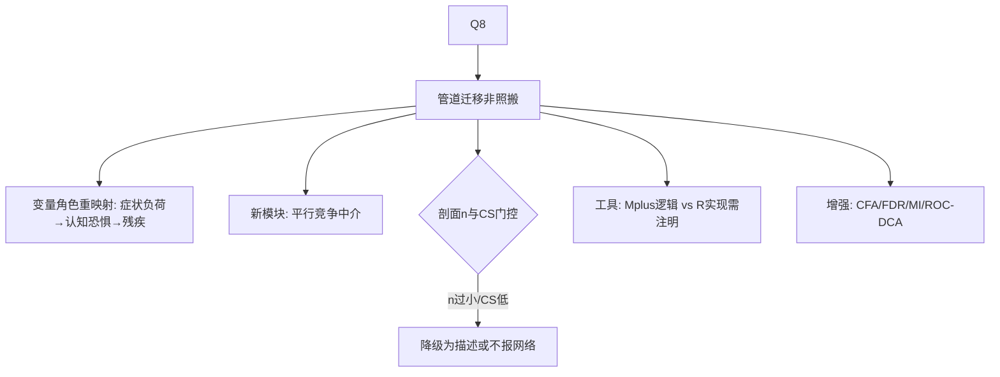

# AI-A Revised — paper_060 / Q8（吸收高严重度）

## Final Answer
1) **不是「直接复用」**：是**管道迁移+实质重设**——LPA 观察变量改为 DAS 条目；网络节点重映射；中介从「单中介+剖面调节」改为「平行竞争中介（SSD-12∥Whiteley）」属**新模块**（原文无），需方法学自洽而非简单改编。  
2) **角色映射**：原文 X=资源（SOC）；本课题 X=症状负荷（PHQ-15/SSS-8）——理论方向不同（负担↑→残疾↑），须预声明。M=过度关注/恐惧；Y=WHO-DAS。  
3) **条件门控**：每剖面 n 门槛（原文规划>80）；小剖面不做正式网络/仅描述；节点数控制，CS 过低不报强结论。  
4) **工具**：原文 LPA 在 Mplus；R 的 tidyLPA/mclust 需注明算法差异，必要时对照。  
5) **可迁移框架**：K 扫描+复合选模、glasso+CS/桥、bootstrap 间接效应、剖面分层比较。  
6) **增强**：CFA 区分效度、竞争/反向模型、FDR、MI/FIML、ROC/DCA（反馈）。

## Mermaid

## Revision Log
- 高: 「直接复用」→管道实质转换
- 高: 暴露属性资源vs负担
- 高: 平行竞争中介=新模块
- 高: 剖面样本量/节点数/CS 门控
- 高: Mplus vs R 工具差异
