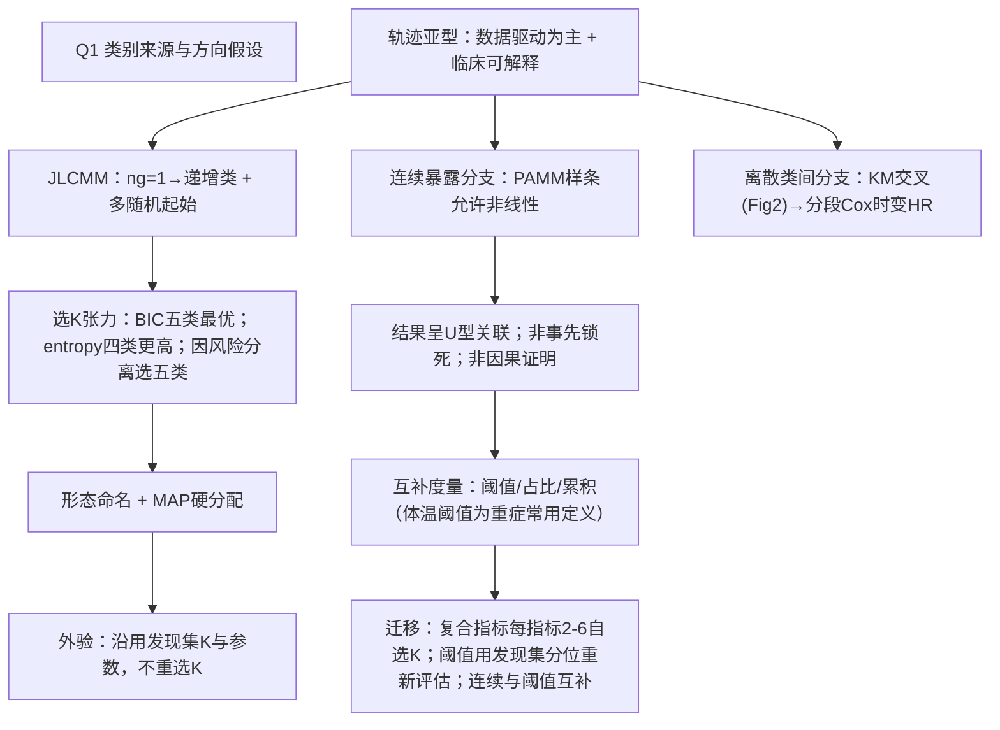

# AI-A Decision Tree Round 2 (Revised)

paper_id: paper_1871653
question_id: Q1
task_type: literature_decision_tree_reasoning
question: Q1 类别数量来源与暴露-结局方向假设
source_file: adversarial_lit_reading/chunks/paper_1871653_fcimb_temperature_jlcm.md

## Revision Log

| attack_id | severity | action | change |
|---|---|---|---|
| N-A1 | 中 | 采纳 | 「数据驱动」→「数据驱动为主，辅以临床可解释性」 |
| N-A2 / MB-1 | 中 | 采纳 | 补 entropy 四类最优 vs BIC 五类 + 风险分离 的张力 |
| N-A5 / EP-4 | 中 | 采纳 | 区分方法能力 vs 结果呈现；U 型为关联非因果（MB-4） |
| N-A6 / EP-2 | 高 | 采纳 | KM 交叉证据改 Results 3.2/Fig2 |
| E-A4 | 高 | 采纳 | 拆开连续 PAMM 与类间分段 Cox 为平行分支 |
| E-A5 | 中 | 采纳 | 四套互补度量挂在 PAMM 分支 |
| N-A8 | 中 | 采纳 | 阈值「重新评估」；连续与阈值互补非降级 |
| MB-2 | 中 | 采纳 | 外验沿用发现集 K，不重选 |

## 1. Evidence Map

| evidence_id | location | evidence_summary | used_by_node |
|---|---|---|---|
| E1 | Methods 2.5.1 | JLCMM；ng=1 起步；递增类数 + grid search | N2 |
| E2 | Methods 2.5.1 | 选 K：BIC、后验概率、entropy、临床可解释；≥5%；MAP | N3 |
| E3 | Results 3.2 | BIC 五类最低；entropy 四类最高、五类略降；五类风险分离更清晰 → 主分析 5 类 | N3 |
| E4 | Results 3.2 / Fig1 | 五类按轨迹形态命名 | N4 |
| E5 | Methods 2.5.3 | PAMM 惩罚样条允许非线性与时间交互 | N5 |
| E6 | Results / Fig5 | 连续暴露–死亡呈 U 型关联（观察性） | N6 |
| E7 | Results 3.2 Fig2 + Methods | KM 交叉 → 分段 Cox | N7 |
| E8 | Methods 2.5.3 | 连续/阈值/占比/累积四套互补；阈值 ≤36/≥39 °C | N8 |
| E9 | Methods 2.5.4 | 外验用发现集参数估后验类概率（K 沿用） | N10 |

## 2. Decision Tree - Mermaid

## 3. Node Table

| node_id | node_type | claim | evidence_location | evidence_summary | confidence | risk_tag |
|---|---|---|---|---|---|---|
| N1 | claim | 选类以数据准则为主，含临床可解释 | Methods 2.5.1 | 非纯算法 | high | |
| N3 | evidence | 五类为权衡结果 | Results 3.2 | BIC vs entropy | high | |
| N6 | evidence | U 型为结果关联 | Fig5 | 观察性 | high | 因果过度 |
| N7 | method | 分段 Cox 因 Fig2 交叉 | Results 3.2 | 证据在 Results | high | |
| N8 | method | 四套互补 | Methods 2.5.3 | 阈值病种语境 | high | |
| N9 | transfer | COPD 复合指标迁移口径 | 用户确认 | P5/P95 锁定 | high | |
| N10 | method | 外验不重选 K | Methods 2.5.4 | 固定参数 | high | |

## 4. Provisional Answer

轨迹类数是**以 BIC/后验/entropy/≥5% 为主、辅以临床可解释性**的选择；本文在 entropy 偏向四类与 BIC/风险分离偏向五类之间权衡后锁定 **5 类**。外验**沿用**发现集类数与参数。暴露–结局：PAMM **允许**非线性，结果呈 **U 型关联**（非事先假定、非因果证明）；类间生存因 KM 交叉用分段 Cox。阈值三套与连续分析**互补**。迁移到复合指标：每指标 2–6 自选最优；阈值用发现集分位重新评估并锁定。

## 5. Uncertainty List

- U1: grid search 类数搜索上限原文未写死数值范围。
- U2: PAMM 区间长度/平滑参数细节原文有限。

## 6. Follow-up Questions

1. （已由用户确认）COPD：K1 每指标自选；P5/P95 发现集锁定。
