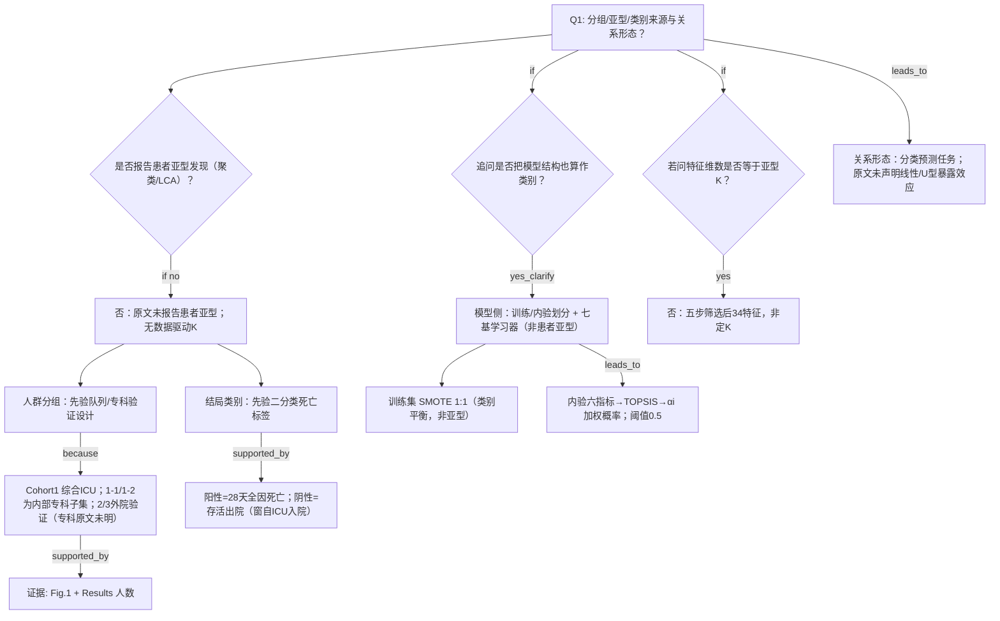

# AI-A Decision Tree Round 2 (Revised)

paper_id: paper_40295871
question_id: Q1
task_type: literature_decision_tree_reasoning
question: 本研究预设了几个分组/亚型/类别？该数量是数据驱动的还是研究者主观指定？是否假设了暴露-结局关系的方向？
source_file: adversarial_lit_reading/chunks/paper_40295871_tcf_septic_shock.md
based_on: A_tree_round1_paper_40295871_Q1.md + B_attack_tree_paper_40295871_Q1.md

## Revision Log

| attack_id | severity | action | change |
|---|---|---|---|
| N-ATT-01 / E-ATT-02 | 中 | 采纳 | Cohort2/3 改为「外院验证、专科类型原文未明确」 |
| N-ATT-02 / P-ATT-02 | 中 | 采纳 | 标明 1-1/1-2 为 Cohort1 内抽取子集 |
| N-ATT-03/04 | 低/中 | 采纳 | 阴性=存活出院；28 天窗口自 ICU 入院起算 |
| N-ATT-05 / P-ATT-04 | 中/高 | 采纳 | 拆分「人群分组」vs「模型结构划分」 |
| N-ATT-06 / E-ATT-04 | 中 | 采纳 | 补 TOPSIS 链路与内验集上算权重 |
| N-ATT-07 / P-ATT-03 | 高 | 采纳 | 特征筛选改为完整五步 |
| P-ATT-01 | 高 | 采纳 | U1 明确 Fig.1 70/30 vs Methods/Table1 ≈80/20 矛盾 |
| E-ATT-01/03 | 高 | 采纳 | 先否定患者亚型，再答队列/结局分组 |
| E-ATT-06 | 高 | 采纳 | 特征维数分支加触发条件 |
| E-ATT-07 / N-ATT-09 | 中/低 | 采纳 | 形状假设标为 Q1 任务不匹配，非论文质量缺陷 |
| Missing: SMOTE | — | 部分采纳 | 在模型侧注明训练集聚类不平衡处理（SMOTE），仍非患者亚型 |

## 1. Evidence Map

| evidence_id | location | evidence_summary | used_by_node |
|---|---|---|---|
| E1 | Methods Study design + Fig.1 | Cohort1=综合ICU 开发；从中抽儿科/呼吸子集做跨专科验证；Cohort2/3=外院验证（专科类型原文未明确说明） | N1a,N2 |
| E2 | Methods Outcomes | 阳性=ICU入院后28天内全因死亡；阴性锚点含存活至出院 | N1b,N4 |
| E3 | Methods Prediction modeling + Table1 | 训练 n=2760、内验 n=691（≈80/20）；Fig.1 题注另写 70/30——文内不一致 | N6,U1 |
| E4 | Methods Data preprocessing (1)–(5) + Fig.2 | 五步特征处理；最终 34 特征由熵排序逐步加至 AUC 最优 | N8 |
| E5 | Methods TOPSIS Eq + Abstract 权重 | 六指标等权归一化→PIS/NIS→贴近度→αi；融合概率阈值 0.5 | N7 |
| E6 | Methods SMOTE | 训练集 1:1 SMOTE 处理类别不平衡 | N6b |
| E7 | 全文 | 无聚类/LCA 定患者亚型 K；无暴露-结局形状假设（任务为分类预测） | N0b,N10 |

## 2. Decision Tree - Mermaid

## 3. Node Table

| node_id | node_type | claim | evidence_location | evidence_summary | confidence | risk_tag |
|---|---|---|---|---|---|---|
| N0 | question | Q1 | — | 根 | high | |
| N0b | question | 有无患者亚型发现？ | 全文 | 无 | high | |
| N0b_no | claim | 无数据驱动患者亚型 K | 全文 | 原文未报告聚类/LCA | high | |
| N1a | claim | 人群分组为先验验证设计 | Methods+Fig.1 | 专科/多中心 | high | |
| N2 | method | 1 综合；1-1/1-2 子集；2/3 外院未明专科 | Methods | 见 E1 | high | |
| N3 | evidence | 人数构成 | Results Fig.1 | 3451 等 | high | |
| N1b | claim | 结局二分类先验指定 | Outcomes | 非聚类 | high | |
| N4 | evidence | 28天死亡 vs 存活出院 | Methods Outcomes | 计时自 ICU 入院 | high | |
| N6 | question | 模型结构是否计入「类别」语义 | — | 需显式区分 | high | |
| N6a | method | 训练/内验+七模型非亚型 | Methods | 见 E3 | high | |
| N6b | method | SMOTE 平衡训练标签 | Methods | 1:1 | high | |
| N7 | method | TOPSIS 得融合权重与 0.5 阈值 | Methods Eq | 0.5 非 Youden 优化（原文未说明代价敏感阈值） | high | |
| N8q | question | 特征数是否被误读为 K | — | 条件分支 | high | |
| N8 | method | 五步筛选→34 | Methods+Fig.2 | 非定 K | high | |
| N10 | claim | 未声明暴露-结局形状；属任务类型不匹配 Q1 关联分支 | Methods | 分类预测 | high | |

## 4. Provisional Answer

本研究**没有**数据驱动的患者亚型个数（无聚类/LCA 定 K）。Q1 意义下的「分组」是研究者**先验指定**的：（1）队列/验证设计（综合 ICU 开发；儿科与呼吸为 Cohort1 **内部抽取**的跨专科子集；Cohort2/3 为外院验证，专科类型**原文未明确说明**）；（2）结局二分类（ICU 入院起 28 天内全因死亡 vs 存活出院）。若把训练/内验与七基学习器+TOPSIS 融合也称作「类别」，那是**模型结构划分**，不是患者亚型；训练集另用 SMOTE 做标签平衡。特征维数 34 来自**五步**预处理后的熵排序逐步建模，**不是**亚型 K。原文作为分类预测研究**未声明**暴露-结局线性/U 型等形状假设——这是问题模板与任务类型不完全匹配，不宜写成论文质量缺陷。

## 5. Uncertainty List

- U1: **文内划分比例矛盾**：Methods/Table1 为 2760/691（≈80/20），Fig.1 题注写 70/30；复现应以 Table1 数字为准并在 Methods 脚注披露。
- U2: Cohort2/3 的 ICU 专科属性原文未明确说明。
- U3: 0.5 分类阈值无 Youden/临床代价优化的专项论证（原文直接给定）。

## 6. Follow-up Questions

1. 迁移到 MIMIC 开发 + eICU 外验时，是否用「对侧库」替代原文专科/外院轴？
2. 成人 Age≥18 门控下，是否完全放弃儿科验证叙事？
