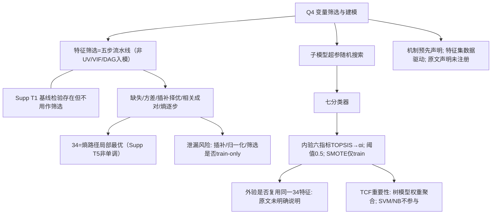

# AI-A Decision Tree Round 2 (Revised)

paper_id: paper_40295871
question_id: Q4
based_on: A_tree_round1 + B_attack_tree_paper_40295871_Q4.md

## Revision Log

| attack | sev | action |
|---|---|---|
| N7 预注册表述 | 高 | 改为原文主动声明未注册；区分机制预先 vs 特征集数据驱动 |
| N2/N3 34最优 | 高/中 | 标注 Supp T5 非单调，34为路径局部最优 |
| N8/Supp T1 | 高/中 | 基线检验≠筛选 |
| N6→N5 时序 | 中 | 超参在融合前 |
| N9/N10/N11 | 中 | 新增泄漏、外验特征复用、重要性聚合局限 |
| N6 随机搜索 | 低 | 去掉「网格」误称 |

## 1. Evidence Map

| id | location | summary |
|---|---|---|
| E1 | Methods preprocessing | 五步特征处理 |
| E2 | Fig.2 / Supp T5 | 熵逐步 AUC；34 局部最高、其后波动 |
| E3 | Methods modeling | 七模型；内验上 TOPSIS；SMOTE 仅训练；阈值0.5 |
| E4 | Supp T6 | 随机搜索超参 |
| E5 | Methods design | 原文声明未准备 protocol、未注册 |
| E6 | Supp T1 | 基线假设检验（非入模筛选） |
| E7 | 全文 | 插补/归一化/外验是否复用34 — 细节未完全写清 |

## 2. Mermaid

## 3. Provisional Answer

筛选逻辑是预测导向五步流水线（非 UV→VIF）。34 特征是熵排序路径上的局部最优（Supp T5 其后波动）。建模：随机搜索训七子模型→内验等权 TOPSIS 融合；SMOTE 仅训练集；阈值 0.5。筛选**机制**在 Methods 预先写出，**最终特征集**数据驱动；原文主动声明未准备研究方案、未注册。Supp T1 有基线检验但不作入模筛选。插补/归一化/外验是否严格 train-only 复用 34 特征，原文未完全写清——迁移时必须强制 train-only。

## 4. Uncertainty

- U1 插补比较所用「同一分类模型」具体哪类
- U2 相关成对 AUC 的评估集
- U3 Fig.1 70/30 vs Methods 80/20
