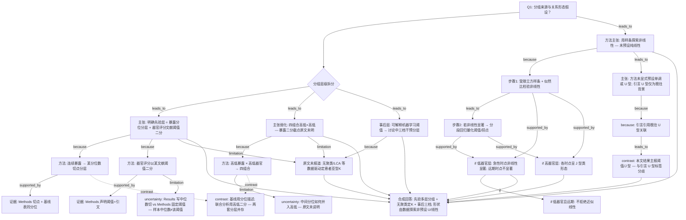

# AI-A Revised Decision Tree

paper_id: paper_40295872
question_id: Q1
revision_source:
  - original_tree: @rounds/A_tree_round1_paper_40295872_Q1.md
  - attack_file: @rounds/B_attack_tree_paper_40295872_Q1.md
  - paper: @chunks/paper_40295872_jin2025_shr_sofa_af_mortality_cardiovasc_diabetol.md

question: 本研究预设了几个分组/亚型/类别？该数量是数据驱动的（如聚类定 K）还是研究者主观指定？是否假设了暴露-结局关系的方向（线性、单调、U 型）？

## 1. Revised Evidence Map

| evidence_id | location | evidence_summary | used_by_node |
|---|---|---|---|
| E1 | Statistical analysis（Page 4） | 暴露按三分位：T1&lt;0.93、T2 0.93–1.22、T3≥1.22；切点先验，非聚类定 K | N1a,N2,N3 |
| E2a | Statistical analysis（Page 4） | 器官评分以 cutoff=5 二分；文称「validated…organ dysfunction [18]」 | N1a,N4,N5a |
| E2b | Results KM 段 + Table 1 | KM 写 SOFA「categorized at the median」；Table1 SOFA 中位数=4.0，与 cutoff=5 不等价 | N4,N5b,U2 |
| E3a | Statistical analysis | 联合四组：Q1 Low暴露+Low器官分 … Q4 High暴露+High器官分 | N1b,N6 |
| E3b | Statistical analysis（同段） | 三分位已定义 Low/Medium/High，但四组 High/Low **未说明** Medium(T2) 如何并入或剔除 | N6u,N1b,U3 |
| E4 | Results Baseline + Table 1 / continued | 基线按三分位描述；死亡率随三分位升高 | N8 |
| E5a | Statistical analysis + Results Fig.1 | RCS 四结点评估非线性；LRT 检验非线性 | N10a,N11a,N11b |
| E5b | Statistical analysis + Results RCS 段 | 显著阈值后以分段 Cox 量化拐点；低器官层阈≈1.0（院内/30 天），高器官层理想点≈1.2 | N10b,N11a,N11b |
| E5c | Results RCS 段 | 低器官层 1 年 P nonlinear=0.168（不显著）；高器官层各时点 J 型均显著 | N11a,N11c |
| E6a | Introduction | 既往文献「U-shaped mortality association is established」作背景 | N12,N16 |
| E6b | Abstract / Results / Discussion | 本文结果用语：threshold / J-shaped / inflection；Discussion「threshold-dependent J-shaped」 | N9b,N13 |
| E7 | 全文 Methods/Results | 未见 LCA/K-means/轮廓系数等聚类定类数；未见预注册形状假设 | N14 |
| E8 | Discussion（Page 10–11） | SHAP 依赖阈值→事后三档 Protected / Alert / Critical（「SHAP-derived thresholds…three distinct physiological groups」） | N15 |
| E9 | Abstract vs Methods | Abstract 写「SHR quartiles」，Methods/Table1 为 tertiles——层数以 Methods 为准 | U1 |

## 2. Revised Decision Tree - Mermaid

> 脱敏：图中无具体疾病名、指标名、数值切点、样本量；仅保留框架逻辑。

## 3. Revised Node Table

> `claim` 列已脱敏；具体切点/疾病/指标名仅保留在 evidence_summary 或第 1 节证据表。

| node_id | node_type | claim | evidence_location | evidence_summary | confidence | risk_tag |
|---|---|---|---|---|---|---|
| N0 | question | Q1：分组个数来源与暴露–结局形状假设 | — | 根问题 | high | |
| N0g | question | 先按分析层级拆分「分组」语义 | — | 基线分位 / 联合四组 / 事后干预层 | high | |
| N1a | claim | 明确可复核的先验分组：暴露分位层 + 器官评分文献阈值二分 | Statistical analysis | 非聚类定 K；confidence 限于此两层 | high | |
| N2 | method | 连续暴露按某分位数切点分层 | Statistical analysis | 三分位切点见 E1 | high | |
| N3 | evidence | 分位定义与基线表一致 | Methods + Table 1 | 支持先验分位 | high | |
| N4 | method | 器官评分以某固定文献阈值二分 | Statistical analysis | Methods cutoff=5 | medium | inconsistency |
| N5a | evidence | Methods 写明阈值并引文献 | Methods [18] | 引文主题为微循环成像，与器官评分阈值验证的直接对应【证据不足/需复查】 | medium | 引用语境存疑 |
| N5b | uncertainty | Results「按中位数切」与 Methods 固定阈值并存；样本中位数≠该阈值 | Results KM + Table 1 | 复现口径冲突 | high | inconsistency |
| N1b | claim | 四组合宣称高低×高低，但暴露二分规则原文未充分定义 → 仅 medium 置信「先验」 | Statistical analysis | 与三分位并列夸大清晰度已纠正 | medium | 证据不足 |
| N6 | method | 高低暴露 × 高低器官 → 四组合 | Statistical analysis | Q1–Q4 标签存在 | medium | |
| N6u | uncertainty | 中间分位如何并入 High/Low（并入一侧 / 剔除 / 另切）原文未说明 | Statistical analysis | 影响四组可复现性 | high | 证据不足 |
| N8 | contrast | 基线描述用分位；联合分析用高低二分——两套分层并存 | Table 1 vs 四组 KM/Cox | 何为主分析层级原文未点名 | medium | |
| N14 | uncertainty | 论文未报道 LCA/K-means 等聚类定患者亚型 K | 全文 | 「未见」≠否定一切数据驱动；须与 N15 并列 | high | |
| N15 | claim | 讨论中据可解释学习阈值事后指定三档干预层——准数据驱动、非预注册亚型发现 | Discussion | Protected/Alert/Critical | high | 事后分层 |
| N9a | claim | 剂量反应用样条探索非线性，方法层未假定纯线性 | Methods | RCS 四结点 | high | |
| N10a | method | 先：样条 + LRT 检验非线性 | Statistical analysis + Fig.1 | 独立步骤 1 | high | |
| N10b | method | 后：非线性显著则分段回归量化阈值/拐点 | Statistical analysis + Results | 独立步骤 2；阈值≠样条曲线本身 | high | |
| N11a | evidence | 低器官层：急性时点非线性显著并报阈值；远期非线性不显著 | Results RCS | 时点条件分支 | high | |
| N11b | evidence | 高器官层：各时点 J 型类形态 + 理想点 | Results RCS | 与低层形态不同 | high | |
| N11c | claim | if 低器官且远期 → 不拒绝近似线性 | Results | P nonlinear 不显著 | high | |
| N16 | claim | 方法未显式预设单调或 U 型；引言 U 型仅为背景引用 | Methods + Introduction | 直接回答 Q1 第三问 | high | |
| N12 | claim | 引言将既往 U 型关联作研究背景 | Introduction | 非本文 Methods 形状锁死 | medium | |
| N13 | contrast | 本文结果主报阈值/J 型，与引言 U 型标签分歧——属回答「未假设必为 U」的核心证据 | Results + Discussion | 非旁支 limitation | high | |
| N17 | synthesis | 合成：明确先验（分位+评分二分）+ 四组边界不明 + 无聚类定 K + 事后三档；形状由探索得出（阈值/J 型），非预设线性/U 型；且形态随时点/器官层变化 | 全树 | 对 Q1 完整作答 | high | |

## 4. Final Answer Based on Revised Tree

本研究**没有**报告用聚类/潜类别等数据驱动方式确定**患者亚型个数 K**。分析中的「分组」应分三层叙述，不宜笼统说「全部清晰先验」：

1. **明确先验指定**：（a）连续暴露按**某分位数**切成多层；（b）器官功能障碍评分按**某文献阈值**二分。二者均非聚类定 K。
2. **先验但边界未写清**：暴露高低 × 器官高低的**四组合**在方法段有标签，但暴露侧如何从多层分位映射为 High/Low（中间层并入或剔除）——**原文未明确说明**，复现存在歧义；故「四组亦同等清晰先验」的主张降级。
3. **事后准数据驱动**：讨论依据可解释机器学习依赖图阈值，另定**三档干预分层**——属于结果解释后的分层，不是预注册的亚型发现，也不是 LCA 定 K。

关于暴露–结局**关系形态**：Methods 用**受限立方样条**探索非线性并检验，显著后再用**分段回归**量化阈值——**未假定纯线性，也未在方法中显式锁定单调或 U 型**；引言 U 型仅为既往文献背景。本文结果主报**阈值 / J 型类**形态，且随**器官分层与随访时点**变化（低器官层远期可不拒绝近似线性）。摘要分位用词与正文不一致时，以 Methods/主表为准。

## 5. Revision Log

| critique_id | accepted_or_rejected | action | reason |
|---|---|---|---|
| N-01 | accepted | 拆 N1→N1a/N1b；N1b medium；N6→N6u | 四组暴露二分截点原文未说明，不得与三分位同等「清晰先验」 |
| N-02 | accepted | N5→N5a/N5b；N4 risk=inconsistency；N5a 标引文语境存疑 | Methods 阈值5 vs Results 中位数切；[18] 与器官阈值验证关联弱 |
| N-03 | accepted | N9→N9a + N16 + N13 contrast；结果标签与方法拆开 | 须区分「检验方法」与「U/J/阈值混用标签」 |
| N-04 | accepted | N12→N13 改 leads_to/contrast，不再作旁支 limitation | U vs J 分歧是回答「是否假设 U」的证据 |
| N-05 | accepted | 新增 N15；N14 收窄为「未报道聚类定 K」 | SHAP 事后三档是 Q1「数据驱动 vs 主观」的第三层 |
| N-06 | accepted | N11→N11a/N11b + N11c 时点分支 | 低器官层远期非线性不显著必须入树 |
| N-07 | accepted | 新增 N16 直答「未预设单调/U」 | 原 N9 只答「不预设线性」不完整 |
| N-08 | accepted | N13 类型改为 contrast，挂入主链至 N17 | 与 E-03 一致 |
| N-09 | accepted | N4/N5b 标注 inconsistency | 与 U2 索引 |
| N-10 | accepted | N6u 显式 uncertainty 边 | 与 N-01/E-01 同根 |
| N-11 | accepted | N8 改为 contrast：基线分位 vs 分析二分并存 | 避免「描述层=唯一分析层」误读 |
| E-01 | accepted | N1 分裂；N1b→N6→N6u | 边逻辑：模糊四组不得支撑强「先验」主张 |
| E-02 | accepted | N10→N10a→N10b；E5 拆 E5a/E5b | 先样条检验、后分段阈值 |
| E-03 | accepted | N12→N13 标 leads_to（非 limitation） | 突出「结果区别于引言 U 型」 |
| E-04 | accepted | N14 改称；并行 N15 | 「无聚类」≠「无任何数据驱动分层」 |
| E-05 | accepted | 树尾 N17 合成节点 | 两大分支交汇成完整 Q1 答案 |
| Ev-4.1 | accepted | E5→E5a/E5b/E5c | RCS 与分段 Cox 分证据 |
| Ev-4.2 | accepted | E5c + N11a/N11c | 补低层 1 年不显著 |
| Ev-4.3 | rejected（低） | 仅入 Remaining U4 备忘 | 不改主树结构；90/360 vs 30/365 属次要张力 |
| Ev-4.4 | accepted | N14 措辞改为「未报道」 | 避免过强否定 |
| Ev-4.5 | accepted | E6→E6a/E6b | 引言 U vs 讨论 J 分列 |
| Miss-5.1 | accepted | =N15 | 同 N-05 |
| Miss-5.2 | rejected | 中介比例不单独立为「分组维度」节点 | 中介是效应分解非分组；三档已由 N15 覆盖 |
| Miss-5.3 | accepted | N0g 三层对位 | 先验/不明边界/事后 |
| Miss-5.4 | accepted | N11c 条件分支 | 时点→形态 |
| Miss-5.5 | accepted | =N6u | 同 N-10 |
| Miss-5.6 | accepted（部分） | 由 N13/N16 覆盖「结果标签未迁就 U 型」 | 不另增低优先级节点 |

## 6. Remaining Uncertainty

- U1: Abstract「quartiles」vs Methods/Table「tertiles」——分析层数以 Methods 为准。
- U2: 器官评分 Methods 固定阈值 vs Results「中位数」切——样本中位数与该阈值不等价；复现须二选一并敏感性。
- U3: 四组暴露 High/Low 与中间分位的映射规则原文未写清。
- U4: 部分结果叙述时点标签（如 90/360 天 vs 30 天/1 年）文内用词不完全对齐，不影响「分位先验 + RCS 探索」主结论，但引用人数/事件时需核对表注。
- U5: 引文 [18] 是否足以支撑「器官评分阈值业经验证」——证据链偏弱，宜降级表述为「作者声明的文献阈值」。
- U6: 事后三档干预层的切点是否在分析计划中预指定——原文未明确说明；宜作探索性临床叙事而非预注册亚型。
