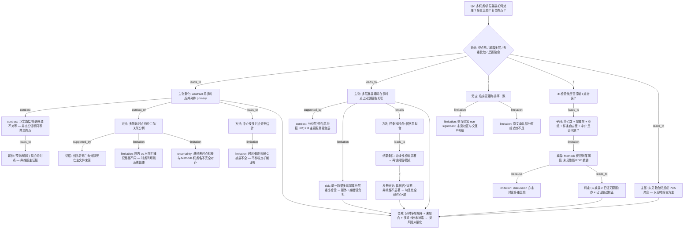

# AI-A Revised Decision Tree

paper_id: paper_40295872
question_id: Q2
revision_source:
  - original_tree: @rounds/A_tree_round1_paper_40295872_Q2.md
  - attack_file: @rounds/B_attack_tree_paper_40295872_Q2.md
  - paper: @chunks/paper_40295872_jin2025_shr_sofa_af_mortality_cardiovasc_diabetol.md

question: 如何处理多亚型/多终点/多层暴露？是否会因多重比较膨胀 I 类错误？是否对相关终点做了主成分/复合终点聚合？

## 1. Revised Evidence Map

| evidence_id | location | evidence_summary | used_by_node |
|---|---|---|---|
| E1a | Abstract Methods | 「primary endpoints were in-hospital, 30-day, and 1-year mortality」——三时点并列称 primary | N1a,N1b |
| E1b | Study endpoint | 出院后死亡来自 Death Master File；院内死亡捕获路径未同句写明 | N3a,N3b |
| E2 | Results Table 2 | 暴露分位层、器官二分、四组合在三时点分别报粗/校正 HR | N4a,N4b |
| E3 | Figure S2 / KM 叙述 | KM 主要按四组合绘制，非三分位全套 KM | N4b,N4c |
| E4a | Statistical analysis + Fig.1 | RCS（四结点）按「时点 × 器官层」展示曲线 | N6a |
| E4b | Results RCS | 非线性用 LRT；低器官层远期 P nonlinear 不显著（反例） | N6b,N6c |
| E5a | Results 正文一句 + Table S1–S3 | 亚组称排序一致、交互「non-significant」；正文未给交互 P 数值 | N7a,N7b |
| E5b | Results 同段 | 承认少数亚组 underpowered | N7c |
| E6 | Mediation + Fig.4 | 中介分三时点 bootstrap；介导比例点估计随时间下降 | N9a,N9b |
| E7 | Nomogram + SHAP | 三时点各建预测/解释工具，非复合终点 | N10 |
| E8 | Statistical analysis | 显著性双侧 P&lt;0.05；未见 Bonferroni/FDR/预先假设族表述 | N11,N12a |
| E9 | Discussion limitations | 局限谈回顾性/单库等，**未讨论**多重比较 | N12b |
| E10 | 全文 | 未见多时点 PCA/复合终点聚合 | N13 |
| E11 | Table 1 Outcome 行 | 出现与 Methods 不完全一致的时点标签（如 90/360 vs 30/365） | N2u |

## 2. Revised Decision Tree - Mermaid

> 脱敏：图中无具体疾病名、指标名、数值切点、样本量；仅保留框架逻辑。

## 3. Revised Node Table

> `claim` 列已脱敏；具体时点名/指标/数值仅保留在证据表或 evidence_summary。

| node_id | node_type | claim | evidence_location | evidence_summary | confidence | risk_tag |
|---|---|---|---|---|---|---|
| N0 | question | Q2：多终点/多层暴露、多重比较、是否聚合 | — | 根问题 | high | |
| N0g | question | 拆分终点族、暴露多层、多重比较、聚合四问 | — | 结构门控 | high | |
| N1a | claim | Abstract 将多个死亡时点并列称为 primary | Abstract | E1a | high | |
| N1b | contrast | 正文处理/随访来源不对等 → 不得过度解读为已充分裁定的同等共主终点 | Results + Study endpoint | 篇幅与来源不对称 | medium | 过度解释 |
| N2 | method | 多时点分时分析，非单一复合终点建模 | Study endpoint + Results | 分时 KM/Cox/RCS | high | |
| N2u | uncertainty | 基线表时点标签与 Methods 终点命名不完全对齐 | Table 1 vs Methods | 标签张力 | medium | inconsistency |
| N3a | evidence | 出院后死亡有外部死亡主文件来源 | Study endpoint | E1b | high | |
| N3b | limitation | 院内与出院后捕获路径不同，可能引入时点间偏差 | Study endpoint | 原文未量化 | medium | |
| N4a | claim | 多层暴露编码在多时点上分别报告关联估计 | Table 2 | 分位/二分/组合 | high | |
| N4b | contrast | HR 多套分层均报；KM 主要服务组合层——「完全同框架」降级 | Table 2 vs Fig S2 | ATK-04 | medium | |
| N4c | risk | 同一数据多套暴露分层重复检验放大 I 类错误负担 | Methods + Results | 原文未校正披露 | high | 多重比较 |
| N6a | method | 样条按时点×器官层拟合（方法层） | Methods + Fig.1 | 与结果阈值拆开 | high | |
| N6b | result_interpreting | 非线性检验显著后才解释阈值/形态 | Results RCS | LRT | medium | 方法结果混用已拆 |
| N6c | counterexample | 低器官×远期非线性不显著 → 禁止泛化到全部时点×层 | Results | P nonlinear 不显著 | high | |
| N7a | method | 亚组称风险排序与总体一致 | Results + Supp | 探索性 | medium | |
| N7b | limitation | 交互仅定性 non-significant；未见多重校正与交互 P 明细 | 正文一句 + S 表 | 弱证据 | high | 证据不足 |
| N7c | limitation | 原文承认部分亚组功效不足 | Results | underpowered | high | |
| N9a | method | 中介按多时点分别估计 | Mediation | bootstrap | medium | |
| N9b | limitation | 中介时序与部分不确定性披露不全 → 不作稳定机制证明 | Mediation | 探索性 | high | 因果过度 |
| N10 | method | 预测/解释工具分时点；支撑「分时展开」非「终点平等」 | Nomogram/SHAP | 与推断分层 | medium | |
| N11 | uncertainty | 多终点是否控制 I 类错误？ | — | 分支入口 | high | |
| N11a | question | 终点×暴露层×亚组×样条×中介是否同属检验族？ | 全文检验清单 | 扩展多重比较范围 | high | |
| N12a | limitation | Methods 仅披露双侧某显著性阈值，未见族控/FDR | Statistical analysis | 未披露 | high | |
| N12b | limitation | Discussion 局限亦未讨论多重比较 | Discussion | 未意识到或未处理 | high | |
| N12c | claim | 「未披露」不可推出「已校正」或「已证无膨胀」 | 合成 N12a/b | 审慎判定 | high | |
| N13 | claim | 未见复合终点或 PCA 聚合；以分时报告为主 | 全文审查 | 非单点 E3 支撑 | high | |
| N14 | synthesis | 分时多层展开、未聚合、多重比较未披露 → I 类错误风险未量化 | 全树 | 对 Q2 作答 | high | |

## 4. Final Answer Based on Revised Tree

本文对**多随访死亡时点**采取**分时并行报告**（生存曲线、比例风险、样条、中介、预测工具各自按时点展开），**未见**主成分或复合终点聚合。Abstract 虽将多时点并列称为 primary，但正文随访来源与叙述权重**不对等**，不宜写成已充分裁定的「同等共主终点」。

**多层暴露**以分位层、器官评分二分及二者组合层在多时点分别报告关联；但 KM 主要服务组合层，且**同一数据多套分层重复检验**进一步加重多重比较负担。样条分析须保留条件分支：低器官层远期可出现**非线性不显著**，不得把非线性/阈值叙事泛化到全部时点×层。

关于 **I 类错误**：Methods 仅写双侧某显著性阈值，**未见** Bonferroni/FDR/预先假设族控制的披露，Discussion 亦未讨论；亚组交互多仅写 non-significant 且承认部分功效不足。故只能判定为**多重比较策略未披露、膨胀风险未量化**——不能证明已校正，也不能证明无膨胀。

## 5. Revision Log

| critique_id | accepted_or_rejected | action | reason |
|---|---|---|---|
| ATK-01 | accepted | N1→N1a/N1b；弱化「同等并行主终点」 | 高严重度；Abstract 并列≠正文充分共主裁定 |
| ATK-02 / ATK-11 | accepted | N1a→N2 改 `context_of` | 分时方法不能 because「终点平等」主张 |
| ATK-03 / ATK-20 | accepted | 拆 N3a/N3b | 院内/出院后来源不对等入树 |
| ATK-04 | accepted | N4→N4a/N4b | 「同框架复用」降级；KM 主要组合层 |
| ATK-05 / ATK-17 | accepted | N6→N6a/N6b | 方法拟合 vs 结果阈值拆开 |
| ATK-06 / ATK-15 / ATK-23 | accepted | N7→N7a/N7b/N7c；置信降级 | 交互证据弱+功效不足 |
| ATK-07 / ATK-24 | accepted | N9→N9a/N9b | 中介不作机制强证 |
| ATK-08 | accepted | N10 挂 N1b 延伸，非强证终点平等 | 预测≠推断 |
| ATK-09 / ATK-16 | accepted | N12→N12a/N12c「未披露」 | 禁止偷换为「没有做过」 |
| ATK-10 | accepted | N13 证据改为全文审查 | 断开错误 N3 支撑 |
| ATK-14 | accepted | 增 N12b | 局限段未谈多重比较 |
| ATK-18 | accepted | 增 N11a | 多重比较范围扩至暴露/亚组/样条/中介 |
| ATK-19 | accepted | 增 N2u | Table1 时点标签张力入树 |
| ATK-21 | accepted | 增 N4c | 多套暴露分层额外 I 类负担 |
| ATK-22 | accepted | 增 N6c 反例分支 | 低器官×远期非线性不显著 |
| ATK-12 / ATK-13 | accepted（部分） | N4a→N6a 标 `entails`；结构由 N0g 收紧 | 采纳边澄清，不另堆冗余 if |

## 6. Remaining Uncertainty

- U1: Abstract「primary」并列是否等于作者意图上的共主终点族——正文未再裁定。
- U2: 基线表时点标签与 Methods 终点名不完全对齐时，引用事件率须核表注。
- U3: 亚组交互检验功效与校正策略——主文未给出可复核统计量。
- U4: 中介变量相对暴露/结局的测量时序——原文未明确说明。
- U5: 补充材料是否另有多重比较说明——主 chunk 未见正文披露。
