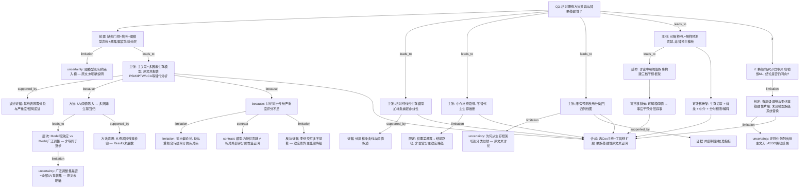

# AI-A Revised Decision Tree

paper_id: paper_40295872
question_id: Q3
revision_source:
  - original_tree: @rounds/A_tree_round1_paper_40295872_Q3.md
  - attack_file: @rounds/B_attack_tree_paper_40295872_Q3.md
  - paper: @chunks/paper_40295872_jin2025_shr_sofa_af_mortality_cardiovasc_diabetol.md

question: 该方法/模型与既有方法的区别在哪？对照逻辑回归/Cox/PSM/IPTW/LCA/传统聚类/其他 ML。本研究为何选此法而非彼法？换一种方法结论会变吗？

## 1. Revised Evidence Map

| evidence_id | location | evidence_summary | used_by_node |
|---|---|---|---|
| E0a | Data extraction | 缺失&gt;20% 删变量；&lt;20% MissForest；文称图模型识别路径 | N0p,N0p_u |
| E0b | Statistical analysis | 暴露分位切点 + 器官评分文献阈值二分为分析预设分层 | N0p,N2b |
| E1 | Methods Statistical analysis | 主推断：Cox；UV P&lt;0.05 进入多因素；Model I 未调整 / Model II 广泛调整 | N1,N2a,N2b |
| E2 | Methods only | Schoenfeld 声明已验 PH；Results 未展开具体结果 | N4 |
| E3 | Methods + Fig.1 Results | RCS 四结点 + 显著后分段 Cox | N5,N6 |
| E4 | Mediation + Fig.4 | bootstrap 中介；路径限定为暴露→死亡（经某实验室中介），非器官分主路径 | N7a,N7b |
| E5 | Nomogram Results + Fig.2 | 三时点 multivariable logistic + 后退逐步；C-index/校准 | N9,N10 |
| E6a | Model interpretation + Fig.3 | SHAP 解释预测贡献 | N11a |
| E6b | Discussion | SHAP 阈值 → Protected/Alert/Critical 三档干预叙事 | N11b,N17b |
| E7 | Discussion | 称传统 ICU 评分 overlook bidirectional pathophysiology（论述性） | N13,N14a |
| E8 | Results Subgroup | non-significant interaction terms——对「效应修饰」主张的反向张力 | N13b |
| E9 | Table 1 | 暴露分位与严重度/死亡率递进（描述性） | N1d |
| E10 | Strengths/limitations + 全文 | 有 Model I→II、亚组、RCS；**未见** PSM/IPTW/竞争风险/LCA/他族 ML 系统替换 | N15,N16 |
| E11 | Packages 句 | 列出 glmnet；主文筛选叙述为 UV→MV 与 backward stepwise | N16u |

## 2. Revised Decision Tree - Mermaid

> 脱敏：图中无具体疾病名、指标名、数值切点、样本量；仅保留框架逻辑。

## 3. Revised Node Table

> `claim` 列已脱敏。

| node_id | node_type | claim | evidence_location | evidence_summary | confidence | risk_tag |
|---|---|---|---|---|---|---|
| N0 | question | Q3：方法差异与替换稳健性 | — | 根问题 | high | |
| N0p | method | 分析前置：缺失门控、填补、图模型声称、暴露/器官先验分层 | Data extraction + Methods | 可复制性前置 | high | |
| N0p_u | uncertainty | 图模型如何落到入模名单——原文未明确说明 | Data extraction | 细节缺失 | high | 证据不足 |
| N1 | claim | 主关联为多因素生存回归；原文未报告 PSM/IPTW/LCA 等替代分析 | Methods | 正向确认+负向仅「未报告」 | high | |
| N1d | evidence | 基线表显示暴露分位与严重度/结局递进 | Table 1 | 描述性支撑分层 | medium | |
| N2a | method | 单因素某阈值筛入 → 多因素生存模型 | Methods | UV→MV | high | |
| N2b | method | Model：粗效应 vs 广泛调整（层次调整） | Table 2 脚注 | 非逐步同义词 | high | |
| N2u | uncertainty | 广泛调整集是否等于全部 UV 显著集——原文未明确 | Methods vs 脚注 | 双轨可能 | medium | |
| N4 | method | 声明用残差检验比例风险；Results 未展数 | Methods only | 证据强度中等 | medium | |
| N5 | claim | 相对纯线性生存模型，增加样条/分段描述非线性 | Methods + Results | 方法增量 | high | |
| N6 | evidence | 分层样条与阈值类结果 | Fig.1 | 结果层 | high | |
| N7a | claim | 中介补充机制路径，不替代主推断 | Mediation | bootstrap | high | |
| N7b | limitation | 中介仅覆盖暴露→结局路径，未覆盖器官分主效应路径 | Mediation 措辞 | 路径限定 | high | |
| N9 | claim | 个体预测改用分类回归列线图 | Nomogram | 与主推断分流 | high | |
| N9u | uncertainty | 为何从生存框架切换分类似然——原文未讨论 | Nomogram | 逻辑跳跃点 | medium | |
| N10 | evidence | 报告内部判别/校准 | Fig.2 | 口径：文中用 C-index | medium | |
| N11a | claim | 可解释 ML 用于解释预测贡献，非替换主生存推断 | Fig.3 | 非无监督分型 | high | |
| N11b | claim | 讨论进一步把可解释阈值写成三档干预框架 | Discussion | 事后临床叙事 | high | 事后分层 |
| N13 | claim | 作者论述传统严重度评分忽略双向病理交互 | Discussion | 论述性差异 | medium | 因果过度 |
| N13b | counterevidence | 亚组交互多不显著 → 「效应修饰」主张需降级表述 | Results | 反向张力 | high | |
| N14a | limitation | 缺与重拟合传统评分的严格头对头 | Discussion | 证据中等 | medium | 逻辑跳跃 |
| N14b | contrast | 模型内特征贡献 ≠ 相对外部评分增量的外证 | SHAP vs Discussion | 两层次 | high | |
| N15 | uncertainty | 若换倾向评分/竞争风险/他族 ML，点估计是否同向 | — | 替换敏感性入口 | high | |
| N16 | claim | 原文有层级调整与亚组等片段稳健性；**未见模型族级系统替换** | 全文 | 修正「完全没做稳健性」 | high | 证据不足 |
| N16u | uncertainty | 正则化包列出但主文无对应选模路径/结果 | Packages 句 | 用途不明 | medium | |
| N17a | transfer | 可迁移：生存关联+样条+中介+分时预测/解释 | 合成 | 骨架 | medium | |
| N17b | transfer | 可迁移延伸：可解释阈值→事后干预分层叙事（须标探索性） | Discussion | 高运载点 | medium | 可迁移性须标注 |
| N18 | synthesis | 主线选生存模型并扩展工具链；换族后结论是否不变——原文未证明 | 全树 | 答 Q3 | high | |

## 4. Final Answer Based on Revised Tree

相对最直接替代法，本文**主推断**选择**多因素生存回归**（单因素阈值筛入 → 广泛调整），并声明比例风险残差检验；相对纯线性报告，增加**样条/分段**描述非线性；相对纯关联，增加**中介**（仅覆盖暴露→结局路径）与**分时分类列线图 + 可解释贡献图**。作者论述相对传统严重度评分的增量，但属**论述对比**，且亚组**交互多不显著**构成反向张力；模型内特征贡献不能直接当作「相对外部评分增量」的外证。

**为何选此而非 PSM/IPTW/LCA/他族 ML**：原文正向写明主推断为生存回归，**未报告**上述替代分析及其选择理由的系统对照。**换法结论是否改变**：存在 Model 粗→广泛调整、亚组与样条等片段稳健性，但**未见**倾向评分、竞争风险或其他机器学习主模型的**模型族级替换敏感性**——故「换法仍稳健」不能由原文直接证明。可迁移的是「生存关联 + 样条 + 中介 + 分时预测/解释」骨架，以及讨论中「可解释阈值 → 事后干预分层」叙事（须标探索性）。

## 5. Revision Log

| critique_id | accepted_or_rejected | action | reason |
|---|---|---|---|
| N-A1 | accepted | N1 改为「主法=Cox；未报告替代」 | 负向断言不超过原文 |
| N-A2 / E-A1 / MB-6 | accepted | N2→N2a/N2b + N2u | Model 层次与 UV 全集关系不明 |
| N-A3 | accepted | N7→N7a/N7b | 中介路径限定 |
| N-A4 | accepted | 增 N9u | Cox→logistic 切换未解释 |
| N-A5 | accepted（部分） | N13 保留论述强度，脱敏后不绑病种专名 | 采纳「双向病理」力度，图中脱敏 |
| N-A6 / EP-5 / MB-3 | accepted | 增 N11b + N17b | 高严重度：三档干预框架入迁移 |
| N-A7 | accepted | N4 保持 medium + Methods-only | Results 无 PH 数值 |
| E-A2 | accepted | N10 注明 C-index 口径 | 分类模型报判别指标 |
| E-A3 | accepted | 增 N14b | 内证 vs 外证对比 |
| E-A4 | accepted | N16 改写 | 有片段稳健性，缺模型族替换 |
| EP-2 / MB-1 | accepted | 增 N0p/N0p_u | 高严重度：预处理分支 |
| EP-4 | accepted | 增 N1d | Table1 描述证据 |
| MB-2 | accepted（部分） | 并入 N0p 先验分层 | 不堆具体切点到 claim |
| MB-4 | accepted | 增 N13b | 高严重度：交互不显著反向证据 |
| MB-5 | rejected（低） | 仅留 Remaining U | 出院后数据源对 Q3 方法差异非核心 |
| EP-1 / EP-3 | accepted | 证据表区分 Methods/Results；保留 glmnet 不确定 | 粒度与 U 提升 |

## 6. Remaining Uncertainty

- U1: 广泛调整协变量集与「凡 UV 显著皆入」是否同一集合——原文未逐条对照。
- U2: 图模型（文中措辞）如何约束强制保留/排除变量——未展示。
- U3: PH 检验具体全局/逐变量结果——Results 未展开。
- U4: glmnet 是否用于未展示敏感性或仅加载——主文未写清。
- U5: 列线图 C-index 与常规分类 AUC 口径差异——原文未讨论。
