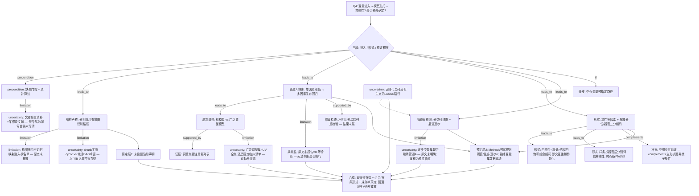

# AI-A Revised Decision Tree

paper_id: paper_40295872
question_id: Q4
revision_source:
  - original_tree: @rounds/A_tree_round1_paper_40295872_Q4.md
  - attack_file: @rounds/B_attack_tree_paper_40295872_Q4.md
  - paper: @chunks/paper_40295872_jin2025_shr_sofa_af_mortality_cardiovasc_diabetol.md

question: 变量/协变量筛选与建模逻辑是什么？（入模依据：临床重要性/单因素 p/文献/DAG/VIF；模型形式：加性/交互/RCS；是否 LASSO/逐步）该逻辑是否在分析前预先确定？

## 1. Revised Evidence Map

| evidence_id | location | evidence_summary | used_by_node |
|---|---|---|---|
| E1 | Data extraction + Statistical analysis | 缺失&gt;20% 删变量；&lt;20% 用 MissForest；文称 multiple imputation | N1,N2 |
| E2 | Data extraction 段末（chunk 字面） | 「A directed **cyclic** graph model was used to identify various causal pathways prior to statistical analysis」 | N3,N4,U_dag |
| E3 | Statistical analysis | Cox：单因素关联 P&lt;0.05 的候选进入多因素 | N5a |
| E4 | Statistical analysis + Table 2 脚注 | Model I 未调整；Model II 列举广泛协变量（实验室/治疗/严重度等） | N5b,N6,N5u |
| E5a | Statistical analysis + Fig.1 | RCS（4 knots）评估非线性；显著后分段 Cox | N8a,N8c |
| E5b | Statistical analysis + Table 2 Combined | 四组合（高低暴露×高低器官）为饱和式组合编码 | N8b |
| E5c | Results RCS | 样条按器官层分别展示；远期低器官层非线性可不显著 | N8c |
| E6 | Nomogram Results | 后退逐步 logistic，保留 α=0.05；与主 Cox 筛选叙述分立 | N10a,N10b |
| E7 | Mediation | 中介变量预指定；bootstrap 分解 | N12 |
| E8 | Results Subgroup | 亚组交互多为补充验证，非主模型默认乘积项叙事 | N13 |
| E9 | Methods | Schoenfeld 声明验 PH；Results 未展具体结果 | N17 |
| E10 | 全文 | 未见 VIF/共线性诊断报告；未见预注册分析计划 | N14,N15a |
| E11 | Packages 句 | 列出 glmnet；主文无 LASSO 路径/λ/CV 描述与结果 | N16 |

## 2. Revised Decision Tree - Mermaid

> 脱敏：图中无具体疾病名、指标名、数值切点、样本量；仅保留框架逻辑。

## 3. Revised Node Table

> `claim` 列已脱敏。

| node_id | node_type | claim | evidence_location | evidence_summary | confidence | risk_tag |
|---|---|---|---|---|---|---|
| N0 | question | Q4：筛选逻辑、模型形式、是否预指定 | — | 根问题 | high | |
| N0g | question | 拆分：进入 / 形式 / 预定程度 | — | 结构门控 | high | |
| N1 | method | 缺失比例门控后填补，再进入建模 | Data extraction | &gt;某比例删；其余填补 | high | |
| N2 | uncertainty | 「多重填补」表述与算法常规产物如何合并——原文未写清 | Methods | m/池化未披露 | medium | |
| N3 | method | 文称分析前用有向图识别因果路径 | Data extraction | chunk 字面 cyclic | medium | |
| N4 | limitation | 构图过程、纳入标准、如何映射到调整集——未披露 | 全文 | 落地不足 | high | 证据不足 |
| N4b | uncertainty | 字面「cyclic」与常规无环 DAG 术语冲突——记录字面并标存疑，不臆改正文 | chunk vs 常规 | 术语张力 | medium | 方法误读风险 |
| N5a | claim | 推断管道主规则：单因素某阈值 → 多因素生存模型 | Statistical analysis | UV→MV | high | |
| N5b | method | 粗模型 vs 广泛调整模型的层次报告 | Table 2 | Model I/II | high | |
| N5u | uncertainty | 广泛调整集来自 UV 全集还是固定临床清单——双轨未澄清 | Methods vs 脚注 | 关键歧义 | high | |
| N6 | evidence | 广泛调整协变量具名列表存在 | Table 2 脚注 | 可复核名单 | high | |
| N8a | method | 加性多因素 + 暴露分位/器官二分编码 | Methods | 主形式 | high | |
| N8b | method | 四组合为高低×高低饱和组合编码（交互饱和参数化） | Methods + Table 2 Combined | 非「未做交互」 | high | |
| N8c | method | 样条按器官层分别评估非线性；部分时点×层可不显著 | Fig.1 | 条件分支 | high | |
| N13 | method | 亚组交互为补充验证，complements 主形式 | Results + Supp | 非 N8 子条件 | medium | |
| N10a | method | 预测管道：分类列线图 + 后退逐步 | Nomogram | 独立筛选叙述 | high | |
| N10b | uncertainty | 逐步变量是否继承推断管道入选集——原文未明确；宜视为独立管道 | Nomogram vs Cox | 双管道 | high | |
| N12 | method | 中介支路预指定中介变量 | Mediation | 路径预设 | high | |
| N14 | limitation | 原文未报告 VIF 等共线性诊断 → 无法判断是否执行 | 全文 | 未报告≠未做 | high | |
| N17 | method | 声明比例风险残差检验；结果未展开 | Methods only | 假设检查披露不全 | medium | |
| N15a | claim | 未见预注册分析计划声明 | 全文 | 计划层缺失 | high | |
| N15b | claim | Methods 预写规则（阈值/结点/逐步 α）；最终变量集仍数据驱动 | Methods + Results | 规则半预定 | high | |
| N16 | uncertainty | 正则化包列出但无 LASSO 路径描述/结果——用途不明 | Packages | 可能未用于主筛选 | medium | |
| N18 | synthesis | 双管道筛选 + 组合/样条形式 + 规则半预定；图落地与共线性诊断未披露 | 全树 | 答 Q4 | high | |

## 4. Final Answer Based on Revised Tree

变量/建模逻辑宜拆成**双管道 + 形式层 + 预定层**：

1. **进入（推断管道）**：缺失门控与填补后，主规则是**单因素某阈值 → 多因素生存回归**，并报告粗模型与广泛调整模型；广泛调整集与「凡 UV 显著皆入」是否同一——**原文未明确**。文称分析前用**有向图**识别路径，但构图与入模映射**未披露**（chunk 字面为 cyclic，与常规无环图术语存在张力，以字面记录并标存疑）。
2. **形式**：加性多因素为主；暴露另用分位/器官二分及**四组合饱和编码**（即交互饱和参数化）；非线性用**按器官层的样条**（部分时点×层可不显著）。亚组交互为补充验证。
3. **预测管道**：分时**分类列线图**另走**后退逐步**；与推断管道关系原文未写清，宜视为**独立筛选管道**。中介变量属预指定旁支。**共线性诊断（如 VIF）原文未报告**（不能断定未做）。正则化包列出但主文无 LASSO 路径结果。

**是否分析前预先确定**：**规则层面部分预指定**（UV 阈值、样条策略、逐步 α、中介变量）；**变量集合层面数据驱动**；**未见预注册**。图模型落地与共线性诊断均属披露缺口。

## 5. Revision Log

| critique_id | accepted_or_rejected | action | reason |
|---|---|---|---|
| A-N3-1 / 4.1 / A-E2 | **部分采纳** | 保留 chunk 字面 cyclic；增 N4b 术语张力；N4 批判焦点改为「落地未披露」 | **拒绝**「AI-A 误抄、原文必为 acyclic」——当前 chunk 字面即为 cyclic；**接受**高严重度结构要求：停止纠结笔误式批评，改为披露/映射不足 |
| A-N2-1 / 4.2 | accepted | N2 区分方法文献假设 vs 作者披露不全 | 中严重度；避免把 MAR 写成已检验的作者决策 |
| A-N5-1 | accepted | 增 N5u | UV 闸门 vs 固定调整集双轨 |
| A-N8-1 / 4.4 | accepted | N8→N8a/N8b；四组合=饱和交互参数化 | 删除「非默认全交互」误导措辞 |
| A-N10-1 | accepted | 增 N10b 独立管道 | 推断 vs 预测筛选关系不明 |
| A-N15-1 | accepted | N15→N15a/N15b | 预注册 vs 数据驱动拆开 |
| A-N16-1 | accepted | N16 改写用途不明 | 低严重度但澄清 |
| A-E1 | accepted | N0g→N1 标 precondition | 缺失处理为前置 |
| A-E4 | accepted | N14「未报告/无法判断」 | 未报告≠未做 |
| A-E5 | accepted | N8a→N13 改 complements | 亚组非 RCS 子条件 |
| Miss 5.1 | accepted（弱） | 仅入 Remaining U；不把具体 HR 升降写入脱敏答案 | 数值细节不进终版 claim |
| Miss 5.2 | accepted | N8c 标明样条按器官层 | 交互的另一表达 |
| Miss 5.3 | accepted | N8c 含时点条件 NS | 预设结点≠各时点同结论 |
| Miss 5.4 | accepted | 增 N17 | PH 声明入树 |
| Miss 5.5 | accepted（部分） | 由 N14 + Remaining 覆盖 | 逐步/临床筛选可能间接处理共线，但原文未写 |

## 6. Remaining Uncertainty

- U_dag: chunk 写 directed cyclic graph，与流行病学常规 DAG（acyclic）术语冲突——以交付 chunk 字面为准并标存疑；若 PDF 原文实为 acyclic，属 OCR/转录误差，需人工复核 PDF。
- U1: Model 广泛调整集与 UV 入选集是否等同。
- U2: MissForest「multiple imputation」的 m 与合并规则——原文未明确说明。
- U3: 预测逐步变量集是否继承推断管道。
- U4: 未报告 VIF 时，严重度评分之间共线风险——复现须自检。
- U5: glmnet 是否用于未展示敏感性——主文无路径结果。
