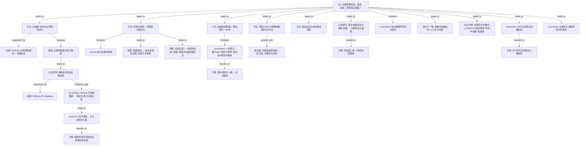

# AI-A Revised Decision Tree

paper_id: paper_40295872
question_id: Q5
revision_source:
  - original_tree: @rounds/A_tree_round1_paper_40295872_Q5.md
  - attack_file: @rounds/B_attack_tree_paper_40295872_Q5.md
  - paper: @chunks/paper_40295872_jin2025_shr_sofa_af_mortality_cardiovasc_diabetol.md

question: 该分析依赖哪些参数假设？是否满足？（Cox 比例风险、RCS/非线性、缺失 MAR、logistic nomogram 等）。若是复杂抽样/加权设计：是否正确使用权重？缺失如何处理？ML/预测工具的划分与验证假设是什么？

## 1. Revised Evidence Map

| evidence_id | location | evidence_summary | used_by_node |
|---|---|---|---|
| E1 | Methods Statistical analysis | 主推断用 Cox proportional hazards；单因素 P&lt;0.05 进多因素；Model1/Model2 层级校正 | N1, N2 |
| E2 | Methods Statistical analysis | 写明 PH「assumptions … were validated using Schoenfeld residual analysis」——仅声明，无数值 | N3, N3u |
| E3 | Results 全文 | 未报告 Schoenfeld 全局/逐变量 P 或违例变量清单 | N3u, N4 |
| E4 | Methods Statistical analysis | 非线性：RCS with four knots；阈值 LRT P&lt;0.05 后 piecewise Cox；knots 百分位未写 | N5, N5c |
| E5a | Results RCS | Low SOFA：院内/30 天非线性显著；1 年 P-nonlinear=0.168（NS） | N6a |
| E5b | Results RCS | High SOFA：各时点 J 型；ideal SHR≈1.2；与阈值点 1.0 概念不同 | N6b |
| E6 | Data extraction + Statistical analysis | 缺失&gt;20% 剔变量；&lt;20% MissForest，假设 MAR | N7 |
| E7 | Methods | 未写 m、结局是否入预测矩阵、推断层 Rubin 或单套 complete；MissForest 常为单次填充 | N8 |
| E8 | 全文 | 未见 survey 权重/PSU/分层；单中心便利队列叙述 | N9 |
| E9 | Methods | Shapiro-Wilk；组间 T/KW、χ²/Fisher | N10 |
| E10a | Methods Statistical analysis | nomogram 校准：bootstrapping-corrected；Brier；**200** resamples | N11, N12 |
| E10b | Results Validation | Internal validation：**1,000** bootstrap；C-index 与校准 MAE | N11, N12 |
| E11 | Methods Data extraction | 「directed cyclic graph」识别路径；未给图/边清单 | N13 |
| E12 | Abstract vs Methods | Abstract「SHR quartiles」；Methods/Results 主用 **tertiles**——表述不一致 | N14a |
| E13 | Methods KM + Table 1 + cutoff | KM「SOFA … at the median」；Table1 SOFA median=4；Methods cutoff=5 → **切点不等** | N14b |
| E14 | Methods Mediation | 反事实框架 + bootstrap 中介；未检验序贯可忽略性/未测混杂/暴露–中介交互 | N17 |
| E15 | 全文 1 年终点 | 365 天死亡；未见 Fine-Gray 等竞争风险模型 | N18 |

## 2. Revised Decision Tree - Mermaid

> 脱敏：无具体疾病名、指标名、切点数值、样本量；仅框架。

## 3. Revised Node Table

> `claim` 已脱敏。

| node_id | node_type | claim | evidence_location | evidence_summary | confidence | risk_tag |
|---|---|---|---|---|---|---|
| N0 | question | 参数假设、缺失、加权、预测验证是否妥当 | — | Q5 根 | high | |
| N1 | method | 主关联推断为多终点时点比例风险回归 | Methods | Cox + HR/CI | high | |
| N1b | method | 比例风险假设须验证后方可声称「满足」 | 方法学 | 插入 N1→N3 中间前提 | high | |
| N2 | method | 单因素显著性筛选后进多因素；两级校正模型 | Methods | 入模门槛明确 | high | |
| N3 | method | Methods **声明**已用残差法验证比例风险——非「已证实满足」 | Methods | 「were validated」一句 | low–medium | 声明≠核验 |
| N3u | uncertainty | Results 无检验数值 → PH 是否满足【证据不足/不可独立核】 | Results | 仅声明 | high | 证据不足 |
| N4 | limitation | 「声明有、数值不可核」属证据缺口而非与 N3 逻辑矛盾 | Results | evidence_gap | high | |
| N5 | method | 样条（固定结点数）+ 似然比阈值后分段回归 | Methods; Fig.1 | 方法对齐 | high | |
| N5c | uncertainty | 结点百分位未报告；阈值对结点敏感【证据不足】 | Methods | 原文未明确说明 | medium | |
| N6a | claim | 非线性结论依赖器官层与时点；低层远期可不显著 | Results RCS | P-nonlinear 时点分支 | high | |
| N6b | claim | 高层持续非线性；分段阈值点与曲线最低点是不同概念 | Results RCS | 勿混同 | high | |
| N7 | method | 高缺失剔变量；较低缺失算法填充；显式 MAR | Methods 两处 | 描述一致 | high | |
| N8 | uncertainty | m、结局入模、Rubin：原文不透明；算法名不等于规范多重插补推断 | Methods | risk=原文不透明 | high | 原文不透明 |
| N9 | claim | 原文未提及复杂抽样/权重；在便利队列语境下不宜套调查加权假设 | 全文 | 「未提及」非绝对证明「不存在」 | medium | |
| N10 | method | 连续变量正态性与组间检验假设 | Methods | 基线表口径 | high | |
| N11 | method | 预测工具假设为分类死亡概率，非生存函数 S(t) | Methods; Results | logistic nomogram | high | |
| N12 | statistic | 内部重抽样校准 + 区分度；Methods 与 Results 重抽样次数冲突 → 校准可信度降级 | E10a/E10b | confidence 降 | medium | inconsistency |
| N13 | uncertainty | 有向图路径未展示；cyclic 用词非常规 | Methods | 原文未明确说明 | low | 证据不足 |
| N14a | uncertainty | 摘要分位用词 vs 正文分位层——表述不一致（非分层逻辑自相矛盾） | Abstract; Methods | severity 相对低 | medium | 表述不一致 |
| N14b | uncertainty | 结果「中位数切」与 Methods 固定阈值并存；样本中位数≠该阈值 → 分组口径冲突 | KM; Table1; Methods | 切点确定不等 | high | inconsistency |
| N17 | uncertainty | 中介：序贯可忽略性/未测混杂/暴露–中介交互原文未检验 | Methods Mediation | Q5 必覆盖 | high | 因果识别 |
| N18 | uncertainty | 远期终点未见竞争风险模型 → 随访偏倚可能 | 全文 | 原文未明确说明 | medium | |
| N15a | transfer | 若迁移为推断性研究：须导出比例风险检验表 | 用户/引擎约束 | 非原文做法 | high | user_input |
| N15b | transfer | 插补按规范 m 套 + 合并规则，勿照抄不透明叙述 | 项目铁律 | 推断层 | high | user_input |
| N15c | transfer | 中介须预声明识别假设与敏感性 | 迁移建议 | 补 M1 | high | |
| N16 | transfer | 第二库外验≠调查加权；勿套加权模板 | 用户研究 | 双库 | high | user_input |

## 4. Final Answer Based on Revised Tree

关键假设栈应读作「声明—证据—缺口」三层，不宜写成「论文已证明全部假设满足」：

1. **比例风险**：Methods 声明用残差法验证；Results **无可复核数值** → 仅能写「作者声明已做」，**不能**独立断言「假设已满足」。迁移推断研究须强制落盘检验表。
2. **暴露–结局形态**：默认允许非线性；样条 + 阈值后分段回归。形态依赖**器官分层与随访时点**（低层远期可不显著；高层可持续非线性）。分段阈值点与曲线最低点勿混同；结点位置原文未写。
3. **缺失**：MAR + 算法填充 + 高缺失剔变量。**m / 结局入模 / Rubin** 原文不透明；算法名≠规范多重插补推断。迁移须规范化。
4. **加权**：原文未提及复杂抽样；非调查设计语境；第二库外验不是加权推断。
5. **预测工具**：分类概率模型 + 内部重抽样校准/区分度；重抽样次数文内冲突 → 内部性能证据降级；未见独立外持划分比例。
6. **中介识别假设**与**远期竞争风险**：原文基本未检验/未建模 → Q5 必记缺口。
7. **口径**：摘要分位用词 vs 正文分位层属表述不一致；器官「中位数切」vs 固定阈值且样本中位数≠阈值属**真实切点冲突**。

## 5. Revision Log

| critique_id | accepted_or_rejected | action | reason |
|---|---|---|---|
| A1 | accepted | N3 改为「声明已验证」；confidence→low–medium；加 N3u | 高：声明≠满足 |
| A2 / E1 | accepted | N3→N4 改 `evidence_gap`；删 contradicted_by | 文本缺口非逻辑矛盾 |
| P1 | accepted | 插入 N1b「PH 需验证」 | 补推导链 |
| A3 / A4 | accepted（部分） | N5c knots caveat；拆 N6a/N6b | 补阴性与阈值/最低点区分 |
| A5 / A6 | accepted | N8 明确算法≠MI推断；risk_tag→原文不透明 | 中高相关 |
| A7 | accepted | N9 改为「未提及」弱断言 | 避免「不存在」绝对化 |
| A8 | accepted | E10→E10a/E10b；N12 medium | 200 vs 1000 |
| A10 / P5 | accepted | 拆 N14a/N14b；N14b 写明中位数≠固定阈值 | 高：性质不同 |
| M1 | accepted | 新增 N17 + N15c | 高：中介假设遗漏 |
| M2 | accepted | 新增 N18 | 中：竞争风险 |
| A11 / E4 | accepted | N15→N15a/N15b；推断限定 | 拆迁移操作 |
| A12 | accepted | N16 保留并写外验≠加权 | 低但合理 |
| M3–M5 | accepted（部分） | 时依协变量/EPV/knots 敏感性入 Remaining | 不全部升主链以免过载 |
| A9 | accepted | 保留 N13 | 低 |

## 6. Remaining Uncertainty

- U1: 补充材料是否含比例风险检验数值表（主 chunk 未见）。
- U2: 填充实现是单次算法迭代还是真 m 套池化。
- U3: 校准重抽样次数以 Methods 还是 Results 为准。
- U4: Model2 协变量时间口径（基线 vs 时变）原文未明确说明。
- U5: 亚组事件数/EPV 是否一律充足——原文仅笼统提 underpowered subgroups。
- U6: 「directed cyclic graph」是否笔误及是否真实约束入模集。
