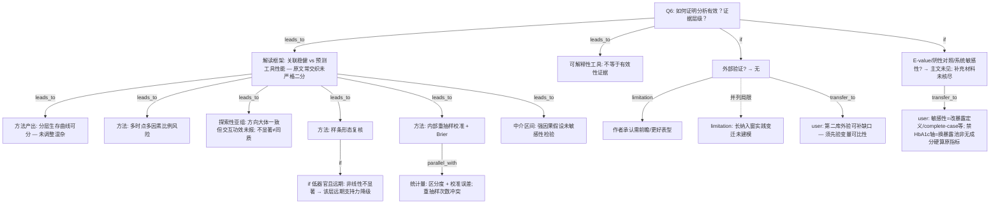

# AI-A Revised Decision Tree

paper_id: paper_40295872
question_id: Q6
revision_source:
  - original_tree: @rounds/A_tree_round1_paper_40295872_Q6.md
  - attack_file: @rounds/B_attack_tree_paper_40295872_Q6.md
  - paper: @chunks/paper_40295872_jin2025_shr_sofa_af_mortality_cardiovasc_diabetol.md

question: 论文如何证明分析有效？（内部验证：C-index/校准/bootstrap；外部验证；敏感性/亚组；阴性对照；E-value）。证据强度如何？

## 1. Revised Evidence Map

| evidence_id | location | evidence_summary | used_by_node |
|---|---|---|---|
| E1 | Results KM / Fig S2 | 四组合 KM；全局 log-rank P&lt;0.001；未详配对多重校正；未调整混杂 | N1 |
| E2 | Results Table 2 | 多时点多因素 Cox HR/CI；高暴露+高器官组风险最高 | N2 |
| E3a | Results 亚组叙述 | 称亚组风险排序大体一致；交互「多不显著」；**未给完整交互 P 矩阵**（Table S1–S3 未在主 chunk 展开） | N3 |
| E3b | Results 亚组 | 「少数功效不足亚组」CI 含空值——一致性有限定 | N3 |
| E4a | Results Fig.1 RCS | 分层样条 + P-nonlinear；低器官层 1 年 **P-nonlinear=0.168（NS）** | N4, N4neg |
| E4b | Results RCS | 低层阈值点 vs 高层曲线最低点——两概念并存勿混同 | N4 |
| E5a | Methods | Bootstrapping-corrected calibration；Brier；**200** resamples | N5 |
| E5b | Results | optimism-corrected 校准；**1,000** bootstrap；C-index 与 MAE | N5, N6 |
| E5c | Methods | 明确提及 Brier scores（与 MAE 互补） | N5 |
| E6 | Results Fig.3 SHAP | 特征贡献与交互形态——可解释性，非外验 | N7 |
| E7 | Results Fig.4 Mediation | Bootstrap 中介比例随时间下降；未做 E-value/负对照 | N8 |
| E8 | 全文 Limitations | **无**外部验证队列；单中心；呼吁前瞻表型验证 | N9, N11 |
| E9 | 主文 10 页检索 | 主文未见 E-value / 阴性对照 / 插补头对头敏感性；**补充材料未纳入本 chunk** | N10 |
| E10 | Discussion | 预测工具性能叙述与关联重要性交织——原文未严格二分效度 | N12 |
| E11 | user_input | 用户计划第二库外验；双库主分析禁 HbA1c 轴暴露池（非「无 HbA1c 仍算原指标」） | N13, N14 |

## 2. Revised Decision Tree - Mermaid

> 脱敏：无具体疾病/指标数值/样本量。

## 3. Revised Node Table

| node_id | node_type | claim | evidence_location | evidence_summary | confidence | risk_tag |
|---|---|---|---|---|---|---|
| N0 | question | 有效性如何证明、强度如何 | — | Q6 | high | |
| N12 | claim | 「关联轨 / 预测轨」是解读框架；原文讨论常交织两轨，要求不同 | Discussion | AI-A 框架 + 原文混用警示 | medium | |
| N1 | method | 分层生存曲线显示组间分布不全相同；未调整混杂；配对细节不明 | Results; Fig S2 | log-rank 全局 | medium | |
| N2 | method | 校正后多时点效应同向支持关联稳健（文内） | Table 2 | 非因果证明 | high | |
| N3 | method | 亚组作探索性稳健性线索；交互不显著≠效应一致；少数亚组 CI 含空；表 S 未在 chunk 内核尽 | Results 叙述 | confidence 降 | low–medium | 探索性 |
| N4 | method | 样条提供非线性/阈值形态复核 | Fig.1 | 方法非「证据」标签 | high | |
| N4neg | claim | if 低器官远期非线性 NS → 该条件分支下形态支持力降级 | Results | P-nonlinear NS | high | |
| N5 | method | 预测工具内部验证含校准曲线与 Brier；次数 Methods/Results 冲突需确认 | E5a–c | 正式 uncertainty | medium | inconsistency |
| N6 | statistic | 区分度与校准误差并列报告；CI 是否 optimism-corrected 原文未写清 | Results | 非「文本证据」类型 | medium | |
| N7 | method | 可解释性增强临床可信，**不计入**预测外推有效性 | Fig.3 | 从 N12 旁路 | medium | 非效度证据 |
| N8 | evidence | 中介有重抽样区间；观察性下识别假设未敏感性检验 | Fig.4 | 比例下降 | medium | 因果过度 |
| N9 | limitation | 无外部/多中心验证 | Limitations | 单中心 | high | 可迁移性不足 |
| N9t | limitation | 长研究期实践变迁可能削弱泛化 | Limitations | temporal changes | medium | |
| N10 | uncertainty | 主文未见 E-value/阴性对照/插补头对头；补充材料未纳入检查 → 穷尽否定降级 | 主文 | absence 有范围 | medium | 证据范围 |
| N11 | limitation | 作者呼吁前瞻表型亚组验证 | Strengths and limitations | 与 N9 并列 | high | |
| N13 | transfer | user_input：第二库外验可补最大缺口；前置条件=关键暴露/评分变量外验库可得且口径可比 | 用户确认 | 非原文结论 | high | user_input |
| N14 | transfer | user_input：补敏感性；「禁 HbA1c 轴」=双库主分析换可算复合指标池，**不是**无该成分仍计算原 HbA1c 依赖指标 | 用户门控 | 澄清 B-N10 | high | user_input |

## 4. Final Answer Based on Revised Tree

有效性证据宜拆开读，且承认原文常把关联与预测叙事缠在一起：

**关联（文内中–高，非因果）**  
多时点校正后效应同向、分层生存可分、样条形态复核（须保留低器官远期非线性不显著分支）。亚组一致性仅作**探索性**线索：交互功效未报、不显著≠同质、少数亚组 CI 含空；补充表未在当前材料内核尽。

**预测工具（内部中，外推低）**  
分类概率工具的内部重抽样校准/区分度/Brier；重抽样次数文内冲突 → 性能数字须谨慎引用。可解释性工具**不能**充当外验。无外部验证。

**未在主文见到的层级**  
E-value、阴性对照、系统敏感性头对头等——结论限于主文检索范围，补充材料需另核。

综合：文内关联与表观内部性能有支撑；跨中心/病种推广证据不足。用户第二库外验对准该缺口，但须先验变量可比性；暴露敏感性按用户门控换池，勿把「禁 HbA1c 轴」误写成「无成分硬算原指标」。

## 5. Revision Log

| critique_id | accepted_or_rejected | action | reason |
|---|---|---|---|
| B-N01 / B-E02 / B-P03 | accepted | N3→low–medium；探索性+功效限定；补 E3b | 高 |
| B-N02 / B-P01 / B-M02 / B-E03 | accepted | N4 改 method；加 N4neg；区分阈值点 vs 最低点 | 高 |
| B-N03 / B-M01 | accepted | N5 正式标次数冲突；补 Brier E5c | 高 |
| B-N04 / B-E04 | accepted | N7 旁路出 N12；N5∥N6 parallel_with | 中–高结构 |
| B-N06 / B-P04 | accepted | N10 限主文范围；补充材料未核尽 | 高 |
| B-N07 / B-E01 | accepted | N12 标注「解读框架+原文混用」 | 中 |
| B-N05 / B-M03 | accepted | N8 加识别假设 caveat | 中 |
| B-N08 | accepted | N6 类型→statistic | 中 |
| B-N09 / B-E05 / B-P06 | accepted | N13 user_input + 变量可比前置 | 高 |
| B-N10 | accepted | N14 重写：禁轴=换池非硬算原指标 | 高：消除方法矛盾表述 |
| B-N11 | accepted | N1 加未调整混杂/全局检验限定 | 中 |
| B-N12 | accepted（部分） | N2 保持 method；具体 HR 留证据表 | 低 |
| B-M04–M06 | accepted（部分） | E3b / N9t / Follow-up 增量比较入 Remaining | 中低 |
| B-E06 / B-E07 | accepted（部分） | N14 澄清暴露差异；N9∥N11 | 中低 |

## 6. Remaining Uncertainty

- U1: Table S1–S3 交互 P 完整矩阵与预先指定状态（chunk 未展开）。
- U2: C-index CI 是否与校准同套 optimism-corrected bootstrap。
- U3: 200 vs 1,000 resamples 以何为准、是否影响 Brier。
- U4: 补充材料是否藏有 E-value/阴性对照/额外敏感性。
- U5: 是否存在相对传统评分的区分度增量比较（原文讨论暗示「超越」但无数表）。
- U6: 关联模型与预测模型指标不可互换解读。
