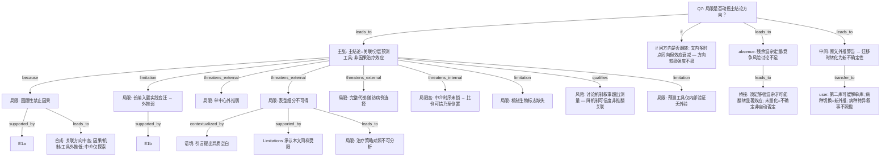

# AI-A Revised Decision Tree

paper_id: paper_40295872
question_id: Q7
revision_source:
  - original_tree: @rounds/A_tree_round1_paper_40295872_Q7.md
  - attack_file: @rounds/B_attack_tree_paper_40295872_Q7.md
  - paper: @chunks/paper_40295872_jin2025_shr_sofa_af_mortality_cardiovasc_diabetol.md

question: 局限有哪些？是否被合理讨论？是否动摇主要结论方向？（残余混杂、选择偏倚、因果倒置、外推、中介时序、AF 表型缺失、单中心等）

## 1. Revised Evidence Map

| evidence_id | location | evidence_summary | used_by_node |
|---|---|---|---|
| E1a | Strengths and limitations | 回顾性 → precludes causal inference | N1 |
| E1b | Strengths and limitations | 长纳入窗 temporal changes → 当代外推不确定 | N2 |
| E2 | Strengths and limitations | 单中心数据 → generalizability 受限 | N3 |
| E3 | Strengths and limitations | 缺炎症/超声/线粒体等直接标志 → 机制受限 | N4 |
| E4a | Strengths and limitations | 无法细分 AF 病因/类型/慢性度（新发 vs 既往） | N5 |
| E4b | Strengths and limitations | **rate versus rhythm control 等治疗策略不可分析** | N16 |
| E5 | Strengths and limitations | 变量易得仍称 broadly applicable；同时呼吁前瞻表型验证 | N6 |
| E6a | Introduction | ICU 相关心律问题可为入院主因或继发；预后研究 seldom distinguish | N7ctx |
| E6b | Limitations | 本文数据 does not allow detailed classification——承认同样受限 | N5, N7 |
| E7a | Methods 人群 | 排除缺代谢关键指标者 | N8 |
| E7b | Methods 人群 | 排除随访不可得者；与 E7a 合并导致 22419→15358，独立贡献未拆 | N8 |
| E8 | Methods Mediation | 反事实 + bootstrap；暴露–中介–结局时序窗未先验锁定 | N9 |
| E9 | Discussion 机制段 | 病理生理长段超出直接测量 | N10 |
| E10 | Results Table 2 | 多时点 HR **同向**但效应随随访延长**衰减**（如约 4.06→2.45） | N11 |
| E11 | 全文 | 未见 E-value；未见竞争风险作为局限深挖 | N12, N17 |
| E12 | Methods/Results 验证 | nomogram/SHAP 仅内部重抽样；无外部队列验证 | N19 |
| E13 | user_input | 用户：第二库外验 + 病种切换 → 单中心可部分缓解，病种切换引入新外推 | N14, N18 |

## 2. Revised Decision Tree - Mermaid

> 脱敏：无具体病名/指标数值；用户迁移场景以抽象占位符表述。

## 3. Revised Node Table

| node_id | node_type | claim | evidence_location | evidence_summary | confidence | risk_tag |
|---|---|---|---|---|---|---|
| N0 | question | 局限是否动摇主结论 | — | Q7 | high | |
| N13 | claim | 主结论应读作关联 + 分层预测，非因果治疗效应 | Limitations; 结论措辞 | relationship 非 causal effect | high | |
| N1 | limitation | 回顾性设计限制因果 | E1a | 明文 | high | 因果过度 |
| N2 | limitation | 长纳入窗实践变迁削弱当代外推 | E1b | 已入主干树 | medium | |
| N3 | limitation | 单中心 → 跨中心外推弱 | E2 | 明文 | high | 可迁移性不足 |
| N4 | limitation | 缺直接生物标志 → 机制解释受限 | E3 | 明文 | high | |
| N5 | limitation | 心律相关表型（病因/类型/慢性度）不可分 | E4a; E6b | 明文 | high | |
| N16 | limitation | 率控 vs 节律等治疗策略不可分析 → 临床操作外推更弱 | E4b | 原文明文曾漏 | high | 分支补全 |
| N6 | claim | 作者同时称 broadly applicable 又呼吁表型验证——外推边界模糊 | Limitations | 自我辩护张力 | medium | |
| N7ctx | evidence | 引言指出预后研究少区分异质情境 | Introduction | 语境非循环辩护 | high | |
| N7 | evidence | Limitations 承认本文数据同样无法细分 | Limitations | 与 Intro 分列 | high | |
| N8 | limitation | 缺代谢指标与缺随访合并剔除 → 选择偏倚；方向未 bound；两类贡献未拆 | E7a/b | 外部效度威胁 | medium | |
| N9 | limitation | 中介时序/可忽略性未锁 → **内部效度高风险**；比例仅探索 | E8 | confidence 升高度重视 | high | 因果倒置风险 |
| N10 | limitation | 机制叙事超出测量；**限定**机制可信度，不推翻关联主张 | Discussion | qualifies N13 | medium | |
| N11 | claim | 文内多时点效应同向 → 方向较稳；但效应随时间衰减 → 强度不稳 | Table 2 | 同向≠等强 | medium | |
| N12 | absence | 残余混杂定量、竞争风险未深挖 | 全文 | absence_of_evidence | medium | |
| N17 | claim | 未做 E-value ≠ 自动否定方向；须混杂强到翻转显著效应才动摇方向 | 逻辑桥接 | 接 N12 | medium | |
| N19 | limitation | 预测工具无外部验证 → 工具外推主张弱 | Methods/Results | 补 M2 | high | |
| N18 | transfer_bridge | 原文外推警告须先转化为迁移不确定性，再谈用户方案 | Limitations | 中间节点 | high | |
| N14 | transfer | user_input：第二库可部分缓解单库；病种切换引入新外推；病种特异机制/治疗话术不适用 | 用户确认 | 置信低于原文 derived | medium | user_input |
| N15 | synthesis | 关联方向中高；因果/机制/中介/工具外推低 | N1–N19 | 分层可信度 | high | |

## 4. Final Answer Based on Revised Tree

作者对回顾性非因果、单中心外推、机制标志缺失、表型不可分等核心局限有明文讨论，总体到位；但须补记：**治疗策略不可分析**、**预测工具无外验**，且中介时序未锁应升为**内部效度高风险**（比例仅探索，不可当机制定论）。

对主结论冲击需拆开：

| 结论类型 | 局限冲击 | 判断 |
|---|---|---|
| 组合暴露与死亡正相关（关联） | 残余混杂/选择可改效应量；文内多时点同向但效应衰减 | **方向文内较稳、强度不稳**；非因果 |
| 中介比例 | 时序与未测混淆 | **仅探索**；倒置风险未排除 |
| 预测工具可分层 | 无外验、单中心、表型/治疗策略不可分 | **外推弱** |
| 讨论中治疗分层建议 | 超出观察关联 | **易因果过度** |

综合：局限动摇的是因果声称、机制精确比例与跨中心工具性能，**不自动推翻**文内关联方向性描述。迁移时：第二库可部分缓解单库，但病种切换引入新外推；病种特异叙事与治疗对照不可照搬。

## 5. Revision Log

| critique_id | accepted_or_rejected | action | reason |
|---|---|---|---|
| B1 / B2 / P1 | accepted | E1→E1a/E1b；树补 N13→N2 | 高：长窗入主干 |
| B4 / M1 / P8 | accepted | 新增 N16 治疗策略不可分析 | 高 |
| B9 | accepted | N9 high；答案升格「探索/倒置风险」 | 高 |
| B10 / B18 | accepted | N13→N10 改 qualifies | 高：非矛盾 |
| B20 / M2 | accepted | 加 N18 桥 + N19 无外验 | 高 |
| B5 / P3 / B15 | accepted | E6a/E6b；N7ctx contextualized_by | 中 |
| B11 / P7 | accepted | N14 user_input；confidence medium | 中 |
| B16 | accepted | N11 补效应衰减 | 中 |
| B19 | accepted | N8 external / N9 internal 边类型 | 中 |
| B12 / B17 | accepted | 加 N17 桥接 | 中 |
| B6 / P4 | accepted | E7a/E7b 拆两类排除 | 中 |
| B3 | accepted | E2 专属 N3 | 中 |
| B13 / M3–M5 | accepted（部分） | 入 Remaining；不全部升主链 | 低–中 |
| B14 | accepted（部分） | N13 已由 Limitations+结论措辞支撑 | 中 |

## 6. Remaining Uncertainty

- U1: 代谢缺失 vs 随访缺失各自导致的选择偏倚方向（原文未拆、未 bound）。
- U2: 出院后死亡匹配误差未量化。
- U3: 竞争风险对远期终点的具体影响。
- U4: 「broadly applicable」与「需表型验证」并列表述的外推边界。
- U5: 高风险亚组极宽 CI 是否暗示不稳定（作者未深挖）。
- U6: 单中心×长时序叠加的「时代–中心」交互未合并讨论。
