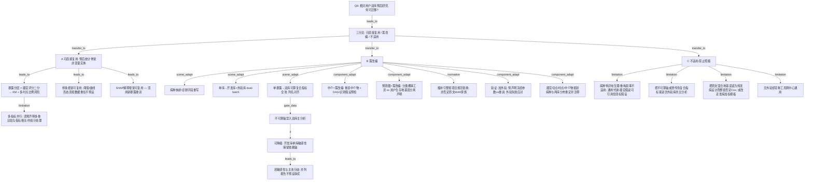

# AI-A Revised Decision Tree

paper_id: paper_40295872
question_id: Q8
revision_source:
  - original_tree: @rounds/A_tree_round1_paper_40295872_Q8.md
  - attack_file: @rounds/B_attack_tree_paper_40295872_Q8.md
  - paper: @chunks/paper_40295872_jin2025_shr_sofa_af_mortality_cardiovasc_diabetol.md

question: 该文方法与套路哪些可迁移到「我的研究」？哪些需改编？哪些不适用？

### 用户已确认的「我的研究」（修正后答案必须保留）

| 维度 | 用户定稿 |
|---|---|
| 疾病 | **脓毒症**（非原文心律相关危重症） |
| 数据库 | **MIMIC-IV 开发 + eICU 外验**（原文仅单库） |
| 暴露 | **不只原文单指标**；并行跑双库可算的**全部复合指标**；eICU 无 HbA1c ⇒ 主分析**禁止 HbA1c 轴**（SHR / HGI / HbA1c_HDL_C / eGDR）；上述可作 **MIMIC 单库敏感性**；**禁止 HDL/LDL 透传**「组成=自身」条目进配对池 |
| 方法迁移 | 原文 **预后预测套路**（暴露×器官评分分层、多时点 Cox、RCS、KM、中介、nomogram、SHAP）迁到脓毒症双库 batch |
| 地基 | **预后 survival**，非发病 |

## 1. Revised Evidence Map

| evidence_id | location | evidence_summary | used_by_node |
|---|---|---|---|
| E1a | Methods Statistical analysis | 统计套路骨架：分层交叉→KM→多时点 Cox→RCS | N1, N1a, N1b |
| E1b | Methods/Results | 中介（碳酸氢盐路径）、logistic nomogram、SHAP——组件异质、绑定具体机制/变量 | N1c_shap, N1c_med, N1c_nomo |
| E2 | Methods 人群 | 单库；特定诊断纳排；需 HbA1c+FBG 算 SHR | N2, N3 |
| E3 | Methods 公式 | SHR 依赖 HbA1c → 无 HbA1c 则该指标不可算 | N3 |
| E4 | Results 发表链 | Table1→组合 KM/Cox→亚组→RCS→nomogram→SHAP→mediation 顺序可借鉴 | N1 |
| E5 | Limitations | 无外验、单中心、表型缺失 | N8, N14d |
| E6 | Methods 缺失 | MissForest + MAR；工程上可改为 MICE+Rubin（规范迁移非否定原文） | N7 |
| E7 | Methods 预测 | nomogram=**logistic** + bootstrap；主推断另有 **Cox** → 原文为混合地基 | N1c_nomo, N14c |
| E8 | Discussion | AF 特异（电生理/重构）与通用代谢–器官交互（线粒体/酸中毒等）混写 | N14a |
| E9 | Methods 引文 [18] | SOFA cutoff=5 所引为危重症/微循环概念验证——非病种特异铁律，稳健性仍弱 | N12 |
| E10 | user_input | 脓毒症；双库；全可算复合指标池；禁双库主分析 HbA1c 轴；禁 HDL/LDL 透传；survival 地基 | N0, N9–N11, N14b |

## 2. Revised Decision Tree - Mermaid

> 脱敏：图中用「某病种/某指标池/某器官评分」；用户场景保留抽象角色（开发库/外验库/禁不可算轴）。

## 3. Revised Node Table

| node_id | node_type | claim | evidence_location | evidence_summary | confidence | risk_tag |
|---|---|---|---|---|---|---|
| N0 | question | 迁移三分法判定 | 用户确认 + Methods | Q8 | high | |
| N13 | claim | 必须分「复用 / 改编 / 不适用」 | Q8 模板 | 强制分叉 | high | |
| N1 | transfer | **可直接复用**：预后模块**统计骨架**（非具体暴露名/病名） | E1a; E4 | 分层→KM→Cox→RCS 顺序 | high | |
| N1a | transfer | 暴露分层 × 器官评分交叉 + 多时点死亡 Cox/KM | Statistical analysis | 四组合为单暴露特例 | high | |
| N1a_m | transfer | 全池并行时须预声明 FDR/相关矩阵/共组分——否则框架膨胀失效 | user 全池设计 | 补 M-01 | high | 多重比较 |
| N1b | transfer | 样条框架可复用；阈值与 J 型类形态**不预设**迁移 | Fig.1 | 发现≠模板参数 | high | |
| N1c_shap | transfer | SHAP 解释链可复用，须随新暴露/模型重训 | Fig.3 | 从原 N1c 拆出 | high | |
| N1c_med | transfer | **中介需改编**：重选中介 + DAG/识别假设/敏感性；原文为探索 | Fig.4; Limitations | 原「可复用」过宽 | high | 因果识别 |
| N1c_nomo | transfer | **列线图需改编**：原文 logistic 预测工具 vs 用户 survival 地基须分离声明 | E7 | 混合地基 | high | 地基冲突 |
| N2 | transfer | 改编：新病种纳排/诊断；禁止沿用原文 ICD 逻辑 | user_input | 病种切换 | high | |
| N3 | transfer | 门控：依赖缺失轴成分的指标禁入双库主分析（数据不可达为主；机制解释力另标不确定） | E3; user | 双理由分列 | high | |
| N4 | transfer | 依赖轴可降级为开发库单库敏感性 | user_input | 可选 | high | |
| N4d | transfer | 敏感性与主池不一致时并列报告 | 方法学 | 补分歧协商 | medium | |
| N7 | transfer | MissForest→规范 MI+Rubin 属**工程规范迁移**，非原文方法错误；同属 MAR 家族；疑 MNAR 另做敏感性 | E6; 铁律 | normative | high | |
| N8 | transfer | 加外验；预声明冻结 vs 重训；规划外验失败诊断路径 | E5; user | 补缺口 | high | |
| N9 | transfer | 「需改编」总括 | — | 场景 vs 组件两维 | high | |
| N10 | transfer | 流水线= survival dual-batch（开发+外验） | user_input | 地基=预后 | high | |
| N11 | transfer | 暴露=双库可算复合指标全池；列名/单位对齐；禁透传伪复合 | user_input | 非单指标复刻 | high | |
| N12 | transfer | 器官切点：原文阈值引危重症文献但单篇弱；须按新病种重检索确认 | E9 | 修正「AF 特有切点」误述 | medium | |
| N14 | transfer | **不适用**总括 | — | — | high | |
| N14a | limitation | 病种特异电生理/重构不适用；通用代谢–器官交互可作**可检验假说**引用 | E8 | 避免一刀切 | high | |
| N14b | limitation | 禁：不可算轴进含外验主分析；禁 HDL/LDL 透传进池 | user 门控 | 保留用户约束 | high | |
| N14c | limitation | 禁：误读原文为纯发病而否定 Cox；禁改走发病/加权地基；logistic 工具须改编而非整链废弃 | E7 | 修正「发病地基」误读 | high | |
| N14d | limitation | 禁：仅内部验证宣称跨中心通用工具 | Limitations | 原文亦弱 | high | |

## 4. Final Answer Based on Revised Tree

### A. 可直接复用（统计骨架，改标签不改结构）

可平移到用户 **预后 survival dual-batch** 的发表故事线：

1. 暴露分层 × 器官功能障碍评分交叉 → 组合风险层（多指标时加多重比较/相关处理）  
2. KM + log-rank  
3. 多随访时点 Cox（时点按新病种惯例重定）  
4. 分层 RCS（**重估**形态，不预设原文阈值）  
5. 亚组稳健性  
6. SHAP 解释（随新模型重训）

### B. 必须改编

| 项 | 原文 | 我的研究（保留用户定稿） |
|---|---|---|
| 病种与纳排 | 特定危重心律队列 | **脓毒症**定义与排除重写 |
| 数据 | 仅单库 | **MIMIC 开发 + eICU 外验** |
| 暴露 | 主打单指标（依赖 HbA1c） | **双库可算复合指标全池并行**；主分析 **剔除 HbA1c 轴**；**禁 HDL/LDL 透传** |
| HbA1c 轴 | 主分析核心 | **仅 MIMIC 单库敏感性**；与主池分歧则并列报告 |
| 中介 | 探索性、绑定原文中介物 | 重选中介 + DAG/识别假设预检 |
| 列线图 | logistic 概率工具 | 与 survival 地基**分离声明**后改编或替换验证口径 |
| 插补/推断 | MissForest 叙述 | 引擎 **m=5 + Rubin**（规范迁移） |
| 验证 | 仅内部 bootstrap | **外验** + 冻结/重训规则 + 失败应对 |
| 切点/时点/中介物 | 原文设定 | 按脓毒症与两库分布重选并注释 |
| 地基 | Cox 推断 + logistic 工具混合 | **预后 survival** dual-batch，非发病 |

### C. 不适用

- 将病种特异电生理/重构与固定干预话术直接写成脓毒症结论（通用代谢–器官假说可引用但须标假设）  
- 把 **SHR/HGI/HbA1c_HDL_C/eGDR** 或 **HDL/LDL 透传** 塞进 **含 eICU 的主分析**  
- 因误读「发病地基」而整链丢掉 Cox，或改走发病 logistic / 加权模板  
- 无外验却宣称工具已可跨 ICU 通用  

**一句话**：迁的是 **预后模块菜谱**；不迁 **原文病种×单指标实体菜品**；HbA1c 依赖指标降级为 MIMIC 敏感性，双库主菜换成可算复合指标全池（禁透传伪复合）。

## 5. Revision Log

| critique_id | accepted_or_rejected | action | reason |
|---|---|---|---|
| N-01 / E-01 / M-05 | accepted | 拆 N1c→SHAP 复用 / 中介改编 / nomogram 改编 | 高：复用边界过宽 |
| N-07 / P-02 / E-05 | accepted | N14c 改为混合地基表述；Cox 可迁、logistic 工具须改编 | 高：纠正「发病地基」误读 |
| N-07(N14a) | accepted | N14a 拆病种特异 vs 通用代谢–器官假说 | 高 |
| M-01 | accepted | 新增 N1a_m 多重比较/相关 | 高：全池空洞 |
| N-02 / N-03 | accepted | N1a/N1b 警示写入树 | 中 |
| N-04 | accepted | N3 数据不可达 vs 机制不确定分列 | 中 |
| N-06 / M-03 | accepted | N8 冻结/重训 + 外验失败路径 | 中 |
| N-08 / P-06 | accepted | N12 修正「AF 特有 5 分」；单篇稳健性不足 | 中 |
| N-05 / E-02 / P-03 | accepted | N7 normative；非否定原文 | 低–中 |
| N-09 / M-02 | accepted | N4d 分歧协商 | 低 |
| M-04 | accepted（部分） | N11 列名/单位对齐 | 中 |
| M-06 | accepted（部分） | Remaining 记 MNAR | 中 |
| M-07 | accepted（部分） | Remaining 文献核查 | 低 |
| E-04 / E-06 | accepted（部分） | N9 下分 scene_adapt vs component_adapt；门控与全池解耦表述 | 中低 |
| 用户约束 | retained | 脓毒症/双库/全池/禁 HbA1c 轴/禁 HDL·LDL 透传/survival 地基全文保留 | 任务强制 |

## 6. Remaining Uncertainty

- U1: 脓毒症下器官评分切点是否沿用原文文献阈值，抑或改用病种常用切点/分位——须课题检索后确认。  
- U2: 中介变量选择（非原文中介物默认）与引擎实验室门控如何对齐。  
- U3: 双库设定下预测工具是「开发库建模+外验校准」还是禁止跨库硬套同一张图。  
- U4: 多时点终点（院内 vs 短期 landmark 等）与原文时点对齐属改编。  
- U5: 脓毒症文献中依赖轴指标若证据强，敏感性报告优先级是否上调。  
- U6: 检验缺失若与严重度相关（MNAR），除规范 MI 外是否加 pattern-mixture 等敏感性。
