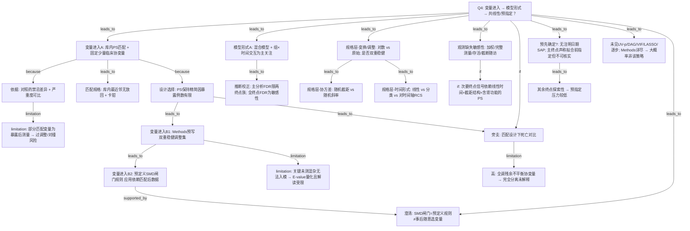

# AI-A Revised Decision Tree

paper_id: paper_42898695
question_id: Q4
revision_source:
  - original_tree: adversarial_lit_reading/rounds/A_tree_round1_paper_42898695_Q4.md
  - attack_file: adversarial_lit_reading/rounds/B_attack_tree_paper_42898695_Q4.md
  - paper: adversarial_lit_reading/chunks/paper_42898695_t2dm_mimic_eicu.md

## 1. Revised Evidence Map

| evidence_id | location | evidence_summary | used_by_node |
|---|---|---|---|
| E1 | Section 2.4 | 库内 1:3 NN 无放回匹配；PS 五变量固定；卡钳 0.25 SD；severity scoring 跨库不可比故库内匹配 | N1,N2,N3 |
| E2 | Section 2.4 | 暴露人数有限→PS 保持精简；残余混杂用双重稳健结局模型而非扩 PS | N4,N5a |
| E3 | Section 2.4 | Methods 预写 DR 调整集：来源库、慢性肝病、心衰、磺脲/胰岛素、day-1 白蛋白/钠、结局分析物自身 | N5a |
| E4 | Results 3.1 | 匹配后每个 \|SMD\|>0.10 的变量带入 DR 结局模型（预定义闸门规则的应用结果） | N5b |
| E5 | Section 2.4 + 4.1 | day-1 eGFR 与 24-h SOFA 部分暴露后测量；作者承认过调整/对撞风险；敏感性去掉 eGFR（及 SOFA）后 ALP 信号不稳 | N2b,N11b |
| E6 | Section 2.5 | LMM `analyte ~ group × day` 随机截距；交互=主关注；主结局=总胆红素；ALP 同入两分析物 FDR 族 | N8,N9 |
| E7 | Section 2.3 | 另报对全部轨迹结局做 BH 的敏感性；主分析 FDR 仅两分析物族 | N9 |
| E8 | Section 2.5 | 八种进一步规格：log、随机斜率、分类 day、day 的 RCS、DR、校正 day-1 值、加来源库等 | N10a,N10b,N10c |
| E9 | Section 2.5 + 3.2 | 观测缺失敏感性：IPOW、≥3 次测量、存活出院、截断至 day4；ALP 对部分规格脆弱 | N11a,N11b |
| E10 | Section 2.5 + 3.3 | 死亡：Fisher / 条件 logistic / 匹配集 GEE；全调 20 个残余不平衡协变量→完全分离未解释 | N12,N17 |
| E11 | Section 2.3 + 2.5 | 无注明日期 SAP；主结局与两分析物族称拟合前指定但不可独立核实；其余探索性 | N13,N14 |
| E12 | Section 2.5 + 3.3 | E-value 用于量化未测混杂；对某点估计可算保护值，但当 CI 含无效值时对「显著关联」的保护解读受限 | N7 |
| E13 | 全文 Methods | 未见 UV-p、DAG、VIF、LASSO/逐步的明确叙述 | N15 |

## 2. Revised Decision Tree - Mermaid

> ⚠️ 脱敏：图中不得出现文献具体数值/疾病名/药名/库名/样本量等；用泛化占位符。

## 3. Revised Node Table

> ⚠️ `claim` 列脱敏。

| node_id | node_type | claim | evidence_location | evidence_summary | confidence | risk_tag |
|---|---|---|---|---|---|---|
| N0 | question | Q4：进入逻辑、模型形式、预指定程度 | — | 根问题 | high | |
| N1 | method | 库内倾向评分匹配，固定少量临床协变量入 PS | Section 2.4 | 非 UV-p 筛选 | high | |
| N2 | claim | 匹配变量含肾功能与严重度，依据为对照药禁忌与可比性 | Section 2.4 | 临床先验 | high | |
| N2b | limitation | 部分匹配变量测于暴露确立后，作者自认过调整/对撞风险 | Section 2.4, 4.1 | 主规格仍保留 | high | 因果过度 |
| N3 | method | 库内最近邻、无放回、卡钳（原文明确） | Section 2.4 | 匹配规格 | high | |
| N4 | method | PS 保持精简；残余混杂改由双重稳健结局模型处理 | Section 2.4 | 设计选择 | high | |
| N5a | method | Methods 预写双重稳健调整集（来源库、共病、并用药、基线实验室等） | Section 2.4 | 预指定名单 | high | |
| N5b | method | 另有预定义 SMD 闸门：匹配后超阈变量入结局模型 | Results 3.1 | 规则预写、应用依赖数据 | high | |
| N7 | limitation | 关键未测混杂无法入模；E-value 量化，但 CI 含无效时解读受限 | Section 2.5, 3.3 | 方法局限 | high | |
| N8 | method | 混合模型以组×时间交互为轨迹主关注；主终点为指定肝指标轨迹 | Section 2.5 | 非默认全交互 | high | |
| N9 | method | 主分析 FDR 限两终点族；全轨迹 FDR 为补充敏感性（属推断校正） | Section 2.3, 2.5 | 非协变量筛选 | high | |
| N10a | method | 规格层：变换与是否双重稳健调整 | Section 2.5 | 进一步规格 | high | |
| N10b | method | 规格层：随机截距 vs 随机斜率 | Section 2.5 | 协方差结构 | high | |
| N10c | method | 规格层：线性/分类/对**时间轴**样条（非暴露主 RCS） | Section 2.5 | 时间形式 | high | |
| N11a | method | 观测缺失敏感性：观察加权、完整测量、存活、截断随访 | Section 2.5, 3.2 | 与规格并列另一层 | high | |
| N11b | claim | 某次要终点信号依赖线性时间项、截距-only 结构、含肾功能的 PS | Section 3.2, 4.1 | 三依存条件 | high | |
| N12 | method | 死亡对比在匹配设计下用分层/聚类估计 | Section 2.5, 3.3 | 探索性 | high | |
| N17 | limitation | 试图全调残余不平衡协变量→完全分离，未解释；报告估计未做该全调整 | Section 3.3 | 证据缺口 | high | 证据不足 |
| N13 | uncertainty | 无注明日期 SAP；主终点「拟合前指定」仅作者声称、不可核实 | Section 2.3, 2.5 | 预指定弱证据 | medium | 证据不足 |
| N14 | claim | 探索性终点的预指定压力低于主终点 | Section 2.3 | 标签含义 | medium | |
| N15 | uncertainty | Methods 详尽但未见 UV-p/DAG/VIF/LASSO/逐步 → 大概率非该策略，不能严格排除漏报 | 全文 | 原文未明确说明 | medium | |
| N16 | claim | SMD 闸门属预定义规则，不能等同于事后随意选变量 | Section 2.4 + 3.1 | 澄清误读 | high | |

## 4. Final Answer Based on Revised Tree

本文协变量与建模逻辑属于**药物流行病学匹配–双重稳健**套路，而非单因素 p / LASSO / 逐步选模。

**变量进入**：库内倾向评分匹配使用**固定少量临床协变量**（含肾功能与严重度，因对照药禁忌与跨库评分不可比）；作者承认部分变量为暴露后测量并存在过调整/对撞风险。因暴露例数有限，**PS 保持精简**，残余混杂由 **Methods 预写的双重稳健调整集**处理，并叠加**预定义 SMD 闸门**（规则预写，应用结果依赖匹配后数据——**不等于**事后随意挑变量）。关键未测混杂无法入模，用 E-value 量化且当区间含无效值时解读受限。Methods 详尽但未见 UV-p、DAG、VIF、LASSO/逐步 → **大概率非该策略**。

**模型形式**：轨迹主模型为混合模型的**组×时间交互**；对时间轴的样条/随机斜率等属进一步规格层，与观测缺失敏感性（加权/完整测量等）分层。主分析 FDR 仅限两终点族（属推断校正）。死亡支路在匹配设计下报告；**全调残余不平衡协变量因完全分离未解释**，故报告的死亡估计并非该全调整模型。

**预指定**：无注明日期的统计分析计划；主终点与两终点族称拟合前指定但**不可独立核实**；其余为探索性。

## 5. Revision Log

| critique_id | accepted_or_rejected | action | reason |
|---|---|---|---|
| A-N16 / A-E2 / P3（高） | accepted | 重写 N16；断开 N13→N16；区分预定义规则 vs 应用依赖数据 | 高严重度：不可把 SMD 闸门说成事后随意选模 |
| A-N12 / M1（高） | accepted | 新增 N17；明确报告死亡估计未做全协变量调整 | 完全分离导致调整模型未解释 |
| M2（高） | accepted | 新增 N11b 三依存条件 | ALP 信号脆弱性需拆条件 |
| A-N4 / A-E1（中） | accepted | N4 改为「PS 精简→DR 处理残余混杂」；边由 if 改为 because | 避免因果过度 |
| A-N5（中） | accepted | 拆 N5a/N5b | 预设 DR 集 vs SMD 闸门两层 |
| A-N2 / 修复9（中） | accepted | 新增 N2b | 暴露后测量与过调整/对撞 |
| A-N7 / M7（中） | accepted | N7 写明 E-value 解读受限 | CI 含无效时的局限 |
| A-N10 / A-E5（中） | accepted | 拆 N10a/b/c 与 N11a | 规格层次 vs 观测缺失敏感性 |
| A-N9 / P9（中） | accepted | N9 标明属推断校正 | FDR≠协变量筛选 |
| A-N15 / P8（低） | accepted | N15 改为「大概率非该策略」 | 未提及≠证据不足漏报 |
| A-N1（低） | accepted | N1/N3 强调库内匹配 | severity 低但正确 |
| M3 MELD-Na（中） | rejected（本树） | 未新增独立节点 | 更偏结局解读/Q1–Q2，Q4 以筛选与形式为主；记入 Remaining |
| M4 暴露定义敏感性（中） | partially | 未单列节点，写入 Remaining | 属暴露误分类敏感性，与协变量筛选相邻但非核心 |
| M5 性别分层（低） | rejected | 不入树 | 可行性约束，非 Q4 主链 |
| M6/M8 跨库/时点死亡（中） | partially | 来源库已在 N5a；库特异随访记 Remaining | 避免树过载 |

## 6. Remaining Uncertainty

- U1: 预设 DR 名单与 SMD 闸门命中集的交集/差集原文未逐表对照。
- U2: 暴露定义限「入院前记录」的敏感性对主结论的定量影响未在本树展开。
- U3: 复合指数显著但解读为非肝信号——属结局诠释，未并入 Q4 主链。
- U4: 较长随访死亡仅单库可得，对「死亡模型协变量逻辑」外推有限。
