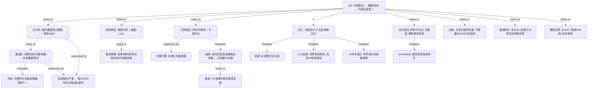

# AI-A Revised Decision Tree

paper_id: paper_42898695
question_id: Q5
revision_source:
  - original_tree: adversarial_lit_reading/rounds/A_tree_round1_paper_42898695_Q5.md
  - attack_file: adversarial_lit_reading/rounds/B_attack_tree_paper_42898695_Q5.md
  - paper: adversarial_lit_reading/chunks/paper_42898695_t2dm_mimic_eicu.md

## 1. Revised Evidence Map

| evidence_id | location | evidence_summary | used_by_node |
|---|---|---|---|
| E1 | Section 2.5 | 主分析随机截距 LMM；有效推断需条件 MAR（模型协变量+既往观测）；作者声明不可检验且不大可能精确成立 | N1 |
| E2 | Section 2.5 | 四类观测缺失备选：IPOW、≥3 次测量、存活出院、截断至某日 | N3 |
| E3 | Results 3.2 | 次要终点：IPOW 下点估计可更大但精度降；部分规格消失；部分规格保留 | N4 |
| E4a | Section 2.4 | 库内匹配因严重度评分跨库不可比；卡钳最近邻 | N7 |
| E4b | Results 3.1 + Fig.S1 | SMD/Love plot 报告平衡 | N8 |
| E5 | Section 2.4, 4.1 | eGFR/SOFA 暴露后测量：过调整与对撞双重威胁；敏感性从 PS 剔除 | N9,N10 |
| E6a | Section 2.5 | 死亡：匹配集条件 logistic / 匹配集聚类 GEE | N11 |
| E6b | Results 3.3 | 全调残余不平衡协变量完全分离；较长随访死亡与 Cox 仅单库 | N12,N18,N19 |
| E7a | Section 2.5 | 库特异估计 + DerSimonian–Laird / I² / Q / leave-one-out 方法 | N13 |
| E7b | Results 3.2 | leave-one-out 显示合并推断可依赖单库纳入 | N13 |
| E8 | 全文 Methods | 无调查权重/PSU/分层；三库方便样本池化 | N14 |
| E9 | Section 2.5 | 未见基线协变量 MI 步骤；day-1 协变量缺失处理原文未明确说明 | N15 |
| E10 | Section 2.5 + Results | 日可测人数大幅下降；支撑观测缺失敏感性必要性 | N16 |
| E11 | Section 2.3, 2.5 | 无注明日期 SAP；BH 族预选两终点；其余探索 | N17 |
| E12 | Section 2.5 | 进一步规格：log、随机斜率、分类 day、day 的 RCS 等 | N5,N6 |

## 2. Revised Decision Tree - Mermaid

> ⚠️ 脱敏框架。

## 3. Revised Node Table

> ⚠️ claim 脱敏。

| node_id | node_type | claim | evidence_location | evidence_summary | confidence | risk_tag |
|---|---|---|---|---|---|---|
| N0 | question | Q5：假设清单与备选 | — | 根问题 | high | |
| N1 | method | 主分析随机截距混合模型；推断需条件 MAR（协变量+既往观测）；作者称不可检验且不大可能精确成立 | Section 2.5 | 主缺失假设 | high | |
| N3 | method | 四类观测缺失备选预先设定 | Section 2.5 | IPOW 等 | high | |
| N4 | evidence | 次要终点：部分备选点估计仍在但精度降；部分规格信号消失；部分保留 | Results 3.2 | 评估而非否定备选设定 | high | |
| N5 | method | 主规格假设线性时间与截距-only 协方差 | Section 2.5 | 结构假设 | high | |
| N6 | method | 用变换/随机斜率/分类时间/时间轴样条探测依赖 | Section 2.5 | 进一步规格 | high | |
| N7 | method | 库内匹配下的可换性与卡钳可比 | Section 2.4 | 跨库评分不可比故库内 | high | |
| N8 | evidence | 标准化均数差与 Love plot | Results 3.1 | 平衡报告 | high | |
| N9 | limitation | 部分匹配变量暴露后测量：过调整与对撞双重威胁（作者自认） | Section 2.4, 4.1 | 设计张力 | high | 因果过度 |
| N10 | method | 从 PS 省略可疑后基线变量的敏感性 | Suppl S4 | 备选匹配 | high | |
| N11 | method | 死亡在匹配设计下用分层/聚类模型 | Section 2.5 | 设计一致 | high | |
| N12 | limitation | 试图全调残余不平衡 → 完全分离未解释 | Results 3.3 | 可估性失败 | high | |
| N18 | uncertainty | 单库探索性 Cox；原文未报告比例风险检验 | Results 3.3 | PH 未检 | high | 证据不足 |
| N19 | limitation | 事件相对协变量稀疏威胁渐近假设 | Results 3.3 | 小样本 | high | |
| N13 | method | 跨库可合并性用随机效应合并与剔除单库检验 | Section 2.5, 3.2 | 库数少解释力有限 | medium | |
| N14 | claim | 方便样本池化，无调查权重；NHANES 加权不适用 | Methods | 不需要加权 | high | |
| N15 | uncertainty | 未见基线 MI；基线/day-1 缺失处理原文未明确说明 | Methods | 原文未明确说明 | medium | 证据不足 |
| N16 | evidence | 轨迹日可测比例骤降，强化 MAR 风险 | Section 2.5 + Results | 支撑备选必要性 | high | |
| N17 | method | 无注明日期 SAP；FDR 族预选；其余探索 | Section 2.3, 2.5 | 推断边界 | high | |
| N20 | uncertainty | 未校正医院层聚类（多中心结构差异大） | Discussion/Methods | 原文未明确说明 | medium | 可迁移性不足 |

## 4. Final Answer Based on Revised Tree

本文关键假设并非「经典 Cox-PH 主分析」叙事，而是：

1. **主轨迹**：随机截距混合模型 + **条件 MAR**（条件于模型协变量与既往观测）；作者自认不可检验且不大可能精确成立。  
2. **备选**：观察加权、完整测量、存活子集、截断随访；对次要终点的评估显示——有的规格点估计仍在但精度下降，有的信号消失，有的保留，**不能把「失去显著性」简单等同于效应消失**。  
3. **结构**：线性时间与截距-only；用变换/随机斜率/分类时间/时间轴样条探测。  
4. **匹配**：库内可换性；平衡用标准化均数差；部分匹配变量暴露后测量带来**过调整与对撞**双重威胁，敏感性省略之。  
5. **死亡/Cox**：匹配设计估计；全调整完全分离；**探索性 Cox 仅单库且未见 PH 检验报告**；事件稀疏威胁渐近。  
6. **加权/插补**：无调查加权；基线 MI 与 day-1 缺失处理**原文未明确说明**；轨迹缺失严重。  
7. **池化**：跨库可合并用异质性与剔除单库检验；医院层聚类未校正。

## 5. Revision Log

| critique_id | accepted_or_rejected | action | reason |
|---|---|---|---|
| A2/B1（高） | accepted | 重写 N4；边改为 evaluates | 区分精度损失 vs 效应消失 |
| B2（中→按高修） | accepted | N16 改连 N1/N3，断开对 N15 的支持 | 轨迹缺失≠基线 MI |
| M1/修复3（高） | accepted | 新增 N18 | Q5 明示 Cox PH |
| A1（中） | accepted | 重写 N1 条件 MAR 细节 | 主分析限定 |
| A3（中） | accepted | N7 强调库内 | 跨库评分不可比 |
| 修复6（中） | accepted | N9 写过调整+对撞 | 作者双层披露 |
| M4（中） | accepted | 新增 N19 | 小样本渐近 |
| M2（低） | accepted | 新增 N20 | 医院聚类迁移风险 |
| A4（低） | accepted | N14 补池化可合并性 | 与 N13 呼应 |
| M3 PS logit（中） | partially | 记入 Remaining | 树已覆盖库内五变量精简，避免与 Q4 重复堆叠 |
| M5 day-1 缺失细节（中） | accepted | 写入 N15 | 原文未明确说明 |

## 6. Remaining Uncertainty

- U1: 条件 logistic/GEE 有限样本校正是否充分——原文未展开。
- U2: IPOW 是否逼近 MNAR——原文未声称。
- U3: PS 模型自身 logit 线性/无交互假设未单独检验。
- U4: 基线协变量缺失率与可用案例规则需代码/原始表才能核实。
