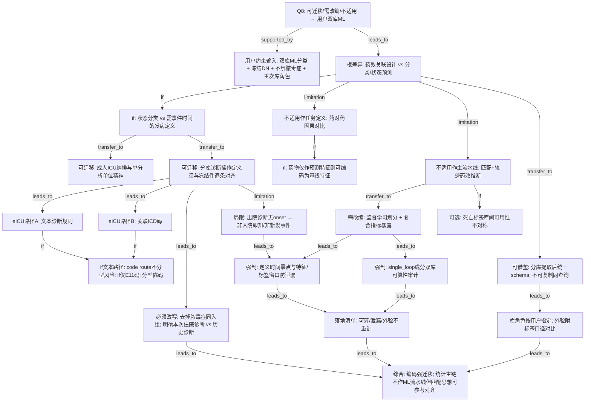

# AI-A Revised Decision Tree

paper_id: paper_42898695
question_id: Q8
revision_source:
  - original_tree: adversarial_lit_reading/rounds/A_tree_round1_paper_42898695_Q8.md
  - attack_file: adversarial_lit_reading/rounds/B_attack_tree_paper_42898695_Q8.md
  - paper: adversarial_lit_reading/chunks/paper_42898695_t2dm_mimic_eicu.md

## 1. Revised Evidence Map

| evidence_id | location | evidence_summary | used_by_node |
|---|---|---|---|
| E1 | Section 2.1 | 成人≥18；分库 T2DM/脓毒症识别规则不同；MIMIC/NWICU 同次住院诊断码；eICU 文本或关联码；首合格单位规则 | N1,N2,N3 |
| E2 | Section 2.1 | eICU：文本路径（糖尿病相关串且非 1 型表述）**或**关联 ICD 250.x/E11 | N2a,N2b,N4 |
| E3 | Limitations | eICU **code route** 不区分糖尿病分型（原文原意；非「宽松」价值判断） | N4 |
| E4 | Section 2.1 | MIMIC/NWICU 诊断为出院诊断、无 onset；与脓毒症同次住院 | N3,N11,N14 |
| E5 | Section 2.2–2.5 | 暴露对比=药物记录；主链=PSM+LMM；非 ML 划分 | N5,N6 |
| E6 | Section 2.1 | MIMIC/NWICU 同查询结构；eICU 结构不同后对齐 canonical schema | N8 |
| E7 | Results 3.1 / 3.3 | 匹配队列库贡献不均；较长随访死亡信息库间不对称 | N9,N16 |
| E8 | 用户确认（非论文证据） | 双库 ML 分类/发病；DN 冻结；不绑脓毒症；eICU 开发内验 / MIMIC 外验；single_loop | N0u,N7,N12,N15 |

## 2. Revised Decision Tree - Mermaid

> ⚠️ 脱敏；用户约束节点单独标注。

## 3. Revised Node Table

> ⚠️ claim 脱敏；用户约束标明来源。

| node_id | node_type | claim | evidence_location | evidence_summary | confidence | risk_tag |
|---|---|---|---|---|---|---|
| N0 | question | Q8 迁移分桶 | — | 根问题 | high | |
| N0u | claim | 用户已确认双库 ML、冻结结局标签、人群与库角色 | 用户确认 | 非论文证据 | high | |
| N10 | claim | 原文药效关联 vs 用户分类/预测任务类型不同 | Aims vs 用户 | 根差异 | high | |
| N10a | question | 先裁定：状态分类还是需事件时间的发病定义 | 用户确认 | 条件分支 | high | |
| N1 | transfer | 成人 ICU 与单分析单位规则可参考 | Section 2.1 | 纳排骨架 | high | |
| N2 | transfer | 分库诊断定义须与冻结件逐条对齐后方可作结局标签 | Section 2.1 | 非自动等同冻结 | high | |
| N2a | method | 次库文本诊断路径存在 | Section 2.1 | 路径 A | high | |
| N2b | method | 次库关联码路径存在 | Section 2.1 | 路径 B | high | |
| N3 | transfer | 去掉脓毒症同入组；明确本次住院诊断 vs 历史诊断口径 | Section 2.1 | 必须改写 | high | |
| N4 | limitation | 若走文本/未分型码路则分型风险；若仅严格分型码则风险不同 | Limitations | 原文称 code route 不分型 | high | |
| N5 | limitation | 药对药对比不作 ML 任务定义 | Section 2.2 | 不适用 | high | 可迁移性不足 |
| N5b | transfer | 药物记录可降级为预测特征（非因果对比） | Section 2.2 | 条件迁移 | medium | |
| N6 | limitation | 匹配+轨迹药效链不作 ML 主流水线 | Section 2.4–2.5 | 弱迁移 | high | 可迁移性不足 |
| N7 | transfer | 改为监督划分与复合指标暴露（用户约束） | 用户确认 | 需改编 | high | |
| N14 | transfer | 必须定义时间零点与特征/标签窗口，防出院诊断泄漏 | Section 2.1 + 用户任务 | 强制门控 | high | |
| N15 | transfer | single_loop 成分须做双库可算性审计 | 用户确认 | 强制门控 | high | |
| N8 | transfer | 分库独立提取再统一 schema；不可假设同查询复用 | Section 2.1 | 工程改编 | high | |
| N9 | transfer | 库角色按用户指定；外验须报告标签口径差异 | Results + 用户 | 角色与漂移 | high | |
| N11 | limitation | 出院诊断无 onset：非入院即知、非新发事件 | Section 2.1 | 标签语义 | high | 因果过度 |
| N12 | transfer | 可算性、泄漏排除、外验不重训清单 | 用户+规范 | 落地 | medium | |
| N16 | transfer | 若用死亡标签：库间随访信息可用性不对称 | Section 3.3 | 可选 | medium | |
| N13 | claim | 编码强迁移；统计主链不作 ML 流水线，匹配/分层思想可参考对齐 | 全树 | 综合 | high | |

## 4. Final Answer Based on Revised Tree

**可迁移（强）**：分库成人 ICU 纳排精神；**T2DM 操作定义在与冻结件逐条对齐后**可作结局标签；双库先各自提取再统一 schema 的工程思路。

**必须改写**：去掉脓毒症同入组；明确标签是**本次住院诊断还是历史诊断**；先裁定任务是**状态分类**还是需事件时间的发病；**强制**定义时间零点与特征窗口防出院诊断泄漏；**强制**做复合指标成分双库可算性审计；开发/外验库角色按用户指定并报告**标签口径差异**。

**eICU 定义**：拆成文本路径 vs 码路径；原文仅明确 **code route 不分型**，不得笼统称「宽松」。若只走严格分型码，风险结构改变。

**不适用**：药对药因果对比与匹配–轨迹药效主链作为 ML 主流水线；药物若仅作特征则可另议。死亡随访信息库间不对称——仅当用户引入死亡相关任务时参考。

**综合**：编码与纳排强迁移；统计主链不作 ML 流水线，但库内匹配/分层思想可用于分布对齐参考。

## 5. Revision Log

| critique_id | accepted_or_rejected | action | reason |
|---|---|---|---|
| B-N2-01 / P2（高） | accepted | N2 改为与冻结件对齐；拆 N2a/N2b | 禁止自动等同并集 |
| B-N4-01 / P1（高） | accepted | 删「宽松」；按路径条件化 | 只保留原文 code route 不分型 |
| B-N11-01 / P3 / M1（高） | accepted | 重写 N11；新增 N14 | 出院诊断泄漏门控 |
| B-E-01 / B-E-02（高） | accepted | 新增 N10a；N3 含本次 vs 历史诊断 | 任务类型与口径 |
| M2（高/中） | accepted | 新增 N15 | single_loop 可算性 |
| B-N5 / B-E-03（中） | accepted | 新增 N5b | 药物可作特征 |
| B-N6 / M3（中） | accepted | 新增 N16 | 死亡标签可用性 |
| B-N8 / P4（中） | accepted | 重写 N8 | 不可复制同查询 |
| B-N9 / B-E-04（中） | accepted | N9 加标签口径对比 | 外验漂移 |
| B-N7（中） | accepted | N7 后强制经 N14/N15 | 用户节点标明非论文证据 |
| B-N13（低） | accepted | N13 微调 | 匹配思想可参考对齐 |
| N0u | accepted | 显式用户约束节点 | 防把用户输入当论文证据 |

## 6. Remaining Uncertainty

- U1: 冻结件与提取脚本最终走文本并集还是码主路径——以提取实现为准。
- U2: 次库 unit LOS 门槛是否照搬原文——项目化裁量。
- U3: 「发病」中文表述与状态分类的写作口径——属 Methods 裁决。
- U4: 第三库经验对两库课题的异质性外推有限。
